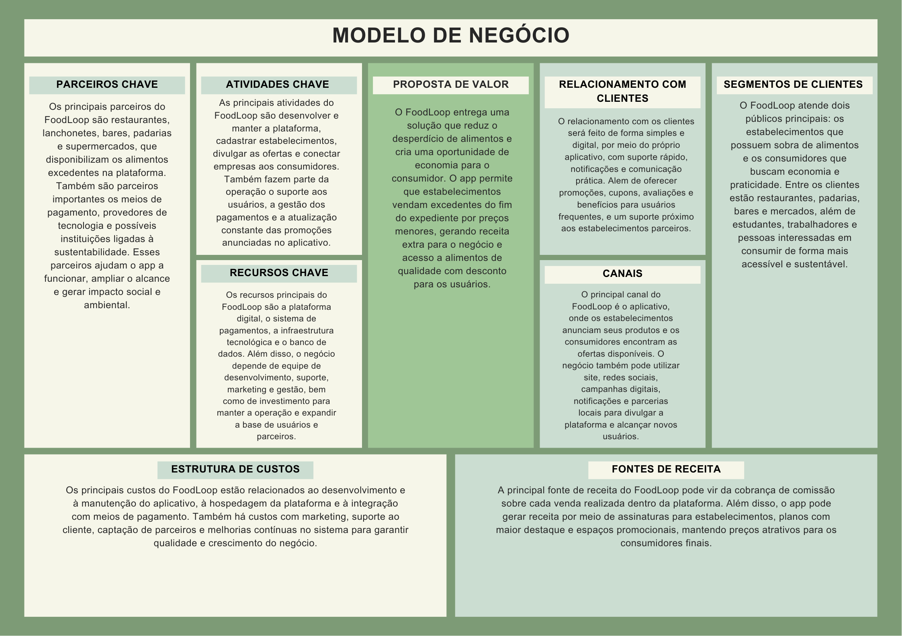
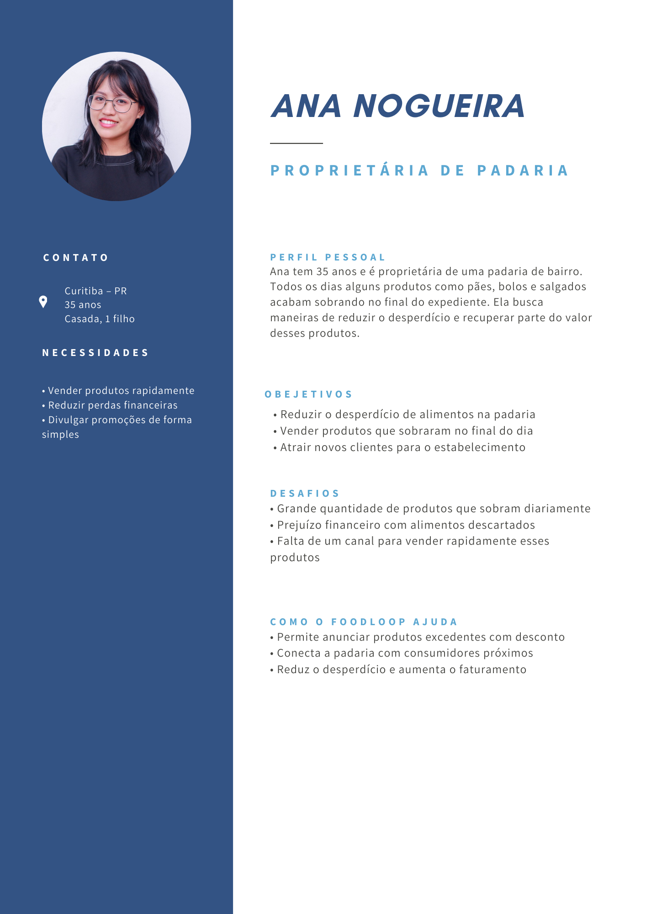
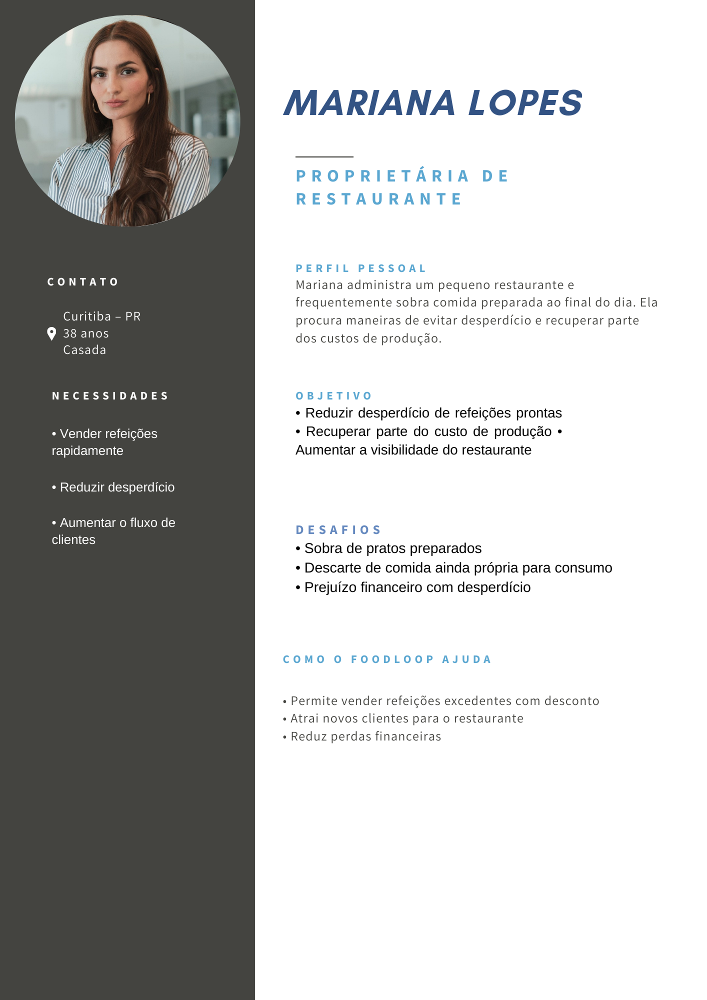
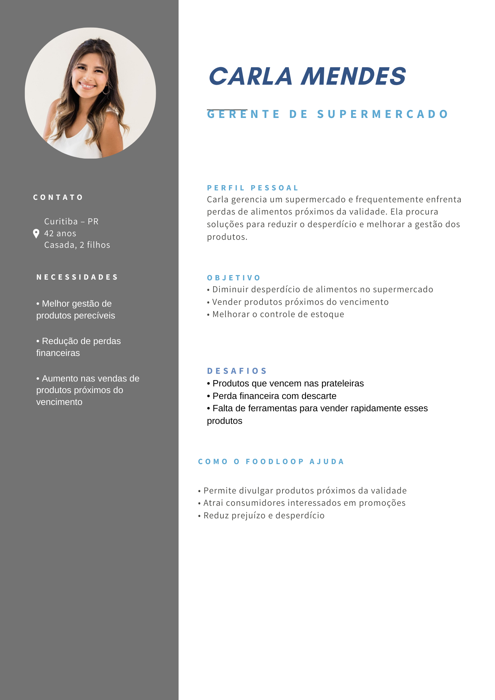
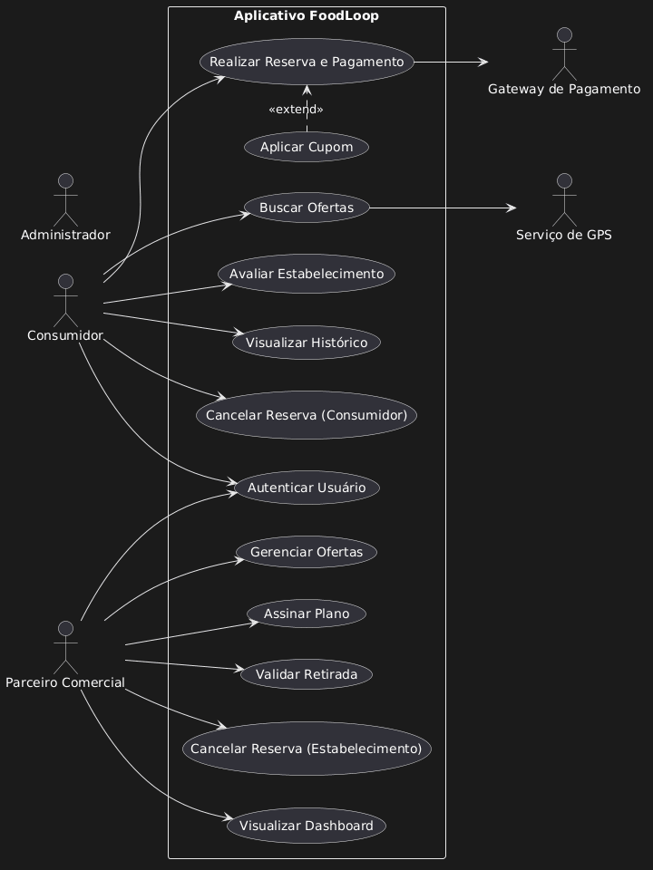

# Especificação do projeto

Pré-requisitos: <a href="01-Contexto.md"> Documentação de contexto</a>

Esta seção apresenta a definição do problema e a proposta de solução sob a perspectiva do usuário, utilizando técnicas de modelagem que permitam compreender e detalhar as necessidades do negócio e as funcionalidades esperadas do sistema.  

Nesta seção são apresentadas as personas, histórias de usuários, requisitos funcionais e não funcionais, bem como as restrições do projeto. Também são descritas as ferramentas e metodologias empregadas para elaborar essas especificações, garantindo que todos os participantes possuam uma compreensão unificada do escopo, dos objetivos e das prioridades do trabalho.

## Modelo de negócio (*Business Model Canvas*)

O Business Model Canvas (BMC) foi elaborado com base na proposta do FoodLoop, considerando seus públicos, proposta de valor, canais, recursos, custos e fontes de receita.

A seguir, apresenta-se o modelo de negócio desenvolvido para o projeto.

## Personas

> **Links úteis**:
> - [Rock content](https://rockcontent.com/blog/personas/)
> - [Hotmart](https://blog.hotmart.com/pt-br/como-criar-persona-negocio/)
> - [O que é persona?](https://resultadosdigitais.com.br/blog/persona-o-que-e/)
> - [Persona x público-alvo](https://flammo.com.br/blog/persona-e-publico-alvo-qual-a-diferenca/)
> - [Mapa de empatia](https://resultadosdigitais.com.br/blog/mapa-da-empatia/)
> - [Mapa de stalkeholders](https://www.racecomunicacao.com.br/blog/como-fazer-o-mapeamento-de-stakeholders/)

## Histórias de usuários

Com base na análise das personas, foram identificadas as seguintes histórias de usuários:

|EU COMO... `PERSONA`| QUERO/PRECISO ... `FUNCIONALIDADE` |PARA ... `MOTIVO/VALOR`                 |
|--------------------|------------------------------------|----------------------------------------|
| Rafael Souza, estudante universitário com orçamento limitado | ver uma lista de restaurantes próximos com refeições com desconto | economizar na alimentação sem precisar pesquisar em vários aplicativos |
| Rafael Souza, estudante universitário sem tempo para cozinhar | filtrar as ofertas disponíveis por distância e preço | encontrar rapidamente a opção mais acessível perto da universidade |
| Carla Mendes, gerente de supermercado com produtos próximos ao vencimento | cadastrar produtos próximos da data de validade com desconto | reduzir o desperdício e evitar prejuízo financeiro com o descarte |
| Carla Mendes, gerente de supermercado | visualizar o desempenho das ofertas cadastradas | avaliar quais promoções funcionam melhor e otimizar a gestão de estoque |
| Lucas Ferreira, designer gráfico que pede comida fora com frequência | reservar refeições com desconto pelo aplicativo antes de sair do trabalho | garantir a oferta e evitar os altos gastos com delivery no fim do dia |
| Lucas Ferreira, designer gráfico preocupado com sustentabilidade | avaliar os estabelecimentos parceiros após retirar o pedido | ajudar outros usuários a escolher melhor e incentivar a qualidade dos parceiros |
| Mariana Lopes, proprietária de restaurante com sobras no fim do expediente | publicar refeições excedentes do fim do dia com desconto | recuperar parte do custo de produção e evitar o descarte de comida própria para consumo |
| Mariana Lopes, proprietária de restaurante | editar ou encerrar ofertas publicadas em tempo real | manter as informações atualizadas e evitar reservas de itens já esgotados |
| Ana Nogueira, proprietária de padaria com grande volume de sobras diárias | anunciar os produtos que sobram no final do expediente de forma simples e rápida | vendê-los antes do encerramento e reduzir o prejuízo com alimentos descartados |
| Ana Nogueira, proprietária de padaria | ser notificada quando uma reserva for confirmada por um consumidor | organizar o pedido com antecedência e garantir uma boa experiência de retirada |
| Pedro Santos, professor com rotina agitada e pouco tempo para cozinhar | receber notificações de promoções em restaurantes próximos a mim | aproveitar ofertas acessíveis sem precisar buscar ativamente, economizando tempo e dinheiro |
| Pedro Santos, professor preocupado com sustentabilidade | acessar o histórico de pedidos realizados na plataforma | reaproveitar estabelecimentos já aprovados e acompanhar minha contribuição à redução do desperdício |
| Rafael Souza, estudante universitário que acessou o app pela primeira vez | criar uma conta na plataforma como consumidor | ter acesso às ofertas disponíveis e conseguir fazer reservas nos estabelecimentos parceiros |
| Mariana Lopes, proprietária de restaurante que quer começar a usar o app | cadastrar meu estabelecimento e fazer login na plataforma | começar a publicar ofertas e alcançar novos consumidores próximos |
| Lucas Ferreira, designer gráfico que usa o app com frequência | acumular benefícios por ser um usuário recorrente e aplicar cupons de desconto | economizar ainda mais nas refeições e ser recompensado pela fidelidade à plataforma |
| Ana Nogueira, proprietária de padaria que busca mais visibilidade no app | aderir a um plano de destaque para o meu estabelecimento | aparecer em posições privilegiadas na listagem e atrair um volume maior de consumidores próximos |
| Rafael Souza, estudante universitário que fez uma reserva no app | pagar pela reserva diretamente no aplicativo, sem precisar levar dinheiro | concluir a compra de forma prática e segura antes de ir buscar o pedido |
| Lucas Ferreira, designer gráfico que não conseguirá retirar um pedido reservado | cancelar uma reserva que fiz | evitar que o estabelecimento separe o produto inutilmente e preservar minha reputação na plataforma |
| Mariana Lopes, proprietária de restaurante quando um item reservado deixar de estar disponível | cancelar a reserva de um consumidor pelo aplicativo | avisá-lo a tempo e evitar que ele se desloque até o restaurante sem necessidade |
| Ana Nogueira, proprietária de padaria ao criar uma oferta | definir a quantidade disponível de cada produto anunciado | controlar o estoque com precisão e evitar reservas além do que tenho disponível |

> **Links úteis**:
> - [Histórias de usuários com exemplos e template](https://www.atlassian.com/br/agile/project-management/user-stories)
> - [Como escrever boas histórias de usuário (user stories)](https://medium.com/vertice/como-escrever-boas-users-stories-hist%C3%B3rias-de-usu%C3%A1rios-b29c75043fac)
> - [User stories: requisitos que humanos entendem](https://www.luiztools.com.br/post/user-stories-descricao-de-requisitos-que-humanos-entendem/)
> - [Histórias de usuários: mais exemplos](https://www.reqview.com/doc/user-stories-example.html)
> - [9 common user story mistakes](https://airfocus.com/blog/user-story-mistakes/)

## Requisitos

As tabelas a seguir apresentam os requisitos funcionais e não funcionais que detalham o escopo do projeto, alinhados com as diretrizes mapeadas no Business Model Canvas (BMC). Para determinar a prioridade dos requisitos, aplicou-se a técnica de valor de negócio e urgência.

### Requisitos funcionais

| ID | Descrição do Requisito | Prioridade |
| :--- | :--- | :--- |
| **RF-001** | O sistema deve permitir o cadastro, login e gerenciamento de perfis para Consumidores e Estabelecimentos. | ALTA |
| **RF-002** | O estabelecimento deve poder publicar e gerenciar (CRUD) suas ofertas, definindo descrição, preço, e **quantidade em estoque** em tempo real. | ALTA |
| **RF-003** | O sistema deve listar as ofertas disponíveis, permitindo filtros por **geolocalização (distância) e faixa de preço**. | ALTA |
| **RF-004** | O sistema deve processar a reserva e o pagamento online diretamente no aplicativo. | ALTA |
| **RF-005** | O sistema deve permitir o **cancelamento de reservas** tanto pelo consumidor quanto pelo estabelecimento, com atualização de estoque. | ALTA |
| **RF-006** | O sistema deve disponibilizar um **histórico de pedidos** para o consumidor e um **dashboard de desempenho de vendas** para o parceiro comercial. | MÉDIA |
| **RF-007** | O sistema deve permitir a aplicação de cupons de desconto e oferecer benefícios de fidelidade para usuários recorrentes. | MÉDIA |
| **RF-008** | O sistema deve permitir que os consumidores avaliem os estabelecimentos parceiros após a retirada do pedido. | MÉDIA |
| **RF-009** | O sistema deve enviar **notificações push e alertas** sobre status de reservas, confirmações e promoções próximas. | MÉDIA |
| **RF-010** | O sistema deve oferecer suporte à adesão de planos de assinatura para parceiros que desejam maior destaque (visibilidade) no aplicativo. | BAIXA |

### Requisitos não funcionais

| ID | Descrição do Requisito | Prioridade |
| :--- | :--- | :--- |
| **RNF-001** | O aplicativo deve ser desenvolvido no framework **React Native**, garantindo compatibilidade com dispositivos móveis (Android e iOS). | ALTA |
| **RNF-002** | A persistência de dados e a autenticação de usuários devem ser implementadas utilizando a plataforma **Firebase** (Auth, Firestore). | ALTA |
| **RNF-003** | A integração com os provedores de meios de pagamento deve seguir protocolos de segurança avançados e criptografia ponta a ponta. | ALTA |
| **RNF-004** | O tempo de carregamento da listagem de ofertas no mapa não deve ultrapassar 3 segundos. | MÉDIA |

Com base nas histórias de usuários, enumere os requisitos da sua solução. Classifique esses requisitos em dois grupos:

- [Requisitos funcionais
 (RF)](https://pt.wikipedia.org/wiki/Requisito_funcional):
 correspondem a uma funcionalidade que deve estar presente na
  plataforma (ex: cadastro de usuário).
- [Requisitos não funcionais
  (RNF)](https://pt.wikipedia.org/wiki/Requisito_n%C3%A3o_funcional):
  correspondem a uma característica técnica, seja de usabilidade,
  desempenho, confiabilidade, segurança ou outro (ex: suporte a
  dispositivos iOS e Android).

Lembre-se de que cada requisito deve corresponder a uma e somente uma característica-alvo da sua solução. Além disso, certifique-se de que todos os aspectos capturados nas histórias de usuários foram cobertos.

> **Links úteis**:
> - [O que são requisitos funcionais e requisitos não funcionais?](https://codificar.com.br/requisitos-funcionais-nao-funcionais/)
> - [Entenda o que são requisitos de software, a diferença entre requisito funcional e não funcional, e como identificar e documentar cada um deles](https://analisederequisitos.com.br/requisitos-funcionais-e-requisitos-nao-funcionais-o-que-sao/)

## Restrições

O projeto está restrito aos itens apresentados na tabela a seguir, que delimitam o escopo de execução, as escolhas tecnológicas e os recursos disponíveis.

| ID | Restrição |
| :--- | :--- |
| **001** | O projeto e a apresentação deverão ser entregues obrigatoriamente dentro do prazo estipulado pelo cronograma acadêmico. |
| **002** | O desenvolvimento do software deve ser realizado exclusivamente pelos integrantes do grupo, sendo proibida a contratação de terceiros. |
| **003** | A arquitetura de software está restrita ao uso de React Native (Front-end) e Firebase (Back-end/BaaS), conforme validação técnica da equipe. |
| **004** | O custo total do projeto deve ser contido no orçamento zero, utilizando apenas os planos gratuitos (*Free Tier*) de plataformas de hospedagem e APIs. |
## Diagrama de casos de uso

O diagrama de casos de uso a seguir ilustra as principais interações entre os atores e o aplicativo FoodLoop, delimitando a fronteira do sistema e mapeando visualmente os requisitos funcionais definidos para o projeto.

A modelagem apresenta três atores primários: o Consumidor, que utiliza a plataforma para buscar ofertas e realizar reservas; o Parceiro Comercial, que gerencia a publicação de alimentos excedentes e valida as retiradas; e o Administrador, que acompanha os indicadores da plataforma. Adicionalmente, o sistema interage com dois atores externos essenciais para o seu funcionamento: o Serviço de GPS (responsável pela filtragem de localização) e o Gateway de Pagamento (responsável por processar as transações financeiras).

O fluxo central do diagrama destaca que todas as operações críticas do aplicativo — como gerenciar ofertas, buscar restaurantes, efetuar pagamentos, cancelar reservas e avaliar os pedidos — possuem uma dependência de inclusão obrigatória (<<include>>) com o caso de uso "Autenticar Usuário". Essa estrutura garante que todas as ações ocorram em um ambiente logado (via Firebase Auth), assegurando a segurança, o controle de estoque em tempo real e a confiabilidade de ponta a ponta na jornada de redução de desperdício.

> **Links úteis**:
> - [Criando casos de uso](https://www.ibm.com/docs/pt-br/engineering-lifecycle-management-suite/design-rhapsody/10.0?topic=cases-creating-use)
> - [Como criar diagrama de caso de uso: tutorial passo a passo](https://gitmind.com/pt/fazer-diagrama-de-caso-uso.html/)
> - [Lucidchart](https://www.lucidchart.com/)
> - [Astah](https://astah.net/)
> - [Diagrams](https://app.diagrams.net/)
