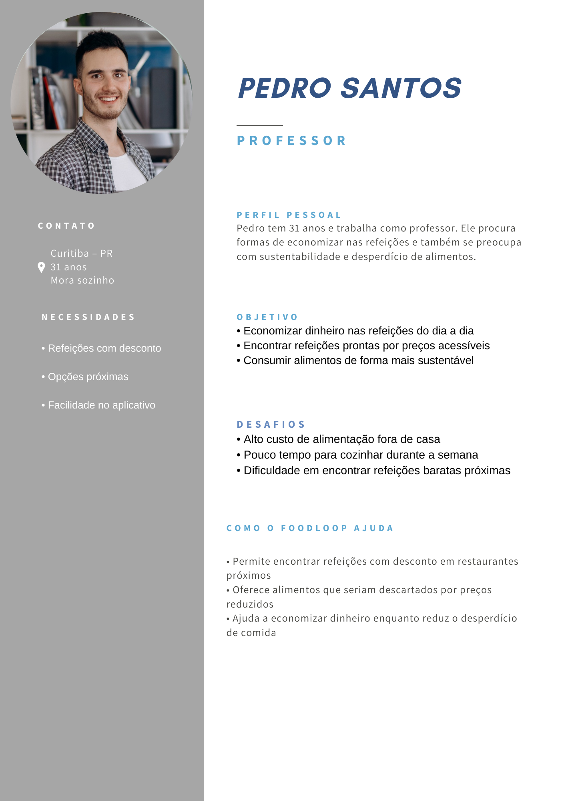
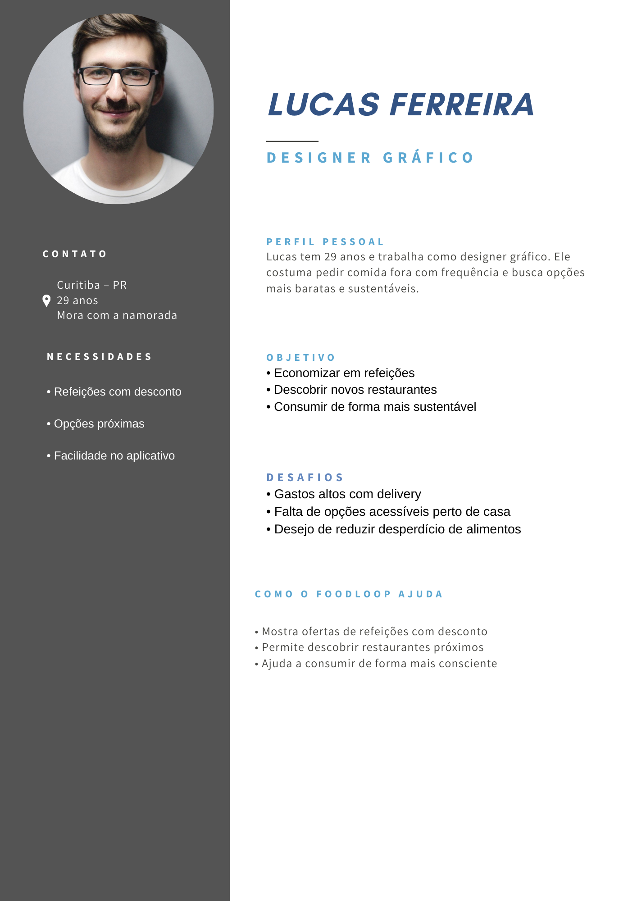
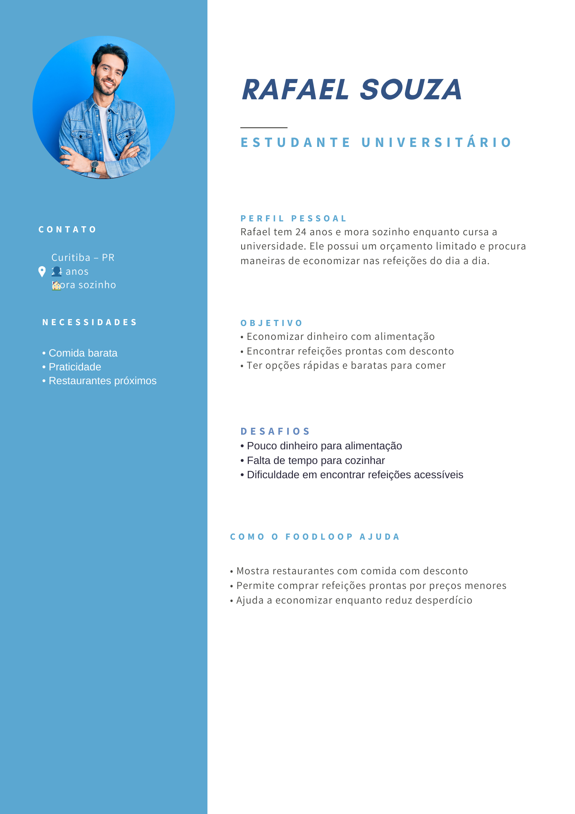

# Especificação do projeto

Pré-requisitos: <a href="01-Contexto.md"> Documentação de contexto</a>

Esta seção apresenta a definição do problema e a proposta de solução sob a perspectiva do usuário, utilizando técnicas de modelagem que permitam compreender e detalhar as necessidades do negócio e as funcionalidades esperadas do sistema.  

Nesta seção são apresentadas as personas, histórias de usuários, requisitos funcionais e não funcionais, bem como as restrições do projeto. Também são descritas as ferramentas e metodologias empregadas para elaborar essas especificações, garantindo que todos os participantes possuam uma compreensão unificada do escopo, dos objetivos e das prioridades do trabalho.

## Modelo de negócio (*Business Model Canvas*)

O Business Model Canvas (BMC) foi elaborado com base na proposta do FoodLoop, considerando seus públicos, proposta de valor, canais, recursos, custos e fontes de receita.

A seguir, apresenta-se o modelo de negócio desenvolvido para o projeto.

### Sustentabilidade financeira e mecanismos de monetização

O modelo de monetização do FoodLoop foi pensado para alinhar a receita da plataforma ao impacto gerado, garantindo que o crescimento do negócio acompanhe o aumento de alimentos aproveitados. Três fluxos de receita sustentam a operação.

**Comissão sobre transações (RF-011).** A plataforma retém automaticamente um percentual fixo sobre cada venda concluída entre estabelecimento e consumidor. Esse percentual é definido contratualmente com o parceiro no momento do cadastro e incide sobre o preço final já com desconto. Como a receita só é gerada quando o alimento é efetivamente vendido, o mecanismo incentiva a plataforma a maximizar a conversão de ofertas publicadas em pedidos concluídos, o que coincide diretamente com a missão de reduzir desperdício.

**Planos de destaque para parceiros (RF-010).** Estabelecimentos podem aderir a um plano de assinatura mensal que garante maior visibilidade na listagem de ofertas, aparecendo em posições privilegiadas nas buscas por geolocalização. Esse fluxo funciona como receita recorrente e previsível, complementando a comissão variável, e atende principalmente parceiros com alto volume de sobras que se beneficiam de mais exposição.

**Escalabilidade futura.** Em médio prazo, o modelo prevê parcerias com marcas de sustentabilidade, campanhas patrocinadas no feed de ofertas e relatórios agregados de impacto ambiental vendidos como produto B2B. Essas fontes não fazem parte do escopo da Sprint atual, mas estão mapeadas no BMC como possibilidades de expansão.

Do lado dos custos, o projeto opera integralmente nos planos gratuitos do Render (back-end Node.js e PostgreSQL), do Firebase (Storage e Cloud Messaging no plano Spark) e na cota mensal gratuita do Google Maps Platform, conforme a Restrição 004, mantendo o custo fixo próximo de zero no piloto com a Couto Lanches e permitindo validar o modelo de negócio antes de eventual migração para planos pagos.

## Personas

## Histórias de usuários

Com base na análise das personas, foram identificadas as seguintes histórias de usuários:

|EU COMO... `PERSONA`| QUERO/PRECISO ... `FUNCIONALIDADE` |PARA ... `MOTIVO/VALOR`                 |
|--------------------|------------------------------------|----------------------------------------|
| Rafael Souza, estudante universitário com orçamento limitado | ver uma lista de restaurantes próximos com refeições com desconto | economizar na alimentação sem precisar pesquisar em vários aplicativos |
| Rafael Souza, estudante universitário sem tempo para cozinhar | filtrar as ofertas disponíveis por distância e preço | encontrar rapidamente a opção mais acessível perto da universidade |
| Carla Mendes, gerente de supermercado com produtos próximos ao vencimento | cadastrar produtos próximos da data de validade com desconto | reduzir o desperdício e evitar prejuízo financeiro com o descarte |
| Carla Mendes, gerente de supermercado | visualizar o desempenho das ofertas cadastradas | avaliar quais promoções funcionam melhor e otimizar a gestão de estoque |
| Lucas Ferreira, designer gráfico que pede comida fora com frequência | reservar refeições com desconto pelo aplicativo antes de sair do trabalho | garantir a oferta e evitar os altos gastos com delivery no fim do dia |
| Lucas Ferreira, designer gráfico preocupado com sustentabilidade | avaliar os estabelecimentos parceiros após retirar o pedido | ajudar outros usuários a escolher melhor e incentivar a qualidade dos parceiros |
| Mariana Lopes, proprietária de restaurante com sobras no fim do expediente | publicar refeições excedentes do fim do dia com desconto | recuperar parte do custo de produção e evitar o descarte de comida própria para consumo |
| Mariana Lopes, proprietária de restaurante | editar ou encerrar ofertas publicadas em tempo real | manter as informações atualizadas e evitar reservas de itens já esgotados |
| Ana Nogueira, proprietária de padaria com grande volume de sobras diárias | anunciar os produtos que sobram no final do expediente de forma simples e rápida | vendê-los antes do encerramento e reduzir o prejuízo com alimentos descartados |
| Ana Nogueira, proprietária de padaria | ser notificada quando uma reserva for confirmada por um consumidor | organizar o pedido com antecedência e garantir uma boa experiência de retirada |
| Pedro Santos, professor com rotina agitada e pouco tempo para cozinhar | receber notificações de promoções em restaurantes próximos a mim | aproveitar ofertas acessíveis sem precisar buscar ativamente, economizando tempo e dinheiro |
| Pedro Santos, professor preocupado com sustentabilidade | acessar o histórico de pedidos realizados na plataforma | reaproveitar estabelecimentos já aprovados e acompanhar minha contribuição à redução do desperdício |
| Rafael Souza, estudante universitário que acessou o app pela primeira vez | criar uma conta na plataforma como consumidor | ter acesso às ofertas disponíveis e conseguir fazer reservas nos estabelecimentos parceiros |
| Mariana Lopes, proprietária de restaurante que quer começar a usar o app | cadastrar meu estabelecimento e fazer login na plataforma | começar a publicar ofertas e alcançar novos consumidores próximos |
| Ana Nogueira, proprietária de padaria que busca mais visibilidade no app | aderir a um plano de destaque para o meu estabelecimento | aparecer em posições privilegiadas na listagem e atrair um volume maior de consumidores próximos |
| Rafael Souza, estudante universitário que fez uma reserva no app | pagar pela reserva diretamente no aplicativo, sem precisar levar dinheiro | concluir a compra de forma prática e segura antes de ir buscar o pedido |
| Lucas Ferreira, designer gráfico que não conseguirá retirar um pedido reservado | cancelar uma reserva que fiz | evitar que o estabelecimento separe o produto inutilmente e preservar minha reputação na plataforma |
| Mariana Lopes, proprietária de restaurante quando um item reservado deixar de estar disponível | cancelar a reserva de um consumidor pelo aplicativo | avisá-lo a tempo e evitar que ele se desloque até o restaurante sem necessidade |
| Ana Nogueira, proprietária de padaria ao criar uma oferta | definir a quantidade disponível de cada produto anunciado | controlar o estoque com precisão e evitar reservas além do que tenho disponível |

## Requisitos

As tabelas a seguir apresentam os requisitos funcionais e não funcionais que detalham o escopo do projeto, alinhados com as diretrizes mapeadas no Business Model Canvas (BMC). Para determinar a prioridade dos requisitos, aplicou-se a técnica de valor de negócio e urgência.

### Requisitos funcionais

| ID | Descrição do Requisito | Prioridade |
| :--- | :--- | :--- |
| RF-001 | O sistema deve permitir o cadastro, login e gerenciamento de perfis para Consumidores e Estabelecimentos. | ALTA |
| RF-002 | O estabelecimento deve poder publicar e gerenciar (CRUD) suas ofertas, definindo descrição, preço, e **quantidade em estoque** em tempo real. | ALTA |
| RF-003 | O sistema deve listar as ofertas disponíveis, permitindo filtros por **geolocalização (distância) e faixa de preço**. | ALTA |
| RF-004 | O sistema deve processar a reserva e o pagamento online diretamente no aplicativo. | ALTA |
| RF-005 | O sistema deve permitir o **cancelamento de reservas** tanto pelo consumidor quanto pelo estabelecimento, com atualização de estoque. | ALTA |
| RF-006 | O sistema deve disponibilizar um **histórico de pedidos** para o consumidor e um **dashboard de desempenho de vendas** para o parceiro comercial. | MÉDIA |
| RF-008 | O sistema deve permitir que os consumidores avaliem os estabelecimentos parceiros após a retirada do pedido. | MÉDIA |
| RF-009 | O sistema deve enviar **notificações push e alertas** sobre status de reservas, confirmações e promoções próximas. | MÉDIA |
| RF-010 | O sistema deve oferecer suporte à adesão de planos de assinatura para parceiros que desejam maior destaque (visibilidade) no aplicativo. | BAIXA |
| RF-011 | O sistema deve calcular e reter automaticamente a comissão da plataforma FoodLoop sobre cada transação processada. | ALTA |
| RF-012 | O sistema deve disponibilizar ao Administrador um painel de indicadores de uso, volume de transações e impacto de redução de desperdício. | BAIXA |

### Requisitos não funcionais

| ID | Descrição do Requisito | Prioridade |
| :--- | :--- | :--- |
| RNF-001 | O sistema deve ser entregue como uma **aplicação web responsiva** (SPA em React + Vite), garantindo compatibilidade com os principais navegadores em desktop e dispositivos móveis. | ALTA |
| RNF-002 | A persistência de dados deve ser implementada em **PostgreSQL** acessado por uma API REST em **Node.js + Express**, com autenticação de usuários baseada em **tokens JWT**. Os serviços auxiliares de armazenamento de mídia e notificações push devem usar o **Firebase** (Storage e Cloud Messaging) no plano gratuito. | ALTA |
| RNF-003 | A integração com os provedores de meios de pagamento deve seguir protocolos de segurança avançados e criptografia ponta a ponta. | ALTA |
| RNF-004 | O tempo de carregamento da listagem de ofertas no mapa não deve ultrapassar 3 segundos. | MÉDIA |
| RNF-005 | A aplicação deve estar disponível para uso em pelo menos 99% do tempo durante o horário de pico (18h–22h), minimizando interrupções no período de maior demanda. | ALTA |

## Restrições

O projeto está restrito aos itens apresentados na tabela a seguir, que delimitam o escopo de execução, as escolhas tecnológicas e os recursos disponíveis.

| ID | Restrição |
| :--- | :--- |
| **001** | O projeto e a apresentação deverão ser entregues obrigatoriamente dentro do prazo estipulado pelo cronograma acadêmico. |
| **002** | O desenvolvimento do software deve ser realizado exclusivamente pelos integrantes do grupo, sendo proibida a contratação de terceiros. |
| **003** | A arquitetura de software está restrita à combinação React + Vite (Front-end web), Node.js + Express + PostgreSQL hospedados no Render (Back-end e banco) e Firebase nos planos gratuitos para Storage e Cloud Messaging, conforme validação técnica da equipe. |
| **004** | O custo total do projeto deve ser contido no orçamento zero, utilizando apenas os planos gratuitos (*Free Tier*) de plataformas de hospedagem e APIs. |
## Diagrama de casos de uso

O diagrama de casos de uso a seguir ilustra as principais interações entre os atores e o aplicativo FoodLoop, delimitando a fronteira do sistema e mapeando visualmente os requisitos funcionais definidos para o projeto.

A modelagem apresenta três atores primários: o Consumidor, que utiliza a plataforma para buscar ofertas e realizar reservas; o Parceiro Comercial, que gerencia a publicação de alimentos excedentes e valida as retiradas; e o Administrador, que acompanha os indicadores da plataforma. Adicionalmente, o sistema interage com dois atores externos essenciais para o seu funcionamento: o Serviço de GPS (responsável pela filtragem de localização) e o Gateway de Pagamento (responsável por processar as transações financeiras).

O fluxo central do diagrama destaca que todas as operações críticas do aplicativo, como gerenciar ofertas, buscar restaurantes, efetuar pagamentos, cancelar reservas e avaliar os pedidos, possuem uma dependência de inclusão obrigatória (<<include>>) com o caso de uso "Autenticar Usuário". Essa estrutura garante que todas as ações ocorram em um ambiente logado (autenticação por token JWT validado pela API), assegurando a segurança, o controle de estoque em tempo real e a confiabilidade de ponta a ponta na jornada de redução de desperdício.
