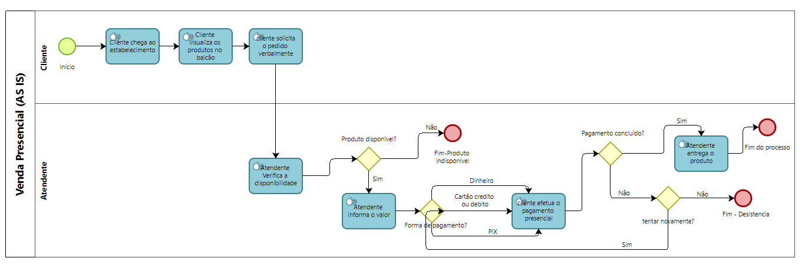
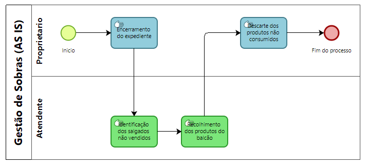
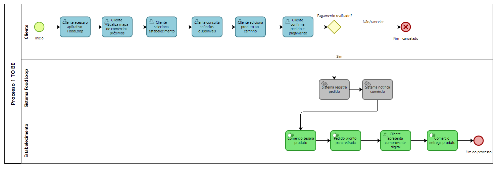
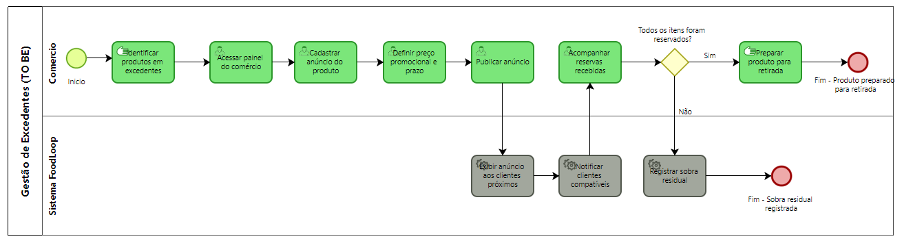

# Modelagem dos processos de negócio

Pré-requisitos: <a href="02-Especificacao.md"> Especificação do projeto</a>

## Modelagem da situação atual (Modelagem AS IS)

Modelagem da situação atual (Modelagem AS-IS)
O contexto de negócio analisado é uma lanchonete que comercializa salgados e sucos para consumo local. O estabelecimento opera de forma inteiramente presencial, sem sistema informatizado de vendas, sem presença em redes sociais e sem política de promoções — os preços são fixos e pré-determinados pelo proprietário. A interação com o cliente ocorre integralmente no balcão, e a única forma atual de registro público de opinião sobre o comércio é via avaliações no Google. Ao final do expediente, os produtos que não foram vendidos durante o dia tornam-se perda para o estabelecimento, uma vez que não há mecanismo para escoá-los antes do fechamento.

Como a proposta do FoodLoop envolve funcionalidades que o estabelecimento ainda não executa de forma tecnológica (anúncio de produtos com desconto, descoberta geolocalizada, avaliações internas ao app, compra via aplicativo), o modelo AS-IS descreve como essas tarefas acontecem hoje no mundo real, mesmo quando realizadas de forma manual, improvisada ou inexistente. Foram identificados três processos principais que serão impactados pela solução proposta:

Processo de venda presencial — fluxo completo de atendimento ao cliente no balcão.
Processo de gestão de sobras ao final do expediente — destinação dos salgados não vendidos.
Processo de avaliação do estabelecimento pelo cliente — como a reputação é construída hoje, via Google.

## Descrição geral da proposta (Modelagem TO BE)

A partir dos gargalos identificados nos modelos AS-IS — a dependência exclusiva do canal presencial para venda, a inexistência de mecanismo de escoamento para os produtos excedentes no fim do expediente e a ausência de vínculo entre a experiência de compra e a avaliação do estabelecimento — a proposta do FoodLoop consiste em uma plataforma mobile que digitaliza e integra essas três dimensões.

A solução estabelece três frentes principais. A primeira consiste em um **canal digital de descoberta e compra**, que substitui a busca passiva e presencial por uma experiência geolocalizada, na qual o cliente visualiza, via aplicativo, os estabelecimentos próximos e seus produtos disponíveis, podendo realizar o pedido e o pagamento dentro do próprio aplicativo e efetuar a retirada no balcão. A segunda consiste em um **mecanismo de escoamento de excedentes**, que confere ao comerciante a capacidade de, a qualquer momento, publicar anúncios com desconto sobre produtos em excesso, convertendo em receita o que hoje é integralmente descartado ao final do expediente. A terceira consiste em um **ciclo de reputação integrado**, que substitui a dependência de plataformas externas por um sistema interno de avaliação acoplado ao pedido, no qual cada cliente é convidado a avaliar sua experiência imediatamente após a retirada.

### Oportunidades de melhoria por processo

- **Processo 1 — Compra via aplicativo:** elimina a dependência do fluxo físico imediato, permitindo que o comércio seja encontrado por clientes que não passariam em frente ao estabelecimento no momento do consumo. Introduz registro digital da transação e comprovante para ambas as partes.
- **Processo 2 — Anúncio de excedente com desconto:** cria um canal antes inexistente para monetizar produtos que hoje configuram perda total, reduzindo o desperdício em favor de receita adicional e ampliando o alcance comercial do estabelecimento.
- **Processo 3 — Avaliação interna do estabelecimento:** vincula a avaliação à experiência de compra, aumentando a taxa de retorno de feedback e fornecendo ao comerciante visibilidade sobre o desempenho individual de cada pedido e de cada anúncio.

### Alinhamento com estratégia e objetivos

A proposta alinha-se ao objetivo extensionista de redução do desperdício de alimentos no varejo local e, simultaneamente, ao objetivo social de ampliação do acesso a alimentação a preços acessíveis. Atende, ainda, a objetivo econômico dos estabelecimentos parceiros, convertendo perda em receita e estabelecendo novo canal de captação de clientes.

### Limites da solução

- O FoodLoop não substitui sistemas internos de gestão do comércio (PDV, estoque, controle fiscal), atuando exclusivamente na ponta de divulgação, venda e avaliação de produtos.
- A solução pressupõe a retirada presencial do produto pelo cliente, não contemplando logística de entrega própria na versão inicial.
- A atuação é geograficamente limitada às regiões em que houver massa crítica de estabelecimentos parceiros e de usuários cadastrados.
- A efetiva redução do desperdício depende da adesão do comerciante ao registro de anúncios: o aplicativo oferece o canal, mas a decisão de utilizá-lo é sempre do estabelecimento.

### Capacidades de negócio habilitadas pela solução

- Gestão de anúncios de excedente pelo comércio;
- Descoberta geolocalizada de ofertas pelo cliente;
- Transação digital com retirada agendada;
- Avaliação e reputação interna dos estabelecimentos;
- Geração de indicadores de desperdício evitado e de receita incremental proveniente de anúncios.

  

  

## Modelagem dos processos

[PROCESSO 1 AS IS - Venda Presencial](./processes/processo-1-as-is.md "Detalhamento do processo 1 AS IS.")

[PROCESSO 1 TO BE - Compra via App FoodLoop](./processes/processo-1-to-be.md "Detalhamento do processo 1 TO BE.")

[PROCESSO 2 AS IS - Gestão de Sobras no Fim do Expediente](./processes/processo-2-as-is.md "Detalhamento do processo 2 AS IS.")

[PROCESSO 2 TO BE - Anúncio de Excedente com Desconto](./processes/processo-2-to-be.md "Detalhamento do processo 2 TO BE.")

## Indicadores de desempenho

Os indicadores a seguir foram definidos para monitorar os dois processos modelados (Cadastro e Publicação de Alimentos e Solicitação de Alimento) e a missão central do FoodLoop: reduzir o desperdício de alimentos ao conectar excedentes de estabelecimentos a consumidores. Cada indicador cobre uma dimensão distinta, sendo elas: **missão/impacto**, **funil de conversão**, **operacional**, **qualidade**, **velocidade de escoamento** e **engajamento**, de modo a evitar pontos cegos no acompanhamento do negócio. Todas as informações necessárias estão previstas no diagrama de classe (entidades `Usuario`, `Anuncio`, `Pedido`, `Avaliacao`).

| **Indicador** | **Objetivos** | **Descrição** | **Fonte de dados** | **Fórmula de cálculo** | **Meta** |
| --- | --- | --- | --- | --- | --- |
| Taxa de aproveitamento de anúncios | Medir quanto do alimento publicado efetivamente deixa de ser descartado, traduzindo diretamente a missão de sustentabilidade da plataforma | Percentual das unidades cadastradas em anúncios que foram retiradas por consumidores (reservas/compras concluídas), em relação ao total publicado no período | Tabelas `Anuncio` e `Pedido` (status concluído) | (Σ quantidade de pedidos concluídos no período / Σ quantidade publicada nos anúncios do período) × 100 | ≥ 40% ao mês |
| Taxa de conversão de anúncios em pedidos | Avaliar a atratividade dos anúncios publicados e a eficácia do funil entre descoberta e reserva | Percentual de anúncios publicados que receberam ao menos um pedido confirmado antes do vencimento | Tabelas `Anuncio` e `Pedido` | (nº de anúncios com ao menos 1 pedido confirmado / nº total de anúncios publicados no período) × 100 | ≥ 30% ao mês |
| Taxa de cancelamento de pedidos | Monitorar a confiabilidade operacional da plataforma e identificar atrito entre consumidores e estabelecimentos | Percentual de pedidos que foram cancelados (pelo consumidor ou pelo estabelecimento) em relação ao total de pedidos criados | Tabela `Pedido` (status = cancelado) | (nº de pedidos cancelados no período / nº total de pedidos criados no período) × 100 | ≤ 15% ao mês |
| Avaliação média dos estabelecimentos | Garantir a qualidade dos parceiros e oferecer aos consumidores um critério confiável de escolha | Média ponderada das notas atribuídas pelos consumidores aos estabelecimentos após a retirada do pedido | Tabela `Avaliacao` | Σ (nota das avaliações) / nº total de avaliações no período | ≥ 3,5 (escala de 1 a 5) |
| Tempo médio de escoamento de anúncio | Medir a velocidade com que anúncios publicados encontram consumidores, indicando eficiência da descoberta geolocalizada | Tempo médio, em horas, entre a publicação de um anúncio e a primeira reserva confirmada da mesma | Tabelas `Anuncio` (data_publicacao) e `Pedido` (data_criacao) | AVG (data_primeiro_pedido_confirmado − data_publicacao_anuncio), em horas, considerando apenas anúncios com pelo menos uma reserva | ≤ 6 horas |
| Volume de desperdício evitado | Quantificar o impacto ambiental direto gerado pela plataforma, para uso em relatórios de sustentabilidade e comunicação com stakeholders | Soma das unidades (ou quilos, quando aplicável) de alimentos comercializados/doados via app no período, que teriam sido descartadas sem a plataforma | Tabelas `Anuncio` e `Pedido` (status concluído) | Σ (quantidade de cada pedido concluído no período) | ≥ 45 unidades ao mês |

Obs.: todas as informações necessárias para gerar os indicadores acima estão contempladas nas entidades `Usuario`, `Anuncio`, `Pedido` e `Avaliacao` do diagrama de classe a ser apresentado na seção de Arquitetura da Solução.
