# Projeto de interface

Pré-requisitos: <a href="02-Especificacao.md"> Especificação do projeto</a>

Visão geral da interação do usuário pelas telas do sistema e protótipo interativo das telas com as funcionalidades que fazem parte do sistema (wireframes).

Apresente as principais interfaces da plataforma. Discuta como ela foi elaborada de forma a atender os requisitos funcionais, não funcionais e histórias de usuário abordados na <a href="02-Especificacao.md"> Especificação do projeto</a>.

## User flow

Fluxo de usuário (user flow) é uma técnica que permite ao desenvolvedor mapear todo o fluxo de navegação do usuário na aplicação. Essa técnica serve para alinhar os caminhos e as possíveis ações que o usuário pode realizar junto com os membros da equipe.

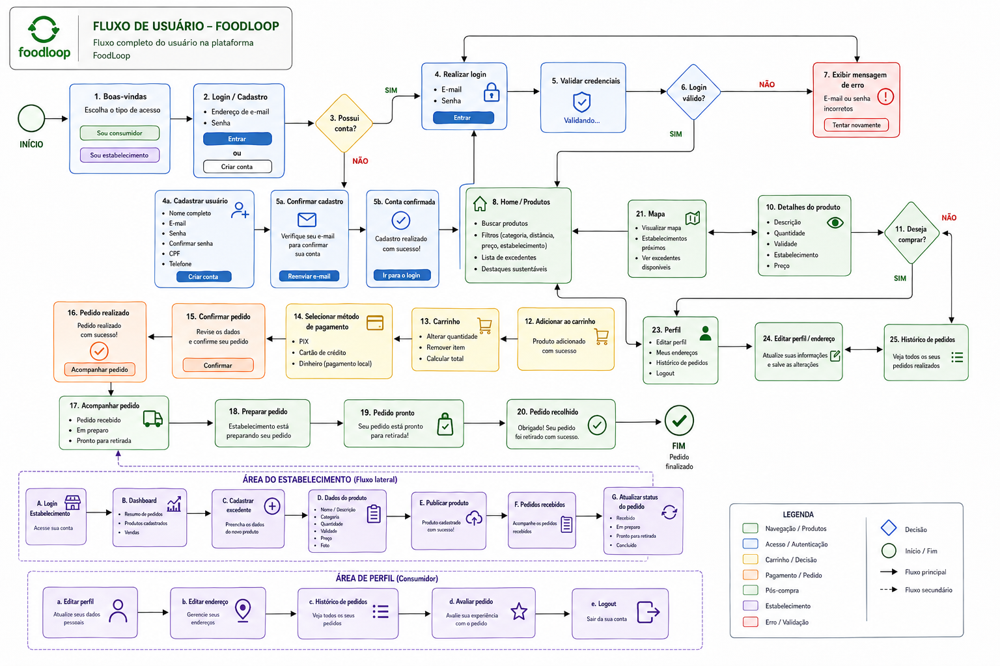

### Diagrama de fluxo

O diagrama apresenta o estudo do fluxo de interação do usuário com o sistema interativo, muitas vezes sem a necessidade de desenhar o design das telas da interface. Isso permite que o design das interações seja bem planejado e tenha impacto na qualidade do design do wireframe interativo que será desenvolvido logo em seguida.

O diagrama de fluxo pode ser desenvolvido com “boxes” que possuem, internamente, a indicação dos principais elementos de interface — tais como menus e acessos — e funcionalidades, como editar, pesquisar, filtrar e configurar, além da conexão entre esses boxes a partir do processo de interação.

Os diagramas a seguir alinham os caminhos e ações possíveis com a especificação do projeto, em particular com os atores Consumidor e Estabelecimento/Parceiro Comercial e com os processos TO-BE descritos em [Modelagem dos processos de negócio](04-Modelagem-processos-negocio.md). O escopo principal cobre os dois atores operacionais da plataforma, porque eles concentram os processos essenciais modelados: compra via aplicativo, anúncio de excedente e avaliação pós-retirada.

A notação adotada segue a convenção tradicional de diagramas de fluxo: retângulos representam telas, losangos representam pontos de decisão (do usuário ou do sistema), e setas representam transições entre estados.

As decisões de fluxo priorizam:

- **Entrada rápida e segura:** operações críticas exigem usuário autenticado, conforme o caso de uso `<<include>> Autenticar Usuário`.
- **Poucos passos para o consumidor:** descoberta geolocalizada, seleção, carrinho, pagamento e retirada presencial.
- **Operação simples para o comerciante:** criação rápida de anúncio, acompanhamento de reservas, validação da retirada e consulta de desempenho.
- **Registro de impacto:** cada pedido concluído alimenta histórico, dashboard, comissão da plataforma e indicadores de desperdício evitado.

### Fluxo 1 — Acesso e roteamento por perfil

Apresenta a entrada do aplicativo, o cadastro, o login, a recuperação de senha e o roteamento do usuário até a Home correspondente ao seu perfil. Cobre RF-001 e mantém o gate rígido de autenticação para operações críticas.

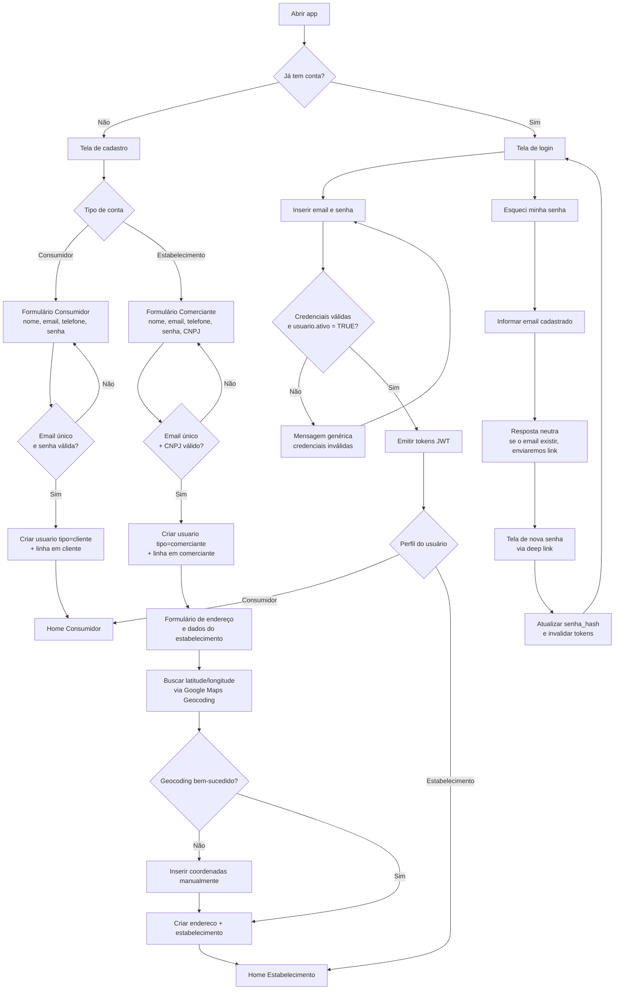

### Fluxo 2 — Compra via App (Consumidor)

Corresponde ao **Processo 1 TO-BE — Compra via App FoodLoop**. Cobre RF-003 (listagem com filtros), RF-004 (reserva e pagamento), RF-005 (cancelamento pelo consumidor), RF-006 (histórico de pedidos do consumidor), RF-009 (notificações de status) e RF-011 (cálculo da comissão sobre transações concluídas). O fluxo respeita a retirada presencial definida nos limites da solução e evita qualquer etapa de entrega.

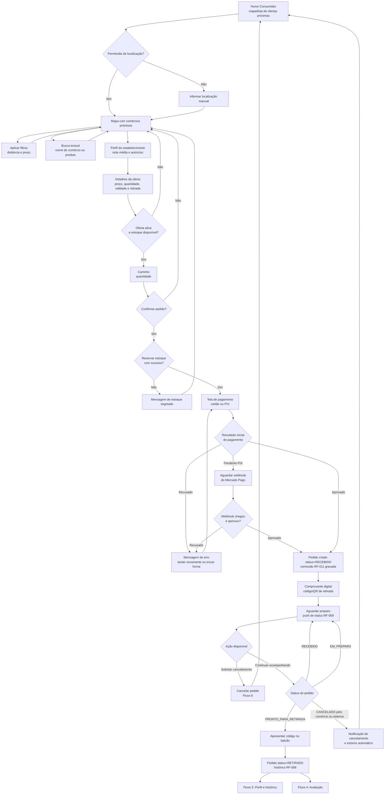

### Fluxo 3 — Gestão de anúncios e reservas (Estabelecimento)

Corresponde ao **Processo 2 TO-BE — Anúncio de Excedente com Desconto**. Cobre RF-002 (CRUD de ofertas com estoque em tempo real), RF-005 (cancelamento pelo estabelecimento), RF-006 (dashboard de desempenho) e RF-009 (notificações de reservas recebidas). Também inclui a validação presencial da retirada, etapa em que o pedido passa para `RETIRADO`.

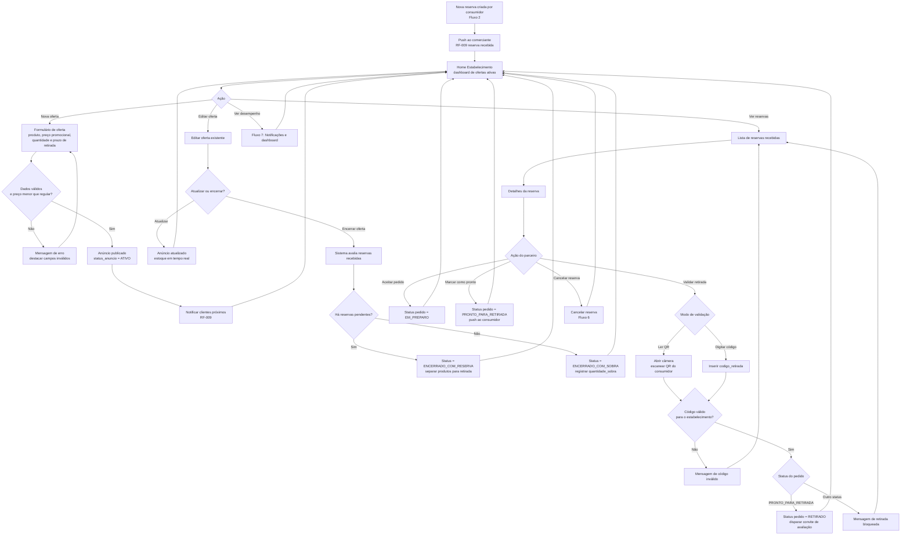

### Fluxo 4 — Avaliação pós-retirada (Consumidor)

Corresponde ao **Processo 3 TO-BE — Avaliação do Estabelecimento no FoodLoop**. Cobre RF-008 (avaliação após a retirada) e reforça a qualidade percebida pelos consumidores ao exibir reputação no perfil do estabelecimento. É disparado por push notification (RF-009) imediatamente após a validação da retirada pelo Fluxo 3.

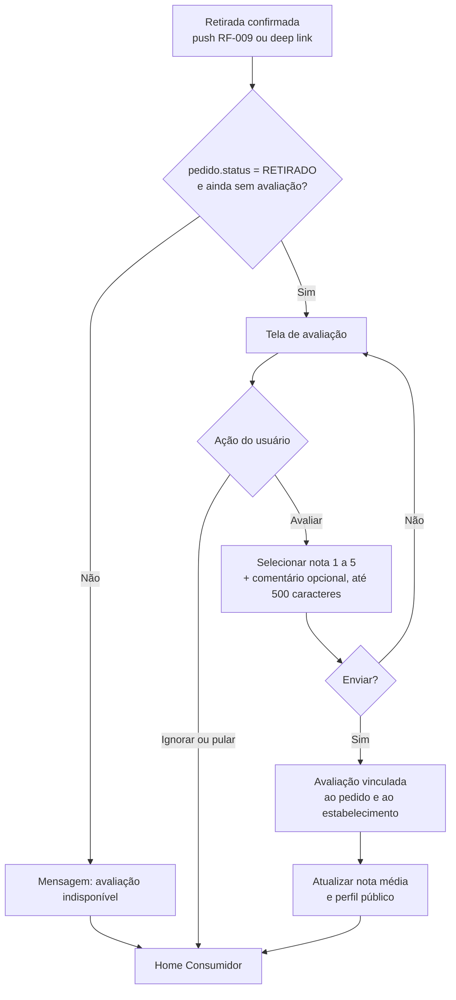

### Fluxo 5 — Perfis, catálogo e histórico

Reúne a gestão de perfil do consumidor, a gestão dos dados do estabelecimento, o catálogo de produtos e o histórico de pedidos. Cobre RF-001 e RF-006. O catálogo de `Produto` é pré-requisito para a criação de anúncios no Fluxo 3.

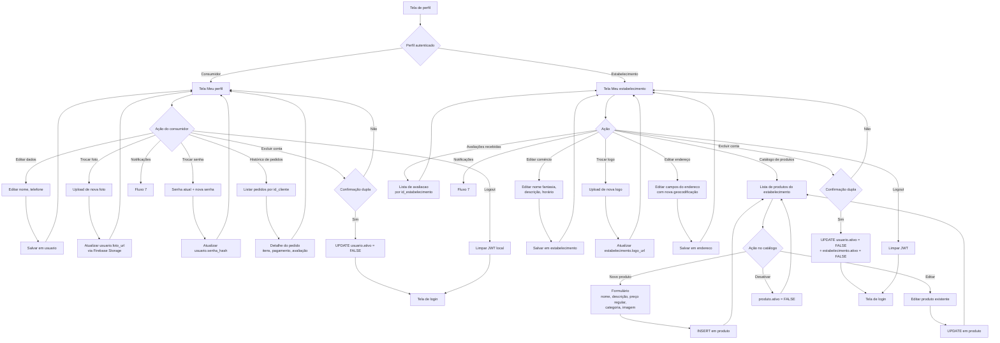

### Fluxo 6 — Cancelamento e estorno

Expande o item de cancelamento que aparece compactado nos Fluxos 2 e 3. RF-005 (ALTA) prevê três caminhos: consumidor cancela, estabelecimento cancela, sistema cancela por timeout. O sistema considera dois timers distintos: o **prazo de retirada do anúncio** (cancela pedidos cujo prazo expirou sem retirada) e a **janela máxima de espera entre `PRONTO_PARA_RETIRADA` e retirada efetiva**.

Em todos os três caminhos, se o pedido já estiver em `PRONTO_PARA_RETIRADA` o cancelamento é permitido mas sinaliza no histórico que houve preparo desperdiçado, alimentando o dashboard do estabelecimento.

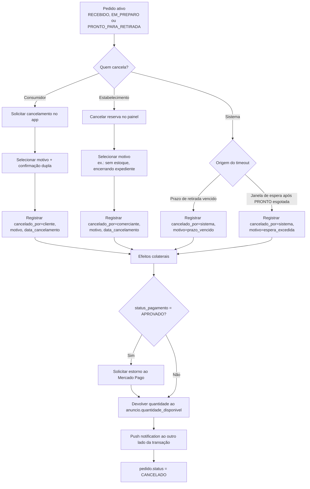

### Fluxo 7 — Notificações e dashboard

Reúne o centro de notificações e o dashboard do estabelecimento. Cobre RF-006 pelo lado dos indicadores operacionais do parceiro e RF-009 pelo lado dos alertas e histórico de notificações.

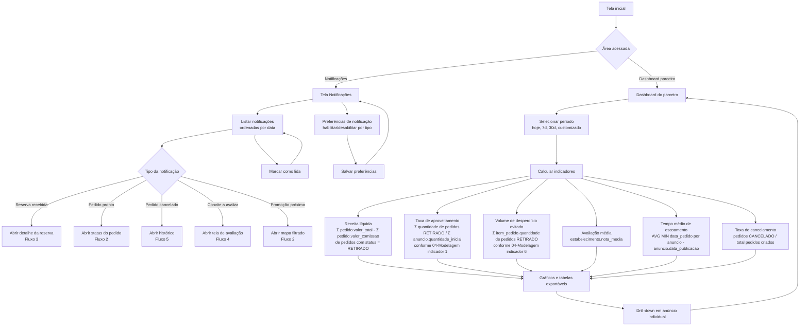

## Wireframes
 
São protótipos usados no design de interface para sugerir a estrutura de um site web e seu relacionamento entre suas páginas. Um wireframe web é uma ilustração que mostra o layout dos elementos fundamentais na interface.
 

## Protótipo interativo
 
O protótipo interativo do FoodLoop foi desenvolvido no Figma e contempla a navegação simulada entre as telas do sistema para os perfis de Consumidor e Parceiro Comercial. O protótipo reflete as funcionalidades e interações planejadas, abrangendo os fluxos de cadastro, autenticação, compra de produtos, cadastro de itens excedentes e acompanhamento de pedidos, servindo como base para validação com usuários e equipe.
 
Acesse o protótipo interativo pelo link abaixo:
 
[🔗 Protótipo FoodLoop — Figma](https://www.figma.com/design/d2W9AGF2pEhukY9mHSVo51/Projeto_interativo?node-id=11-2979&t=e0ou0fcTieZ1B54Y-1)

## Jornada do usuário

## Texto Explicativo — Jornada do Usuário

A jornada do usuário do FoodLoop foi desenvolvida com base no modelo AIDA, permitindo representar as etapas percorridas pelo consumidor desde o primeiro contato com a plataforma até o pós-uso do serviço. O objetivo é compreender como o usuário interage com a aplicação, identificando ações, pontos de contato e percepções ao longo da experiência.

Na fase de conscientização, o usuário conhece o FoodLoop por meio de anúncios, redes sociais, influenciadores ou indicações, despertando curiosidade e interesse pela proposta do aplicativo. Em seguida, na etapa de interesse, o consumidor acessa a aplicação web pelo navegador, cria sua conta e começa a explorar as ofertas disponíveis.

Na fase de desejo, o usuário compara preços, avaliações, localização e produtos disponíveis, aumentando sua intenção de compra. Já na etapa de ação, ocorre a reserva ou compra do alimento excedente, seguida da retirada no estabelecimento parceiro.

Por fim, no pós-uso, o consumidor avalia a experiência, compartilha sua opinião e pode reutilizar a plataforma futuramente, fortalecendo a fidelização e incentivando práticas de consumo mais sustentáveis. Dessa forma, a jornada demonstra como o FoodLoop busca unir tecnologia, economia e redução do desperdício de alimentos em uma experiência simples e acessível para os usuários.

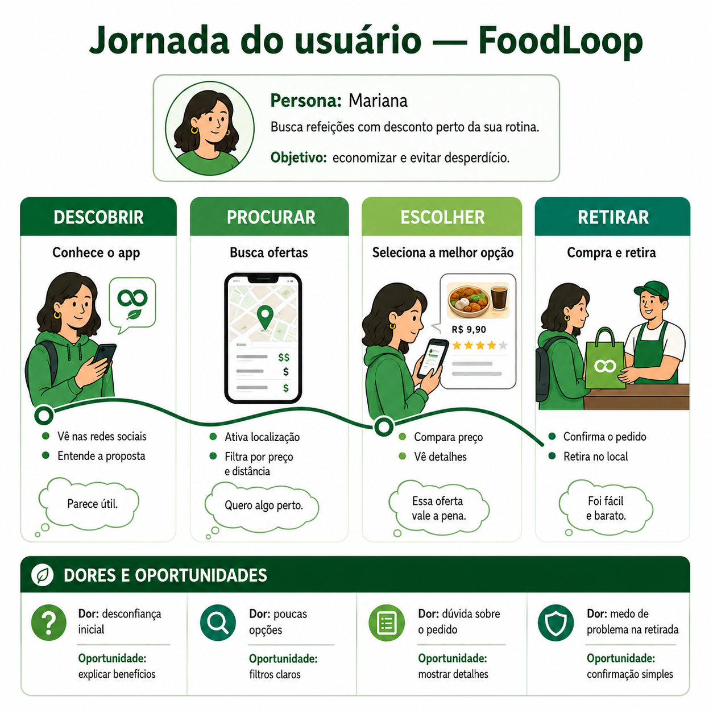

## Interface do sistema
 
Este tópico apresenta todas as interfaces do sistema FoodLoop em sua versão final, descrevendo a função de cada tela e evidenciando aquelas diretamente relacionadas aos processos de negócio modelados em BPMN, conforme documentado no item <a href="04-Modelagem-processos-negocio.md">Modelagem dos processos de negócio</a>.
 
O aplicativo é estruturado para atender dois perfis distintos de usuário: o **consumidor**, que localiza e adquire produtos alimentícios com desconto, e o **parceiro** (estabelecimento comercial), que cadastra e gerencia anúncios de itens excedentes. As interfaces foram desenvolvidas para dispositivos móveis, com identidade visual coesa em paleta verde escuro, representando o posicionamento sustentável da plataforma. O conjunto completo compreende 12 telas funcionais e um conjunto de overlays de feedback ao usuário.
 
---
 
### Tela principal do sistema
 
A tela principal do sistema, exibida após a autenticação do consumidor, é a **tela de Listagem de Produtos**. Ela constitui o ponto central de navegação do aplicativo, reunindo busca, filtragem por categoria e visualização dos anúncios publicados pelos estabelecimentos cadastrados.
 
A interface é composta pelos seguintes elementos:
 
- **Campo de busca** (*Buscar restaurante ou produto*): permite pesquisa textual por estabelecimento ou produto;
- **Filtros de categoria**: etiquetas selecionáveis para *Padaria*, *Doces*, *Refeições*, *Frutas*, *Até 1 km*, *Salada* e *Bebidas*;
- **Cards de produtos**: cada cartão exibe imagem do item, nome, descrição resumida, avaliação em estrelas e botão de adição ao carrinho;
- **Barra de navegação inferior**: acesso rápido às seções de Mapa, Início e Perfil.

 
---
 
### Telas dos processos BPMN
 
#### Processo 1 — Compra de Produto pelo Consumidor
 
O Processo 1 modela o fluxo digital de aquisição de produtos excedentes pelo consumidor, substituindo a dependência do atendimento presencial por uma experiência geolocalizada. As telas descritas a seguir cobrem as etapas de acesso ao sistema, descoberta de produtos, seleção, pagamento e confirmação do pedido.
 
---
 
**Tela 1.1 — Login do Consumidor**
 
Tela exibida ao usuário já cadastrado que deseja autenticar-se na plataforma. Corresponde à **etapa 1 do Processo 1** (acesso ao aplicativo FoodLoop).
 
Elementos da interface:
 
- Mensagem de engajamento (*"Pronto para fechar mais um ciclo? Entre na sua conta e faça parte da nossa revolução sustentável."*);
- Campos de entrada para **Endereço de e-mail** e **Senha**;
- Botão **Entrar**, para autenticação com credenciais cadastradas;
- Botão **Criar conta**, para redirecionamento ao fluxo de cadastro;
- Botão **Seja nosso parceiro**, para acesso ao cadastro de estabelecimentos;
- Botão **Continuar com o Google**, para autenticação via conta Google;
- Link **Saiba +**, que redireciona à tela institucional da plataforma.

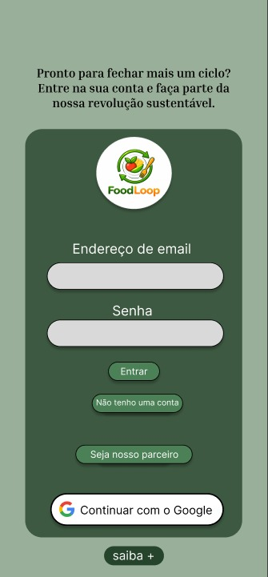
 
---
 
**Tela 1.2 — Listagem de Produtos**
 
Após autenticação, o consumidor é direcionado à tela principal descrita anteriormente. No contexto do Processo 1, esta tela corresponde às **etapas 2 a 4**: visualização dos estabelecimentos próximos e consulta aos anúncios disponíveis. O consumidor pode utilizar filtros de categoria ou o campo de busca para localizar produtos de seu interesse.
 

 
---
 
**Tela 1.3 — Mapa de Estabelecimentos**
 
Exibe em interface cartográfica interativa a localização dos estabelecimentos parceiros cadastrados. Suporta a **etapa 2 do Processo 1**, na qual o cliente visualiza comércios próximos à sua localização.
 
Elementos da interface:
 
- **Mapa interativo** com marcadores posicionados nos estabelecimentos parceiros;
- **Seleção de marcador**: cada ponto pode ser selecionado para exibição de informações do estabelecimento;
- **Barra de navegação inferior** com acesso a Mapa, Início e Perfil.

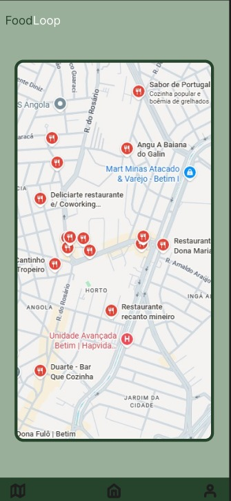
 
---
 
**Tela 1.4 — Detalhe do Produto e Seleção de Pagamento**
 
Exibida quando o consumidor seleciona um produto para aquisição. Cobre as **etapas 5 e 6 do Processo 1**: adição do produto ao carrinho, confirmação do pedido e escolha do método de pagamento.
 
Elementos da interface:
 
- **Carrossel de imagens** do produto com indicador de posição;
- **Nome e descrição** do produto anunciado;
- **Seção de método de pagamento**, com as opções: *PIX*, *Dinheiro (Apenas no local)* e *Cartão de crédito*.

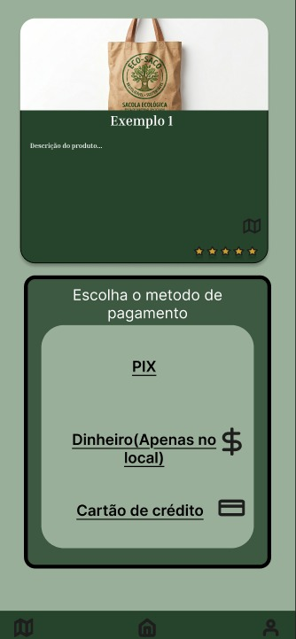
 
---
 
**Tela 1.5 — Confirmação de Pedido**
 
Tela exibida imediatamente após a conclusão do pagamento, informando o consumidor sobre o resultado da transação. Contempla dois estados distintos:
 
- **Pagamento confirmado**: mensagem de sucesso com indicação de que o estabelecimento foi notificado e o pedido está sendo preparado;
- **Pedido recusado**: mensagem de erro com orientação para nova tentativa ou troca de forma de pagamento.

Esta tela encerra o fluxo de compra do lado do consumidor e dá início ao acompanhamento do status do pedido.

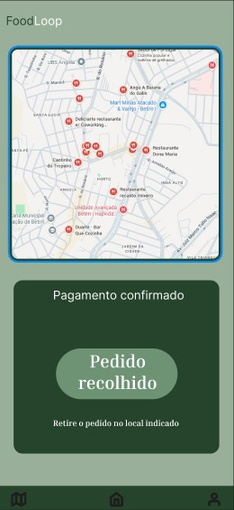
 
---
 
#### Processo 2 — Cadastro e Publicação de Anúncio pelo Parceiro
 
O Processo 2 modela o fluxo pelo qual o estabelecimento comercial identifica produtos excedentes, cadastra-os na plataforma e os disponibiliza com preço promocional para consumidores próximos.
 
---
 
**Tela 2.1 — Cadastro de Parceiro**
 
Tela de registro inicial do estabelecimento comercial, ponto de entrada para que o parceiro acesse as funcionalidades do Processo 2.
 
Campos disponíveis:
 
- **Nome Completo** (representante do estabelecimento);
- **Endereço de e-mail**;
- **Senha** e **Confirme sua senha**;
- **CNPJ**;
- **Telefone**.

Ações disponíveis: **Criar conta** e **Entrar**.

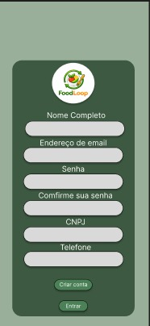
 
---
 
**Tela 2.2 — Painel do Parceiro / Dashboard**
 
Interface central de gestão do estabelecimento comercial. Corresponde à **etapa 2 do Processo 2** (acesso ao painel) e às **etapas 8 e 9** (acompanhamento de reservas e preparação para retirada).
 
Elementos da interface:
 
- **Cabeçalho** com nome do estabelecimento (*Couto Lanches*), endereço, horário de funcionamento e botão **Cadastrar Item**;
- **Lista de pedidos ativos** com nome do item, valor e indicador de status;
- **Painel de métricas**: Receita do dia (R$ 105), Pedidos do dia (7), Avaliação média (4,5) e Ticket médio (R$ 15,00);
- **Painel de impacto sustentável**: CO₂ evitado (0,8 kg) e Refeições salvas (90).

 
---
 
**Tela 2.3 — Cadastro de Item**
 
Operacionaliza as **etapas 3, 4 e 5 do Processo 2**: cadastro do anúncio, definição do preço promocional e publicação do produto excedente.
 
Campos e elementos disponíveis:
 
- **Tipo de anúncio**: *Refeição* ou *Sacola surpresa*;
- **Nome do item** e **Descrição**;
- **Categoria**: seleção por etiquetas (*Padaria*, *Doce*, *Refeição*, *Lanche*, *Suco*, *Fruta*, *Pudim*);
- **Quantidade disponível**: controle numérico com incremento e decremento;
- **Disponível até**: campo de data para prazo de retirada;
- **Valor original** e **Valor especial**: precificação promocional;
- **Upload de foto** do produto;
- Botão **Enviar** para publicação do anúncio.

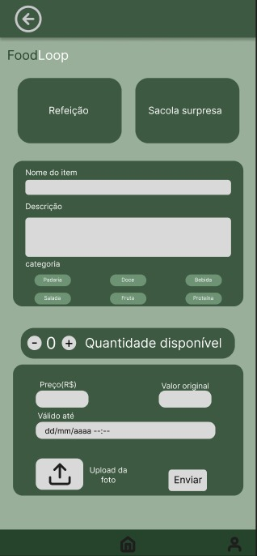
 
---
 
**Tela 2.4 — Dashboard Expandido do Parceiro**
 
Versão expandida do painel do parceiro, exibindo o detalhamento financeiro dos pedidos ativos e o histórico de pedidos finalizados. Suporta as **etapas 8 e 9 do Processo 2**, oferecendo ao estabelecimento visibilidade completa sobre as reservas recebidas e o desempenho operacional.
 
Elementos da interface:
 
- **Cabeçalho** com nome do estabelecimento e acesso ao cadastro de novos itens;
- **Resumo financeiro dos pedidos ativos**: listagem com nome do item, preço unitário, quantidade disponível e valor acumulado;
- **Histórico de pedidos**: registro dos pedidos já realizados no estabelecimento, com indicação de status;
- **Aviso de análise de pedidos em andamento**, sinalizando pedidos aguardando confirmação.

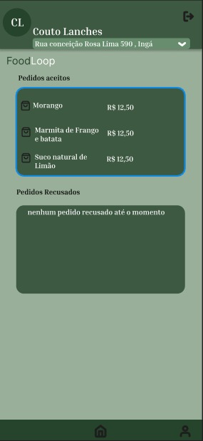
 
---
 
### Demais telas do sistema
 
Esta seção apresenta as telas do FoodLoop que complementam a experiência do sistema sem estarem vinculadas diretamente a um processo BPMN específico.
 
---
 
**Cadastro de Consumidor**
 
Tela de registro inicial de novos consumidores. Coleta as informações necessárias para criação da conta e oferece alternativa de autenticação via Google.
 
Campos: **Endereço de e-mail**, **Nome Completo**, **Senha** e **Confirme sua senha**.  
Ações: **Criar conta**, **Entrar** e **Inscrever-se com o Google**.
 
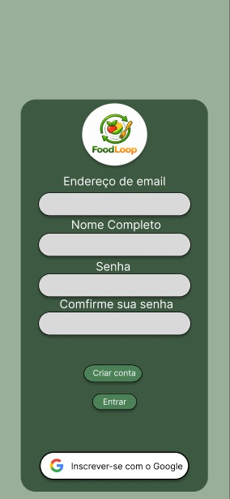
 
---
 
**Perfil do Consumidor e Impacto Sustentável**
 
Reúne informações pessoais e indicadores de impacto ambiental gerado pelo uso da plataforma.
 
Elementos da interface:
 
- **Cabeçalho** com iniciais, nome completo e endereço do usuário (*Gustavo Pontes, Rua Redelvim Andrade 215, Betim*);
- **Último pedido**: nome do item adquirido mais recentemente (*Morango*);
- **Painel "Seu impacto sustentável"**: CO₂ Evitado (5,7 kg) e Pedidos realizados (27);
- **Avaliação de pedidos recentes**: card do último pedido com sistema de avaliação por estrelas.

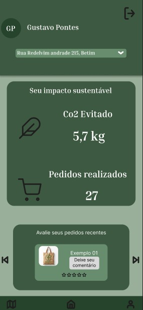
 
---
 
**Tela Institucional — Sobre o FoodLoop**
 
Tela informativa acessível pelo link *Saiba +* na tela de login, apresentando a proposta de valor e a missão da plataforma para novos usuários.
 
Blocos de conteúdo:
 
- **"O Ciclo da Abundância"**: posicionamento do FoodLoop como ponte tecnológica entre estabelecimentos com excedentes e pessoas que buscam alimentos de qualidade por preço justo;
- **"Nossa Missão"**: compromisso com o consumo consciente, redução de emissões de efeito estufa e promoção da economia circular;
- **Ícones de benefícios**: síntese visual dos três pilares da plataforma.

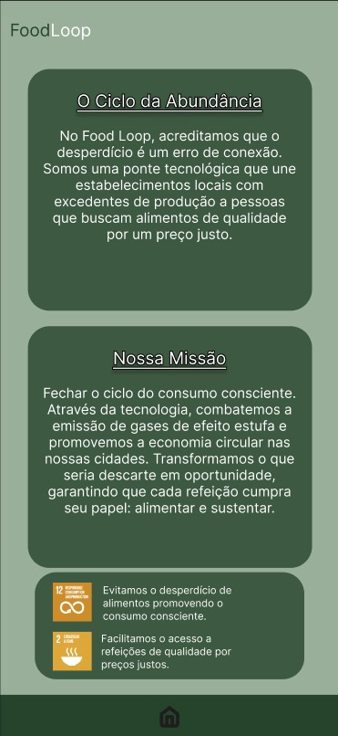
 
---
 
**Overlays de feedback ao usuário**
 
O sistema conta com um conjunto de overlays modais que fornecem retorno imediato ao usuário após ações críticas, sem necessidade de navegação para nova tela. Os overlays identificados no protótipo são:
 
| Overlay | Descrição |
|---|---|
| **Edit_profile** | Formulário de edição de perfil do consumidor (nome, endereço, bairro, cidade e CEP) |
| **Frame 3** | Confirmação de conta criada com sucesso, orientando o usuário a verificar o e-mail para validação |
| **Produto cadastrado com sucesso** | Confirmação de que o anúncio foi publicado com êxito na plataforma |
| **Forma seu Espaço** | Formulário de endereço do estabelecimento (campos: endereço, bairro, cidade e CEP) |
| **Pedido realizado com sucesso** | Confirmação de pedido com nome do produto e ID do pedido, com botão de acompanhamento |
| **Pedido cancelado** | Notificação de cancelamento de pedido com informações resumidas e confirmação via botão *OK* |
| **Preparo do pedido** | Notificação ao parceiro com nome do cliente e ID do pedido a ser preparado |
 
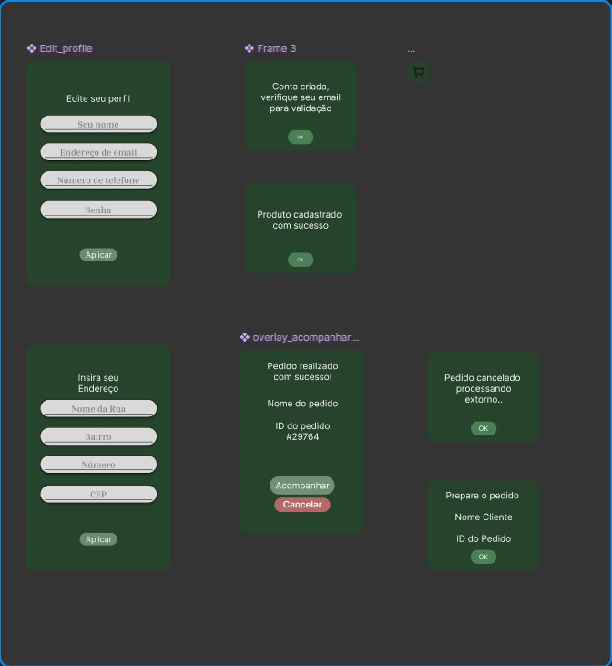
 
---
