# Projeto de interface

Pré-requisitos: <a href="02-Especificacao.md"> Especificação do projeto</a>

Visão geral da interação do usuário pelas telas do sistema e protótipo interativo das telas com as funcionalidades que fazem parte do sistema (wireframes).

Apresente as principais interfaces da plataforma. Discuta como ela foi elaborada de forma a atender os requisitos funcionais, não funcionais e histórias de usuário abordados na <a href="02-Especificacao.md"> Especificação do projeto</a>.

## User flow

Fluxo de usuário (user flow) é uma técnica que permite mapear toda a navegação do usuário na aplicação. Os diagramas a seguir alinham os caminhos e ações possíveis com a especificação do projeto, em particular com os atores definidos no diagrama de casos de uso (Consumidor, Estabelecimento/Parceiro Comercial e Administrador) e com os processos TO-BE descritos em [Modelagem dos processos de negócio](04-Modelagem-processos-negocio.md).

O escopo principal cobre os dois atores operacionais da plataforma, Consumidor e Estabelecimento, porque eles concentram os três processos BPMN TO-BE modelados: compra via aplicativo, anúncio de excedente e avaliação pós-retirada. O ator Administrador (RF-012) tem prioridade BAIXA na lista de RFs, porém o Fluxo geral já encaminha para o painel administrativo, o que torna o valor `'administrador'` no ENUM `tipo_usuario` um requisito bloqueador para que o roteamento de login seja executável de ponta a ponta.

A notação adotada segue a convenção tradicional de user flows: retângulos representam telas, losangos representam pontos de decisão (do usuário ou do sistema), e setas representam transições entre estados.

As decisões de fluxo priorizam:

- **Entrada rápida e segura:** operações críticas exigem usuário autenticado, conforme o caso de uso `<<include>> Autenticar Usuário`.
- **Poucos passos para o consumidor:** descoberta geolocalizada, seleção, carrinho, pagamento e retirada presencial.
- **Operação simples para o comerciante:** criação rápida de anúncio, acompanhamento de reservas, validação da retirada e consulta de desempenho.
- **Registro de impacto:** cada pedido concluído alimenta histórico, dashboard, comissão da plataforma e indicadores de desperdício evitado.

### Fluxo geral — Entrada e roteamento por perfil

O fluxo geral apresenta o ponto de entrada do aplicativo e o roteamento do usuário até a Home correspondente ao seu perfil. O FoodLoop adota a estratégia de **gate rígido de autenticação**, em coerência com a relação `<<include>> Autenticar Usuário` definida no diagrama de casos de uso, que estabelece que toda operação crítica ocorre em ambiente logado.

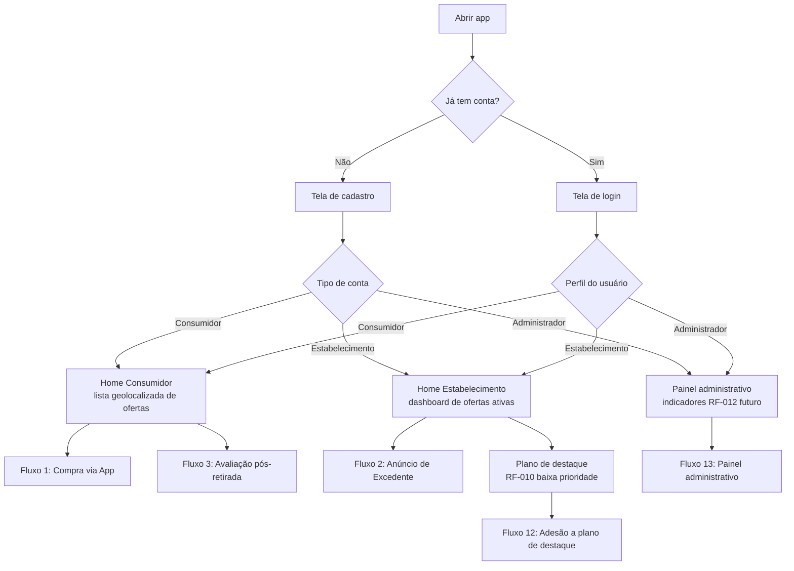

### Fluxo 1 — Compra via App (Consumidor)

Corresponde ao **Processo 1 TO-BE — Compra via App FoodLoop**. Cobre RF-003 (listagem com filtros), RF-004 (reserva e pagamento), RF-005 (cancelamento pelo consumidor), RF-006 (histórico de pedidos do consumidor), RF-009 (notificações de status) e RF-011 (cálculo da comissão sobre transações concluídas). O fluxo respeita a retirada presencial definida nos limites da solução e evita qualquer etapa de entrega.

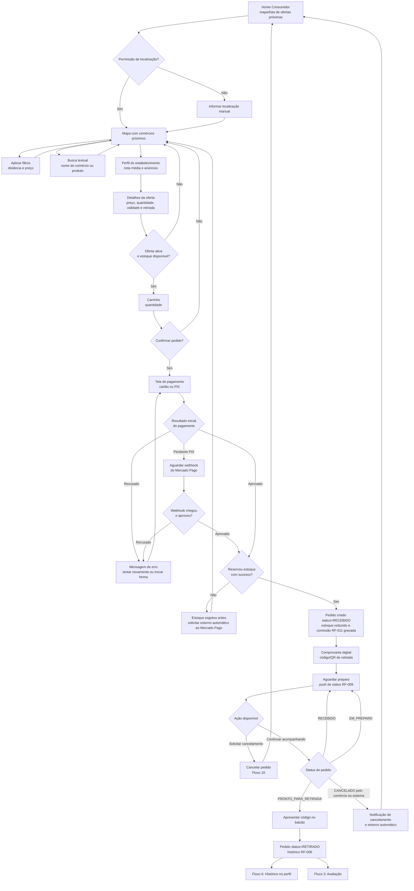

### Fluxo 2 — Anúncio de Excedente (Estabelecimento)

Corresponde ao **Processo 2 TO-BE — Anúncio de Excedente com Desconto**. Cobre RF-002 (CRUD de ofertas com estoque em tempo real), RF-005 (cancelamento pelo estabelecimento), RF-006 (dashboard de desempenho), RF-009 (notificações de reservas recebidas) e RF-010 (adesão futura a plano de destaque). O fluxo também registra a sobra residual ao encerrar uma oferta, mantendo aderência aos indicadores de desperdício evitado e taxa de aproveitamento definidos na modelagem de processos.

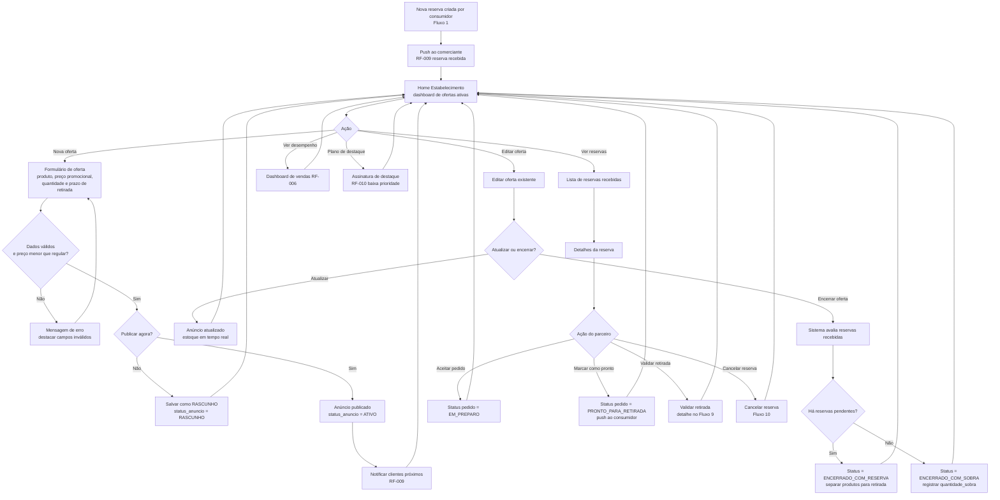

### Fluxo 3 — Avaliação pós-retirada (Consumidor)

Corresponde ao **Processo 3 TO-BE — Avaliação do Estabelecimento no FoodLoop**. Cobre RF-008 (avaliação após a retirada) e reforça a qualidade percebida pelos consumidores ao exibir reputação no perfil do estabelecimento. É disparado por push notification (RF-009) imediatamente após a validação da retirada pelo Fluxo 2.

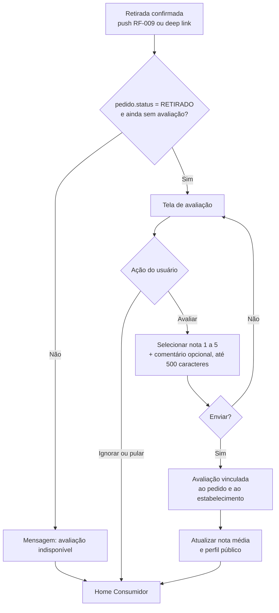

### Fluxo 4 — Cadastro de Consumidor e Estabelecimento

Detalha o cadastro inicial, expandindo o passo "Tela de cadastro" do fluxo geral. Cobre RF-001. O caminho do Estabelecimento exige dois passos adicionais (dados do comércio e endereço com coordenadas) porque o `Estabelecimento` é uma entidade separada do `Usuario`/`Comerciante` no modelo de dados.

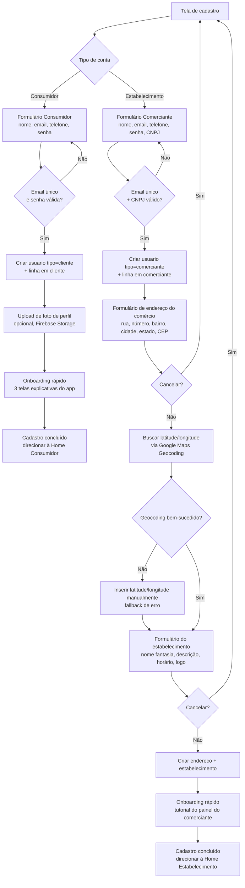

- **Entidades usadas:** `usuario`, `cliente`, `comerciante`, `endereco`, `estabelecimento`
- **Lacunas no modelo de dados:** falta `usuario.foto_url`, `estabelecimento.logo_url` (Firebase Storage previsto em arquitetura mas sem campo no modelo)

### Fluxo 5 — Login e recuperação de senha

Cobre RF-001 do lado de autenticação recorrente. A recuperação por email é exigida pela boa prática de UX e pela coerência com o gate rígido de autenticação adotado no projeto.

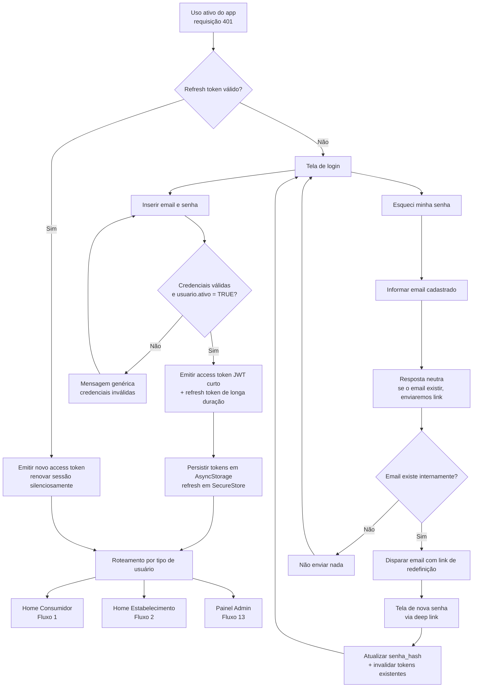

- **Entidades usadas:** `usuario` (campos email, senha_hash, ativo)
- **Lacunas no modelo de dados:** o token de redefinição de senha pode ser implementado por duas vias, ambas válidas. Opção persistida: `token_reset(id, id_usuario, token_hash, validade, usado)` permite invalidar tokens após uso ou expiração e auditar tentativas. Opção efêmera: JWT de curta duração (15 min) assinado pelo back-end, sem tabela, mais simples mas sem revogação. A decisão entra no estágio de implementação do back-end.

### Fluxo 6 — Gestão do perfil do Consumidor

Permite ao consumidor editar dados pessoais, atualizar foto, gerenciar dispositivos e sair da conta. Cobre o lado consumidor de RF-001.

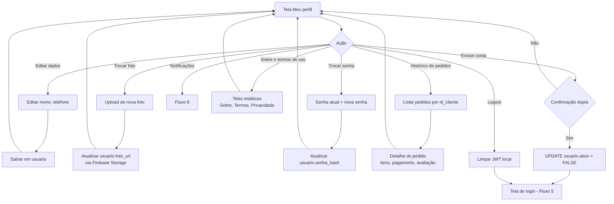

- **Entidades usadas:** `usuario`, `cliente`, `pedido`, `item_pedido`, `pagamento`, `avaliacao`
- **Lacunas no modelo de dados:** `usuario.foto_url` (mesmo gap do Fluxo 4); foto do produto em histórico vem de `produto.imagem` (já existe)

### Fluxo 7 — Gestão do perfil do Estabelecimento e catálogo de produtos

O cadastro de `Produto` é pré-requisito do Fluxo 2 (anunciar exige selecionar um produto do catálogo, conforme `docs/processes/processo-2-to-be.md` Quadro 3). Esse fluxo expõe o CRUD de catálogo e a edição dos dados do comércio.

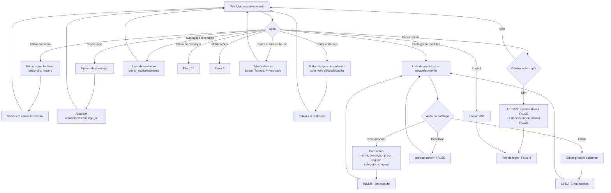

- **Entidades usadas:** `estabelecimento`, `endereco`, `produto`, `avaliacao`
- **Lacunas no modelo de dados:** `estabelecimento.logo_url` (mesmo gap do Fluxo 4); o flow assume que `Produto` é gerenciado antes de `Anuncio`, o que o modelo suporta corretamente

### Fluxo 8 — Centro de notificações

Lista as notificações push recebidas, permite marcar como lidas e abrir a tela contextual. Cobre RF-009 do lado de visualização (o disparo já está coberto nos Fluxos 1, 2 e 3).

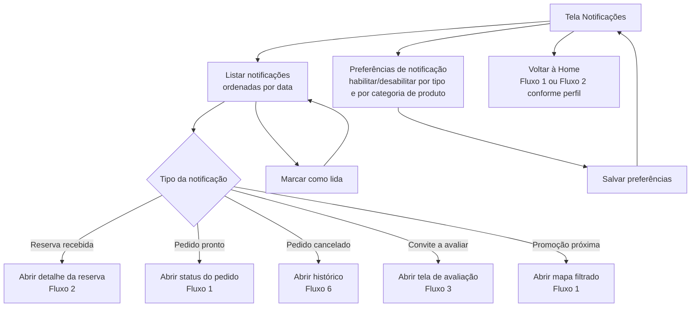

- **Entidades usadas:** **nenhuma existe ainda no modelo de dados**
- **Lacunas no modelo de dados (IMPORTANTE):** falta `device_token(id_usuario, token, plataforma, ativo, ultimo_uso)` para o envio via FCM, `notificacao(id, id_usuario, tipo, titulo, corpo, payload_json, lida, data_envio, data_leitura)` para o histórico no app, `usuario_preferencia_notificacao(id_usuario, tipo, habilitado)` para granularidade por tipo de push, e `usuario_preferencia_categoria(id_usuario, categoria, interesse)` para que a "promoção próxima" do Processo 2 TO-BE Quadro 5 ("público-alvo compatível") seja realmente compatível com o interesse do consumidor.

### Fluxo 9 — Validação da retirada (Estabelecimento)

Detalha o sub-fluxo de validação que aparece compactado no Fluxo 2 (`Validar retirada — Confirmar código/QR do cliente`). É o ponto onde o pedido transita para `RETIRADO` e dispara o convite de avaliação do Fluxo 3, conforme Quadro 5 e seção 3.3 de `processo-1-to-be.md`.

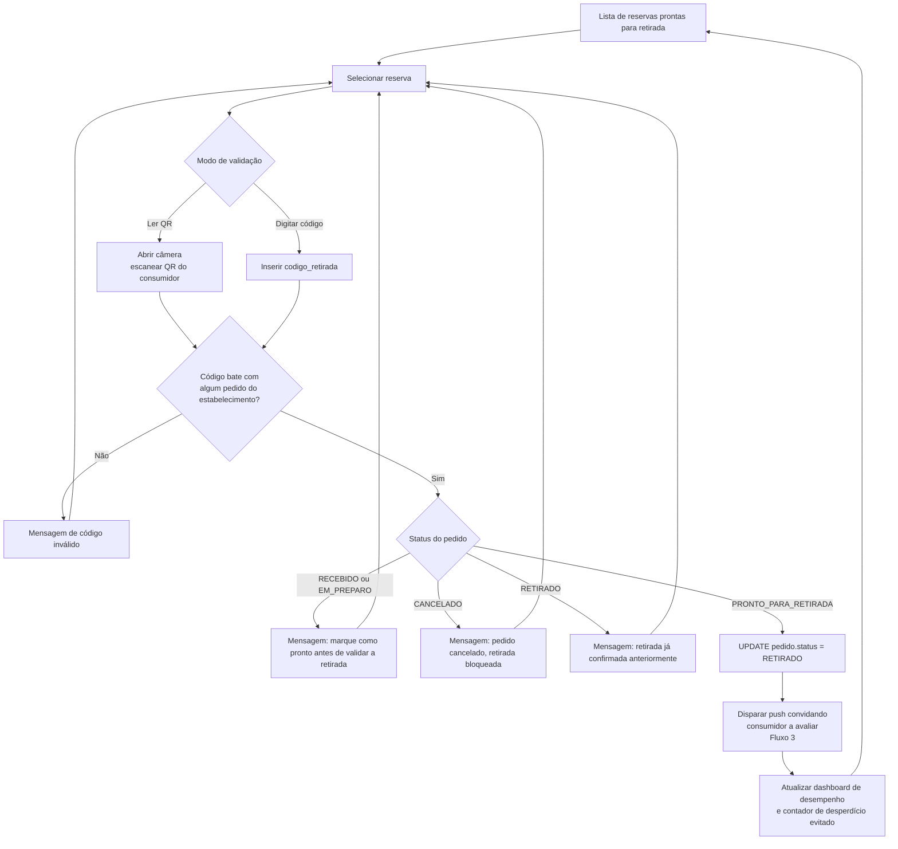

- **Entidades usadas:** `pedido` (status, codigo_retirada), `item_pedido`, `anuncio`
- **Lacunas no modelo de dados:** `pedido.codigo_retirada` precisa ser **UNIQUE** (atualmente não tem constraint); preferencialmente um índice e/ou geração padronizada (UUID curto ou similar)

### Fluxo 10 — Cancelamento detalhado (RF-005)

Expande o item de cancelamento que aparece compactado nos Fluxos 1 e 2. RF-005 (ALTA) prevê três caminhos: consumidor cancela, estabelecimento cancela, sistema cancela por timeout. O sistema considera dois timers distintos: o **prazo de retirada do anúncio** (cancela pedidos cujo prazo expirou sem retirada) e a **janela máxima de espera entre `PRONTO_PARA_RETIRADA` e retirada efetiva** (parâmetro de configuração da plataforma, default 24 horas).

Em todos os três caminhos, se o pedido já estiver em `PRONTO_PARA_RETIRADA` o cancelamento é permitido mas sinaliza no histórico que houve preparo desperdiçado, alimentando o dashboard do estabelecimento.

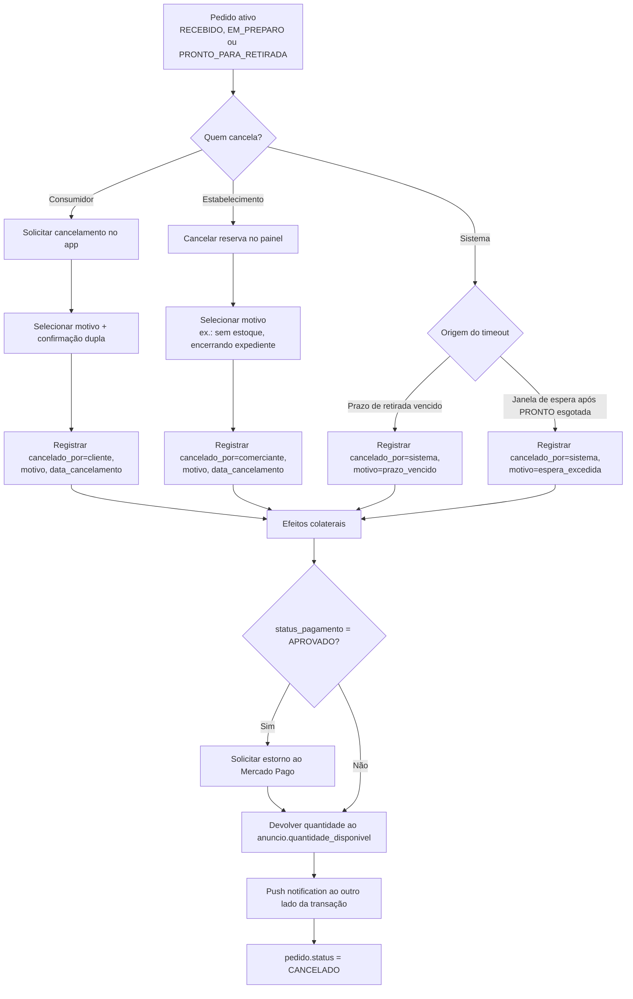

- **Entidades usadas:** `pedido`, `item_pedido`, `anuncio`, `pagamento`
- **Lacunas no modelo de dados (BLOQUEADOR):** `pedido` não tem `cancelado_por`, `motivo_cancelamento`, `data_cancelamento`. Precisa de ENUM `origem_cancelamento(CLIENTE, COMERCIANTE, SISTEMA)`. A política de timeout precisa de parâmetros configuráveis (sugestão: tabela `configuracao_plataforma(chave, valor)` ou constantes versionadas no back-end), com valores iniciais sugeridos: timeout de espera após `PRONTO_PARA_RETIRADA` igual a 24 horas; timeout do prazo de retirada vem direto do `anuncio.prazo_retirada`.

### Fluxo 11 — Dashboard de desempenho do Estabelecimento

Detalha o ponto "Dashboard de vendas RF-006" mencionado no Fluxo 2. Reflete os indicadores definidos em `04-Modelagem-processos-negocio.md` (Taxa de aproveitamento, Volume de desperdício evitado, Avaliação média, etc.).

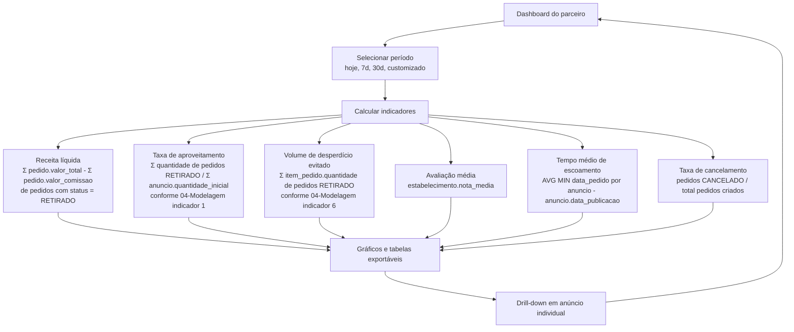

- **Entidades usadas:** `pedido`, `item_pedido`, `anuncio`, `estabelecimento`, `avaliacao`
- **Lacunas no modelo de dados (BLOQUEADOR):** `pedido.valor_comissao` e `pedido.taxa_comissao` ausentes (KPI1 impossível); `anuncio.quantidade_inicial` ausente (KPI2 impossível); cálculo de KPI5 requer `anuncio.data_publicacao` (já existe) e timestamp da primeira reserva (derivável de `MIN(pedido.data_pedido)` por anúncio, OK).

### Fluxo 12 — Adesão a plano de destaque (RF-010)

Cobre RF-010 (BAIXA). Mantido no doc para preservar rastreabilidade futura e expor a lacuna correspondente no modelo de dados.

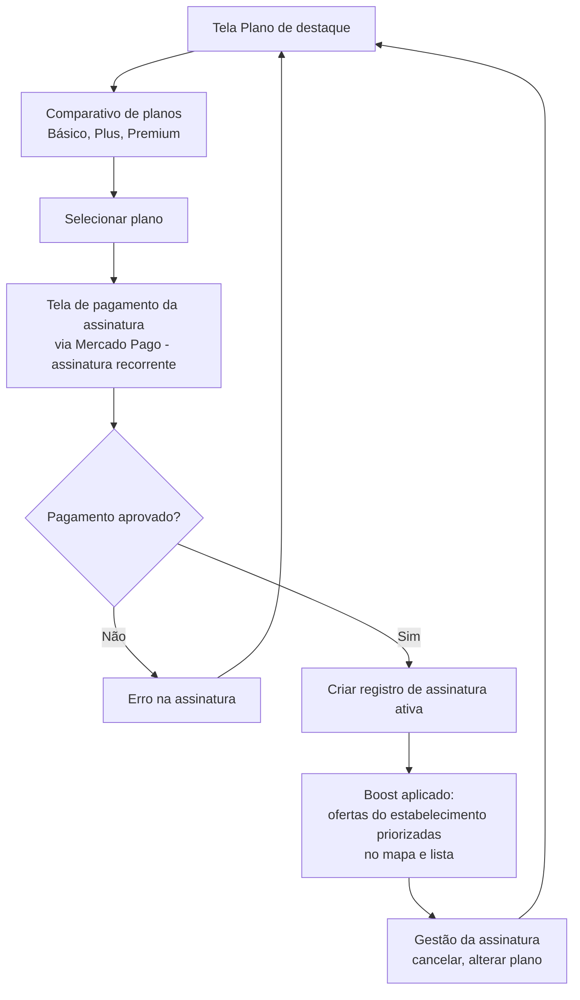

- **Entidades usadas:** **nenhuma existe ainda no modelo de dados**
- **Lacunas no modelo de dados (BAIXA):** falta `assinatura(id, id_estabelecimento, plano, valor_mensal, data_inicio, data_fim, status, id_pagamento_recorrente)`. O ranking de prioridade no mapa/lista exige um campo derivado ou um join contra `assinatura` ativa no momento da consulta.

### Fluxo 13 — Painel administrativo (RF-012)

Cobre RF-012 (BAIXA). Painel do operador da plataforma FoodLoop com visão consolidada de uso, transações e impacto. **Autorização explícita:** o roteamento pelo Fluxo 5 emite token JWT contendo `tipo_usuario`; toda rota deste painel exige middleware de autorização que aceita apenas requisições com `tipo_usuario = administrador`. Autenticação sem essa checagem de papel não é suficiente.

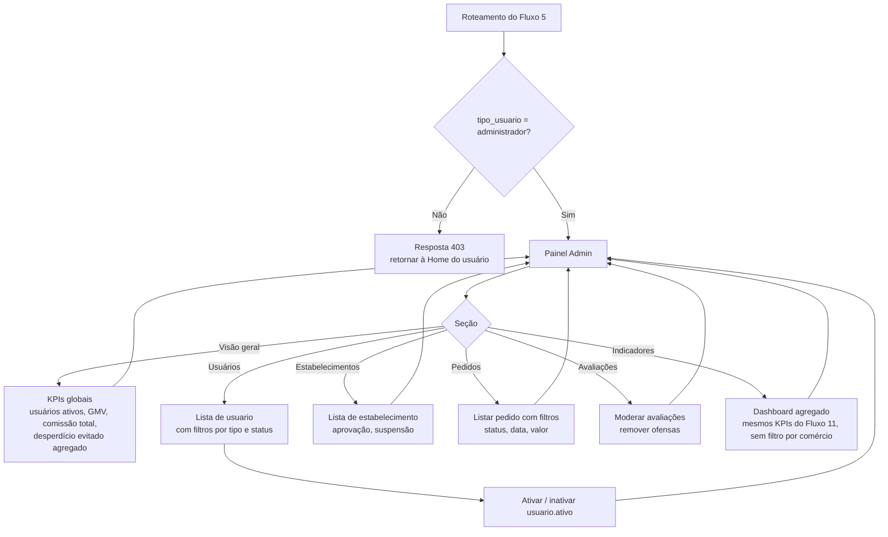

- **Entidades usadas:** todas as principais
- **Lacunas no modelo de dados:** `tipo_usuario` ENUM precisa incluir `'administrador'` (severidade BLOQUEADOR, sem isso o Fluxo geral fica inexecutável); moderação de avaliações exige `avaliacao.removida BOOLEAN` ou `avaliacao.status` para soft delete (severidade BAIXA)

### Rastreabilidade requisitos × user flow

A tabela a seguir relaciona cada requisito funcional aos fluxos em que ele aparece, evidenciando a cobertura do desenho proposto e separando o que pertence ao MVP operacional do que fica como expansão de baixa prioridade.

| Requisito | Cobertura no user flow | Observação |
| :--- | :--- | :--- |
| RF-001 Cadastro, login e gerenciamento de perfis | Fluxo geral, 4, 5, 6, 7 | Cadastro detalhado por tipo, login, recuperação de senha, edição de perfil consumidor e estabelecimento. |
| RF-002 CRUD de ofertas com estoque | Fluxo 2, 7 | Catálogo de produtos no Fluxo 7 é pré-requisito; CRUD do anúncio no Fluxo 2. |
| RF-003 Listagem com filtros geolocalizados | Fluxo 1 | Mapa/lista, permissão de GPS, localização manual e filtros por distância/preço. |
| RF-004 Reserva e pagamento online | Fluxo 1 | Carrinho, confirmação, pagamento por cartão/PIX e comprovante digital. |
| RF-005 Cancelamento de reservas | Fluxo 10 | Detalhamento dos três caminhos: consumidor, estabelecimento, sistema (timeout). |
| RF-006 Histórico e dashboard de desempenho | Fluxo 6 (consumidor) e Fluxo 11 (parceiro) | Histórico no perfil do consumidor; dashboard com KPIs do 04-Modelagem no Fluxo 11. |
| RF-008 Avaliação dos estabelecimentos | Fluxo 3, 7 | Avaliação vinculada ao pedido; comerciante visualiza no Fluxo 7. |
| RF-009 Notificações push e alertas | Fluxo 8 + disparos nos Fluxos 1, 2, 3 e 9 | Centro de notificações + preferências; tokens FCM são pré-requisito. |
| RF-010 Planos de assinatura para destaque | Fluxo 12 | Baixa prioridade; assinatura recorrente via Mercado Pago. |
| RF-011 Comissão da plataforma | Fluxo 1 e KPI no Fluxo 11 | Calculada no pedido aprovado; exposta na receita líquida do dashboard. |
| RF-012 Painel administrativo | Fluxo 13 | Baixa prioridade; KPIs globais e moderação. |

### Pontos de validação para wireframes e testes

Os wireframes e os testes de usabilidade devem garantir que os seguintes pontos críticos estejam visíveis e testáveis:

- Consumidor consegue encontrar uma oferta próxima, filtrar por preço/distância e entender preço, quantidade, validade e janela de retirada antes do pagamento.
- Consumidor consegue concluir pagamento, receber comprovante digital e localizar o status do pedido sem depender de contato externo.
- Estabelecimento consegue publicar uma oferta em poucos passos, alterar estoque, acompanhar reservas e validar retirada por código/QR.
- O fluxo de cancelamento informa claramente o impacto no estoque, no reembolso e nas notificações.
- A avaliação só aparece depois da retirada confirmada, mantendo rastreabilidade entre pedido, estabelecimento e nota.

### Lacunas mapeadas no modelo de dados

Os fluxos acima foram desenhados refletindo a estrutura proposta em `07-Arquitetura-solucao.md` (Diagrama de Classes) e o esboço atual do modelo físico. Sempre que um fluxo demanda persistência que ainda não existe no modelo de dados, isso foi anotado abaixo de cada Mermaid. A tabela consolida essas lacunas para servir de checklist de atualização upstream nos demais documentos (02-Especificacao, 04-Modelagem-processos-negocio e 07-Arquitetura) e no script SQL.

| Severidade | Lacuna | Onde aparece no user flow | RF / fonte | Solução proposta |
| :--- | :--- | :--- | :--- | :--- |
| BLOQUEADOR | Comissão da plataforma sem campo em `pedido` | Fluxos 1, 11 | RF-011 | Adicionar `pedido.valor_comissao NUMERIC(10,2)` e `pedido.taxa_comissao NUMERIC(5,4)`. |
| BLOQUEADOR | Cancelamento sem rastreio de autor, motivo e data | Fluxos 1, 2, 10 | RF-005, Histórias 17 e 18 | Adicionar `pedido.cancelado_por`, `pedido.motivo_cancelamento`, `pedido.data_cancelamento`. |
| BLOQUEADOR | Estoque inicial não preservado | Fluxos 2, 11 | RF-002, indicadores em 04-Modelagem | Adicionar `anuncio.quantidade_inicial INTEGER NOT NULL`. |
| BLOQUEADOR | Trigger `fn_atualizar_nota_media` quebra em DELETE | Fluxo 3 | RF-008 | Usar `COALESCE(NEW.id_estabelecimento, OLD.id_estabelecimento)` na função. |
| IMPORTANTE | Foto de perfil e logo do estabelecimento ausentes | Fluxos 4, 6, 7 | RF-001, arquitetura linha 27 | Adicionar `usuario.foto_url`, `estabelecimento.logo_url`. |
| IMPORTANTE | Tabelas de notificação e device token ausentes | Fluxo 8 + disparos | RF-009 | Criar `device_token`, `notificacao`, `usuario_preferencia_notificacao`. |
| IMPORTANTE | `pedido.codigo_retirada` sem UNIQUE | Fluxos 1 e 9 | RF-004 | Adicionar UNIQUE em `pedido.codigo_retirada` e padronizar geração. |
| IMPORTANTE | `anuncio.descricao` ausente para descrição adicional | Fluxo 2 | `processo-2-to-be.md` Quadro 3 | Adicionar `anuncio.descricao TEXT NULL`. |
| IMPORTANTE | Limite de 500 caracteres no comentário da avaliação | Fluxo 3 | `processo-3-to-be.md` Quadro 3 | Trocar `avaliacao.comentario` para `VARCHAR(500)` ou adicionar CHECK. |
| IMPORTANTE | Validação preço promocional menor que preço regular | Fluxo 2 | `processo-2-to-be.md` Quadro 3 | Trigger ou validação no back-end (CHECK não suporta subquery). |
| BLOQUEADOR | Status `RASCUNHO` ausente no enum `status_anuncio` | Fluxo 2 | RF-002 | Adicionar `'RASCUNHO'` em `status_anuncio` ENUM. O Fluxo 2 depende desse estado para o caminho de não publicar imediatamente. |
| BLOQUEADOR | Tipo `'administrador'` ausente em `tipo_usuario` | Fluxos geral, 13 | RF-012 | Adicionar `'administrador'` no ENUM `tipo_usuario`. O Fluxo geral já roteia para o painel admin, então sem o ENUM o fluxo é inexecutável. |
| BLOQUEADOR | Política de timeout do sistema não parametrizada | Fluxo 10 | RF-005 | Definir parâmetros: timeout do prazo de retirada (vem de `anuncio.prazo_retirada`) e janela de espera após `PRONTO_PARA_RETIRADA` (sugestão 24h). Persistir em `configuracao_plataforma(chave, valor)` ou constantes versionadas. |
| BLOQUEADOR | Quantidade de sobra explícita ausente | Fluxo 2 | RF-002 + indicador 6 do 04-Modelagem | Adicionar `anuncio.quantidade_sobra INTEGER` preenchido no encerramento. |
| BLOQUEADOR | Push de "reserva recebida" ao comerciante sem dados de origem | Fluxo 2 | RF-009 | A tabela `notificacao` precisa carregar `id_pedido` no `payload_json` para deep link ao detalhe da reserva. |
| BAIXA | Tabela de assinatura/plano de destaque ausente | Fluxo 12 | RF-010 | Criar `assinatura(id, id_estabelecimento, plano, valor_mensal, data_inicio, data_fim, status)`. |
| BAIXA | Soft delete em avaliações para moderação | Fluxo 13 | RF-012 | Adicionar `avaliacao.removida BOOLEAN DEFAULT FALSE` ou `avaliacao.status`. |
| REFINAMENTO | ON DELETE incoerente entre `estabelecimento` e `endereco` | Fluxo 4, 7 | Composição no diagrama de classes | Inverter `ON DELETE RESTRICT` para `CASCADE` ou inlinear endereço. |
| REFINAMENTO | `usuario.email` UNIQUE global pode atrapalhar | Fluxos 4, 5 | Decisão de produto | Considerar UNIQUE composto `(email, tipo)`. |
| REFINAMENTO | Token de redefinição de senha sem persistência | Fluxo 5 | RF-001 | Optar entre JWT efêmero ou tabela `token_reset`. |
| REFINAMENTO | Sem índice geoespacial em `endereco` | Fluxo 1 | RNF-004 (mapa em 3s) | Habilitar PostGIS no Render e usar GEOGRAPHY com GIST. |

A coluna **Severidade** sinaliza o que precisa entrar antes da implementação do back-end (BLOQUEADOR), o que afeta telas visíveis no Figma e wireframes (IMPORTANTE), o que está vinculado a RFs de baixa prioridade (BAIXA) e o que são ajustes técnicos sem impacto direto na UI (REFINAMENTO).

> **Ferramentas e referências**:
> - [User flow: o quê é e como fazer?](https://medium.com/7bits/fluxo-de-usu%C3%A1rio-user-flow-o-que-%C3%A9-como-fazer-79d965872534)
> - [User flow vs site maps](http://designr.com.br/sitemap-e-user-flow-quais-as-diferencas-e-quando-usar-cada-um/)
> - [Top 25 user flow tools & templates](https://www.mockplus.com/blog/post/user-flow-tools)
> - Os diagramas acima foram escritos em [Mermaid](https://mermaid.js.org/), renderizado nativamente pelo GitHub. Para gerar imagens estáticas (PNG/SVG) basta colar o código em [mermaid.live](https://mermaid.live) e exportar.

### Diagrama de fluxo

O diagrama apresenta o estudo do fluxo de interação do usuário com o sistema interativo, muitas vezes sem a necessidade de desenhar o design das telas da interface. Isso permite que o design das interações seja bem planejado e tenha impacto na qualidade do design do wireframe interativo que será desenvolvido logo em seguida.

O diagrama de fluxo pode ser desenvolvido com “boxes” que possuem, internamente, a indicação dos principais elementos de interface — tais como menus e acessos — e funcionalidades, como editar, pesquisar, filtrar e configurar, além da conexão entre esses boxes a partir do processo de interação.

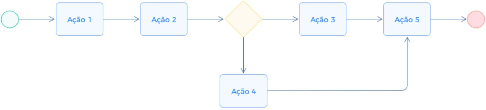

> **Links úteis**:
> - [Como criar um diagrama de fluxo de usuário](https://www.lucidchart.com/blog/how-to-make-a-user-flow-diagram)
> - [Fluxograma online: seis sites para fazer gráfico sem instalar nada](https://www.techtudo.com.br/listas/2019/03/fluxograma-online-seis-sites-para-fazer-grafico-sem-instalar-nada.ghtml)

## Wireframes

São protótipos usados no design de interface para sugerir a estrutura de um site web e seu relacionamento entre suas páginas. Um wireframe web é uma ilustração que mostra o layout dos elementos fundamentais na interface.

 
> **Links úteis**:
> - [Protótipos: baixa, média ou alta fidelidade?](https://medium.com/ladies-that-ux-br/prot%C3%B3tipos-baixa-m%C3%A9dia-ou-alta-fidelidade-71d897559135)
> - [Protótipos vs wireframes](https://www.nngroup.com/videos/prototypes-vs-wireframes-ux-projects/)
> - [Ferramentas de wireframes](https://rockcontent.com/blog/wireframes/)
> - [MarvelApp](https://marvelapp.com/developers/documentation/tutorials/)
> - [Figma](https://www.figma.com/)
> - [Adobe XD](https://www.adobe.com/br/products/xd.html#scroll)
> - [Axure](https://www.axure.com/edu) (Licença Educacional)
> - [InvisionApp](https://www.invisionapp.com/) (Licença Educacional)

## Protótipo interativo

Apresente o protótipo interativo das telas da aplicação, permitindo a navegação simulada pelo sistema. Esse protótipo deve refletir as funcionalidades e interações planejadas, e servir como base para validação com usuários e equipe.  

> **Exemplo:** inserir link para o protótipo no Figma, MarvelApp, InvisionApp, etc.

## Jornada do usuário

A jornada do usuário descreve, em alto nível de detalhes, as etapas que diferentes perfis de usuários realizam para concluir uma tarefa específica na aplicação. Essa técnica ajuda a identificar pontos fortes e oportunidades de melhoria na experiência.  

O mapa da jornada do usuário deve contemplar:  
- Etapas: desde a descoberta até a finalização da tarefa.  
- Ações do usuário: o que o usuário faz em cada etapa.  
- Pontos de contato: onde a interação acontece (site, app, suporte).  
- Emoções e percepções: como o usuário se sente em cada momento.  

**Fases baseadas no modelo AIDA**:  
1. Conscientização: despertar conhecimento sobre o produto (inspiração)  
2. Interesse: aumentar o interesse e engajamento (favoritismo)  
3. Desejo: estimular a intenção de uso/compra (desejo)  
4. Ação: execução da ação esperada (implementação)  

> **Links úteis**:
> - [Dicas sobre como mapear uma jornada do usuário](https://www.userinterviews.com/blog/best-customer-journey-map-templates-examples)
> - [Jornada do usuário versus user flow](https://www.nngroup.com/articles/user-journeys-vs-user-flows/)

## Interface do sistema

Apresente **todas as interfaces do sistema**, em sua versão final, descrevendo brevemente a função de cada tela.

Dê ênfase especial às telas relacionadas aos processos BPMN já mapeados e documentados no item <a href="04-Modelagem-processos-negocio.md"> Modelagem dos processos de negócio</a>.

### Tela principal do sistema

Descrição da tela principal do sistema.

> Insira aqui a imagem da tela principal do sistema.

### Telas dos processos BPMN

#### Processo 1

Descrição das telas relativas às atividades do processo 1.

> Inserir imagens das telas correspondentes às atividades do processo 1.

#### Processo 2

Descrição das telas relativas às atividades do processo 2.

> Inserir imagens das telas correspondentes às atividades do processo 2.

### Demais telas do sistema

Apresente e descreva brevemente as demais telas que compõem o sistema, mesmo que não estejam vinculadas diretamente a processos BPMN.

> Inserir imagens das demais telas.
