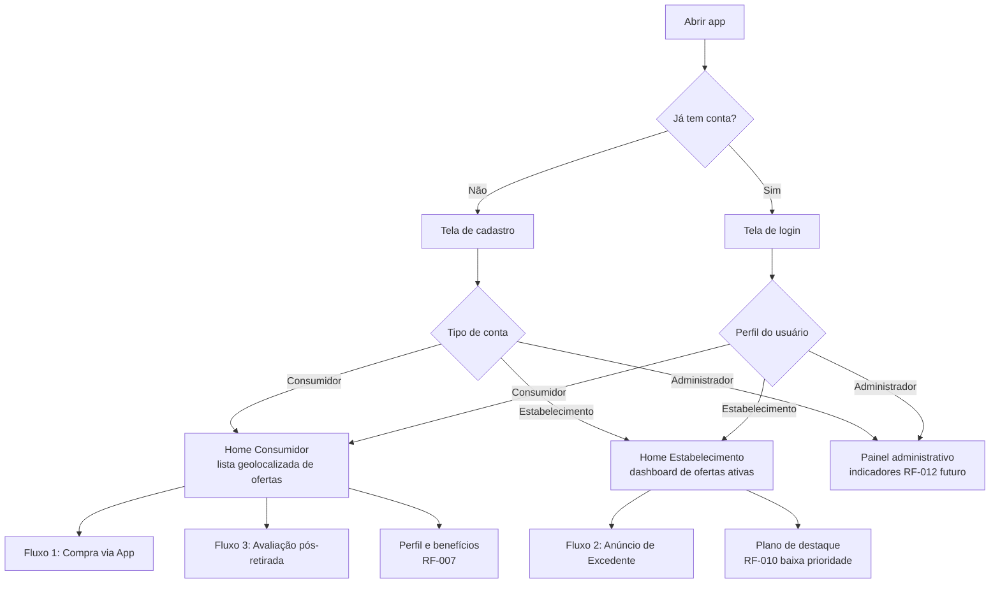
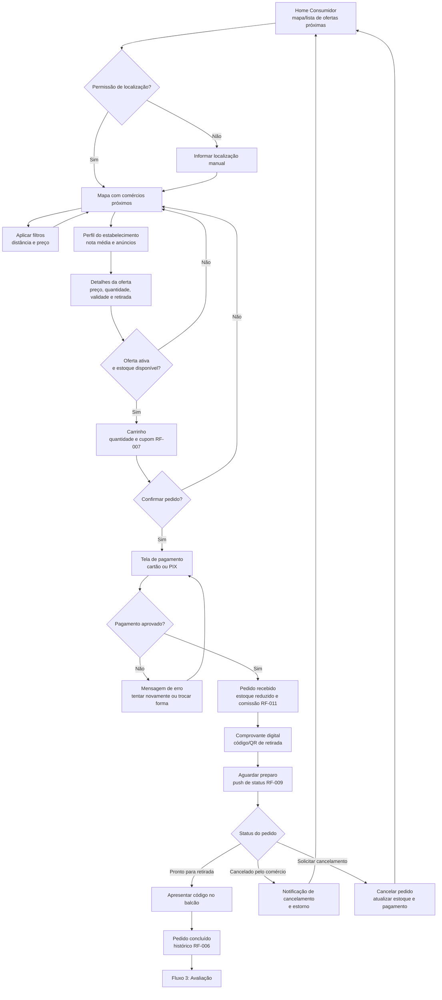
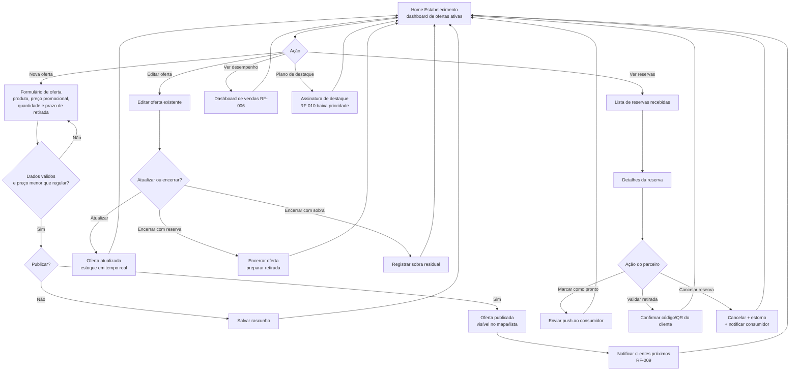
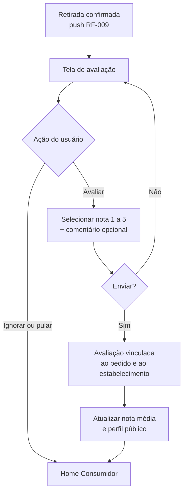
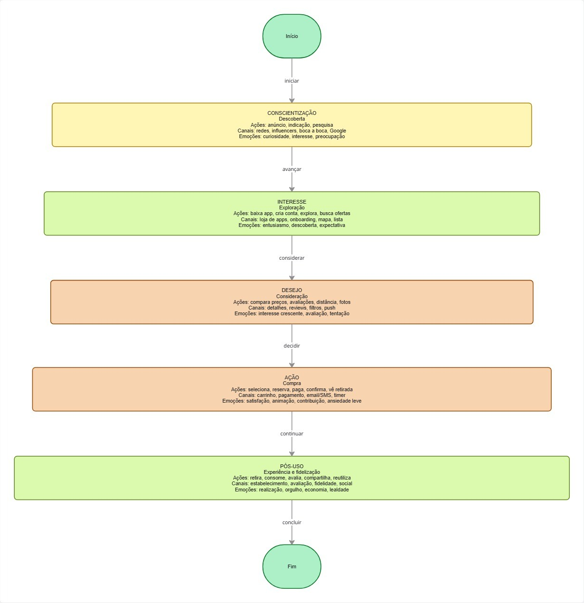

# Projeto de interface

Pré-requisitos: <a href="02-Especificacao.md"> Especificação do projeto</a>

Visão geral da interação do usuário pelas telas do sistema e protótipo interativo das telas com as funcionalidades que fazem parte do sistema (wireframes).

 Apresente as principais interfaces da plataforma. Discuta como ela foi elaborada de forma a atender os requisitos funcionais, não funcionais e histórias de usuário abordados na <a href="02-Especificacao.md"> Especificação do projeto</a>.

 ## User flow

Fluxo de usuário (user flow) é uma técnica que permite mapear toda a navegação do usuário na aplicação. Os diagramas a seguir alinham os caminhos e ações possíveis com a especificação do projeto, em particular com os atores definidos no diagrama de casos de uso (Consumidor, Estabelecimento/Parceiro Comercial e Administrador) e com os processos TO-BE descritos em [Modelagem dos processos de negócio](04-Modelagem-processos-negocio.md).

O escopo principal cobre os dois atores operacionais da plataforma, Consumidor e Estabelecimento, porque eles concentram os três processos BPMN TO-BE modelados: compra via aplicativo, anúncio de excedente e avaliação pós-retirada. O ator Administrador é mantido como fluxo futuro/de baixa prioridade, associado ao RF-012, para preservar a rastreabilidade sem deslocar o foco do MVP validado com a Couto Lanches.

A notação adotada segue a convenção tradicional de user flows: retângulos representam telas, losangos representam pontos de decisão (do usuário ou do sistema), e setas representam transições entre estados.

As decisões de fluxo priorizam:

- **Entrada rápida e segura:** operações críticas exigem usuário autenticado, conforme o caso de uso `<<include>> Autenticar Usuário`.
- **Poucos passos para o consumidor:** descoberta geolocalizada, seleção, carrinho, pagamento e retirada presencial.
- **Operação simples para o comerciante:** criação rápida de anúncio, acompanhamento de reservas, validação da retirada e consulta de desempenho.
- **Registro de impacto:** cada pedido concluído alimenta histórico, dashboard, comissão da plataforma e indicadores de desperdício evitado.

### Fluxo geral — Entrada e roteamento por perfil

O fluxo geral apresenta o ponto de entrada do aplicativo e o roteamento do usuário até a Home correspondente ao seu perfil. O FoodLoop adota a estratégia de **gate rígido de autenticação**, em coerência com a relação `<<include>> Autenticar Usuário` definida no diagrama de casos de uso, que estabelece que toda operação crítica ocorre em ambiente logado.

### Fluxo 1 — Compra via App (Consumidor)

Corresponde ao **Processo 1 TO-BE — Compra via App FoodLoop**. Cobre RF-003 (listagem com filtros), RF-004 (reserva e pagamento), RF-005 (cancelamento pelo consumidor), RF-007 (cupom/benefício no checkout), RF-009 (notificações de status) e RF-011 (cálculo da comissão sobre transações concluídas). O fluxo respeita a retirada presencial definida nos limites da solução e evita qualquer etapa de entrega.

### Fluxo 2 — Anúncio de Excedente (Estabelecimento)

Corresponde ao **Processo 2 TO-BE — Anúncio de Excedente com Desconto**. Cobre RF-002 (CRUD de ofertas com estoque em tempo real), RF-005 (cancelamento pelo estabelecimento), RF-006 (dashboard de desempenho), RF-009 (notificações de reservas recebidas) e RF-010 (adesão futura a plano de destaque). O fluxo também registra a sobra residual ao encerrar uma oferta, mantendo aderência aos indicadores de desperdício evitado e taxa de aproveitamento definidos na modelagem de processos.

### Fluxo 3 — Avaliação pós-retirada (Consumidor)

Corresponde ao **Processo 3 TO-BE — Avaliação do Estabelecimento no FoodLoop**. Cobre RF-008 (avaliação após a retirada) e reforça a qualidade percebida pelos consumidores ao exibir reputação no perfil do estabelecimento. É disparado por push notification (RF-009) imediatamente após a validação da retirada pelo Fluxo 2.

### Rastreabilidade requisitos × user flow

A tabela a seguir relaciona cada requisito funcional aos fluxos em que ele aparece, evidenciando a cobertura do desenho proposto e separando o que pertence ao MVP operacional do que fica como expansão de baixa prioridade.

| Requisito | Cobertura no user flow | Observação |
| :--- | :--- | :--- |
| RF-001 Cadastro, login e gerenciamento de perfis | Fluxo geral | Consumidor, Estabelecimento e Administrador têm roteamento por perfil. |
| RF-002 CRUD de ofertas com estoque | Fluxo 2 | Criação, edição, encerramento e atualização de estoque em tempo real. |
| RF-003 Listagem com filtros geolocalizados | Fluxo 1 | Mapa/lista, permissão de GPS, localização manual e filtros por distância/preço. |
| RF-004 Reserva e pagamento online | Fluxo 1 | Carrinho, confirmação, pagamento por cartão/PIX e comprovante digital. |
| RF-005 Cancelamento de reservas | Fluxos 1 e 2 | Consumidor cancela pedido; estabelecimento cancela reserva com estorno e notificação. |
| RF-006 Histórico e dashboard de desempenho | Fluxos 1 e 2 | Histórico é atualizado após pedido concluído; dashboard fica na Home do Estabelecimento. |
| RF-007 Cupons e benefícios de fidelidade | Fluxo geral e Fluxo 1 | Acesso em Perfil/benefícios e aplicação de cupom no carrinho. |
| RF-008 Avaliação dos estabelecimentos | Fluxo 3 | Avaliação vinculada ao pedido retirado e ao perfil público do estabelecimento. |
| RF-009 Notificações push e alertas | Fluxos 1, 2 e 3 | Reserva recebida, pedido pronto/cancelado, promoções próximas e convite à avaliação. |
| RF-010 Planos de assinatura para destaque | Fluxo geral e Fluxo 2 | Baixa prioridade; previsto como tela futura de assinatura do parceiro. |
| RF-011 Comissão da plataforma | Fluxo 1 | Calculada automaticamente no pedido aprovado/concluído, sem criar etapa extra para o usuário. |
| RF-012 Painel administrativo | Fluxo geral | Baixa prioridade; previsto como painel futuro de indicadores de uso, transações e impacto. |

### Pontos de validação para wireframes e testes

Os wireframes e os testes de usabilidade devem garantir que os seguintes pontos críticos estejam visíveis e testáveis:

- Consumidor consegue encontrar uma oferta próxima, filtrar por preço/distância e entender preço, quantidade, validade e janela de retirada antes do pagamento.
- Consumidor consegue concluir pagamento, receber comprovante digital e localizar o status do pedido sem depender de contato externo.
- Estabelecimento consegue publicar uma oferta em poucos passos, alterar estoque, acompanhar reservas e validar retirada por código/QR.
- O fluxo de cancelamento informa claramente o impacto no estoque, no reembolso e nas notificações.
- A avaliação só aparece depois da retirada confirmada, mantendo rastreabilidade entre pedido, estabelecimento e nota.

> **Ferramentas e referências**:
> - [User flow: o quê é e como fazer?](https://medium.com/7bits/fluxo-de-usu%C3%A1rio-user-flow-o-que-%C3%A9-como-fazer-79d965872534)
> - [User flow vs site maps](http://designr.com.br/sitemap-e-user-flow-quais-as-diferencas-e-quando-usar-cada-um/)
> - [Top 25 user flow tools & templates](https://www.mockplus.com/blog/post/user-flow-tools)
> - Os diagramas acima foram escritos em [Mermaid](https://mermaid.js.org/), renderizado nativamente pelo GitHub. Para gerar imagens estáticas (PNG/SVG) basta colar o código em [mermaid.live](https://mermaid.live) e exportar.

### Diagrama de fluxo

O diagrama apresenta o estudo do fluxo de interação do usuário com o sistema interativo, muitas vezes sem a necessidade de desenhar o design das telas da interface. Isso permite que o design das interações seja bem planejado e tenha impacto na qualidade do design do wireframe interativo que será desenvolvido logo em seguida.

O diagrama de fluxo pode ser desenvolvido com “boxes” que possuem, internamente, a indicação dos principais elementos de interface — tais como menus e acessos — e funcionalidades, como editar, pesquisar, filtrar e configurar, além da conexão entre esses boxes a partir do processo de interação.

> **Links úteis**:
> - [Como criar um diagrama de fluxo de usuário](https://www.lucidchart.com/blog/how-to-make-a-user-flow-diagram)
> - [Fluxograma online: seis sites para fazer gráfico sem instalar nada](https://www.techtudo.com.br/listas/2019/03/fluxograma-online-seis-sites-para-fazer-grafico-sem-instalar-nada.ghtml)

## Wireframes

São protótipos usados no design de interface para sugerir a estrutura de um site web e seu relacionamento entre suas páginas. Um wireframe web é uma ilustração que mostra o layout dos elementos fundamentais na interface.

 
> **Links úteis**:
> - [Protótipos: baixa, média ou alta fidelidade?](https://medium.com/ladies-that-ux-br/prot%C3%B3tipos-baixa-m%C3%A9dia-ou-alta-fidelidade-71d897559135)
> - [Protótipos vs wireframes](https://www.nngroup.com/videos/prototypes-vs-wireframes-ux-projects/)
> - [Ferramentas de wireframes](https://rockcontent.com/blog/wireframes/)
> - [MarvelApp](https://marvelapp.com/developers/documentation/tutorials/)
> - [Figma](https://www.figma.com/)
> - [Adobe XD](https://www.adobe.com/br/products/xd.html#scroll)
> - [Axure](https://www.axure.com/edu) (Licença Educacional)
> - [InvisionApp](https://www.invisionapp.com/) (Licença Educacional)

## Protótipo interativo

Apresente o protótipo interativo das telas da aplicação, permitindo a navegação simulada pelo sistema. Esse protótipo deve refletir as funcionalidades e interações planejadas, e servir como base para validação com usuários e equipe.  

> **Exemplo:** inserir link para o protótipo no Figma, MarvelApp, InvisionApp, etc.

## Jornada do usuário

A jornada do usuário descreve, em alto nível de detalhes, as etapas que diferentes perfis de usuários realizam para concluir uma tarefa específica na aplicação. Essa técnica ajuda a identificar pontos fortes e oportunidades de melhoria na experiência.  

O mapa da jornada do usuário deve contemplar:  
- Etapas: desde a descoberta até a finalização da tarefa.  
- Ações do usuário: o que o usuário faz em cada etapa.  
- Pontos de contato: onde a interação acontece (site, app, suporte).  
- Emoções e percepções: como o usuário se sente em cada momento.  

**Fases baseadas no modelo AIDA**:  
1. Conscientização: despertar conhecimento sobre o produto (inspiração)  
2. Interesse: aumentar o interesse e engajamento (favoritismo)  
3. Desejo: estimular a intenção de uso/compra (desejo)  
4. Ação: execução da ação esperada (implementação)  

> **Links úteis**:
> - [Dicas sobre como mapear uma jornada do usuário](https://www.userinterviews.com/blog/best-customer-journey-map-templates-examples)
> - [Jornada do usuário versus user flow](https://www.nngroup.com/articles/user-journeys-vs-user-flows/)

## Interface do sistema

Apresente **todas as interfaces do sistema**, em sua versão final, descrevendo brevemente a função de cada tela.

Dê ênfase especial às telas relacionadas aos processos BPMN já mapeados e documentados no item <a href="04-Modelagem-processos-negocio.md"> Modelagem dos processos de negócio</a>.

### Tela principal do sistema

Descrição da tela principal do sistema.

> Insira aqui a imagem da tela principal do sistema.

### Telas dos processos BPMN

#### Processo 1

Descrição das telas relativas às atividades do processo 1.

> Inserir imagens das telas correspondentes às atividades do processo 1.

#### Processo 2

Descrição das telas relativas às atividades do processo 2.

> Inserir imagens das telas correspondentes às atividades do processo 2.

### Demais telas do sistema

Apresente e descreva brevemente as demais telas que compõem o sistema, mesmo que não estejam vinculadas diretamente a processos BPMN.

> Inserir imagens das demais telas.
