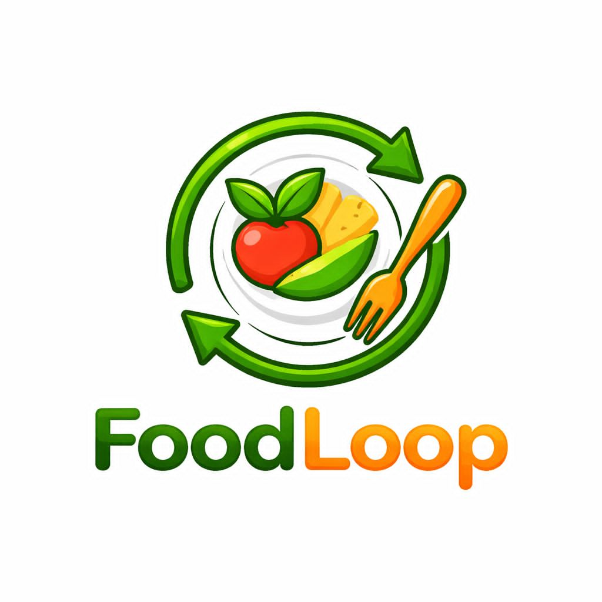
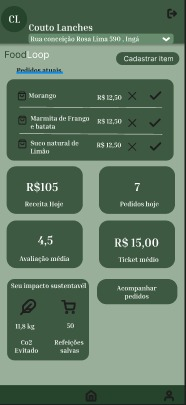

# Template padrão da aplicação

Pré-requisitos: <a href="02-Especificacao.md"> Especificação do projeto</a>, <a href="03-Metodologia.md"> Metodologia</a>, <a href="05-Projeto-interface.md"> Projeto de interface</a>

Esta seção define o layout padrão do aplicativo **FoodLoop**, detalhando a identidade visual, os aspectos de responsividade mobile e a iconografia. Abaixo, encontra-se o manual da marca e a demonstração da aplicação prática destas diretrizes em uma tela de exemplo.

---

## 1. Manual da Marca

### 1.1 Processo de Criação e Significado do Logo
O logo do FoodLoop foi desenhado para representar visualmente a intersecção entre alimentação e economia circular. O símbolo principal é composto por setas verdes contínuas formando um círculo (o "Loop"), simbolizando a redução do desperdício e a sustentabilidade. No centro, elementos figurativos como uma maçã, folhas verdes e um garfo alaranjado remetem diretamente à alimentação natural e de qualidade. A tipografia da marca mescla o verde e o laranja, equilibrando a seriedade do compromisso ambiental com a energia e o apetite do setor alimentício.

> **Logotipo Final:**
>  *(Visualizado no topo da tela de login)*

### 1.2 Uso Correto do Logotipo
O logotipo deve ser aplicado preferencialmente em sua versão original com o fundo branco circular quando alocado sobre os fundos verdes do aplicativo (Verde Floresta ou Verde Sálvia). Isso garante o contraste necessário e a leitura limpa de todos os elementos gráficos e do texto "FoodLoop".

### 1.3 Paleta de Cores
As cores do aplicativo criam um ambiente visual orgânico, acolhedor e sustentável. O contraste principal se dá entre o fundo claro e os cards de conteúdo em verde escuro, garantindo uma estética moderna e focada no conforto visual, com uma variação suave para a barra de navegação.

| Cor Primária (Cards e Header) | Cor Secundária (Navbar) | Cor de Destaque (Elementos) | Cor de Fundo (Background) | Cor de Texto |
| :---: | :---: | :---: | :---: | :---: |
| `#26432B` | `#334B35` | `#6E9274` | `#99AF99` | `#FFFFFF` / `#000000` |
| *Verde Floresta* | *Verde Musgo* | *Verde Sálvia* | *Verde Pastel* | *Branco e Preto* |

### 1.4 Tipografia
A tipografia do aplicativo faz um uso estratégico do contraste entre fontes Serifadas e Sem Serifa para hierarquizar a informação de forma elegante:
* **Títulos e Valores Numéricos (ex: R$ 105, Couto Lanches):** Uso de fonte **Serif** (Estilo Georgia/Times), conferindo um tom clássico, confiável e premium às métricas e nomes dos parceiros.
* **Corpo de Texto, Botões e Inputs:** Uso de fonte **Sans-serif** (Estilo Roboto/Inter) de peso Regular, priorizando a leiturabilidade em telas menores e garantindo um visual limpo.

---

## 2. Iconografia e Elementos Gráficos
A iconografia do FoodLoop é minimalista e utiliza traços escuros ou delineados (outline) para facilitar a identificação sem poluir a tela. 
* **Botões e Cards:** Todos os elementos interativos, caixas de texto e *cards* de fundo possuem bordas fortemente arredondadas (*border-radius* alto), transmitindo uma sensação de interface amigável e moderna.
* **Selos e Navegação:** Ícones padronizados (como o mapa dobrado, a casa, o usuário, folhas de CO2 e carrinho de compras) são dispostos em uma barra de navegação inferior sólida e em painéis de métricas.

---

## 3. Layout e Responsividade 
O layout foi estruturado com foco na usabilidade em dispositivos móveis (*Mobile-First*), dividindo a tela em áreas funcionais bem definidas:
* **Área Superior (Header):** Topo minimalista, contendo a identificação do usuário/estabelecimento (ex: círculo com as iniciais "CL" ou "GP"), título da tela ou botão de voltar em formato circular.
* **Área de Conteúdo (Body):** Utiliza o padrão de *Card-based Design*. As informações, formulários e métricas são agrupadas dentro de blocos arredondados flutuantes sobre o fundo claro.
* **Área Inferior (Navbar):** Barra de navegação fixa na base da tela (`position: fixed`), na mesma cor primária dos cards (`#334B35`), contendo os ícones de Mapa, Início (Home) e Perfil.

---

## 4. Tela de Exemplo (Template Aplicado)
Abaixo, a demonstração do *Dashboard* do Estabelecimento Parceiro, evidenciando como a paleta de cores verde-sobre-verde, a tipografia serifada nos títulos e os cards arredondados se comportam na prática.

> **Tela de Exemplo - Dashboard do Parceiro:**
> 
