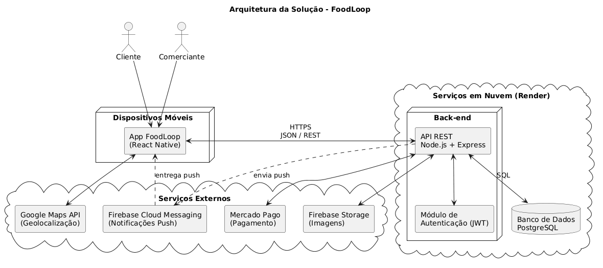
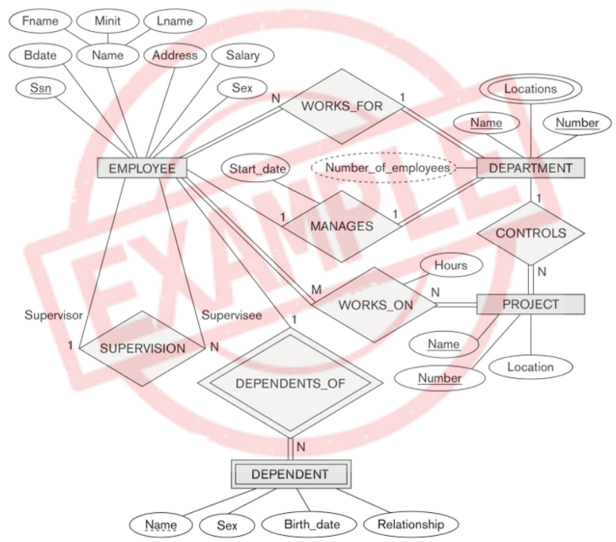
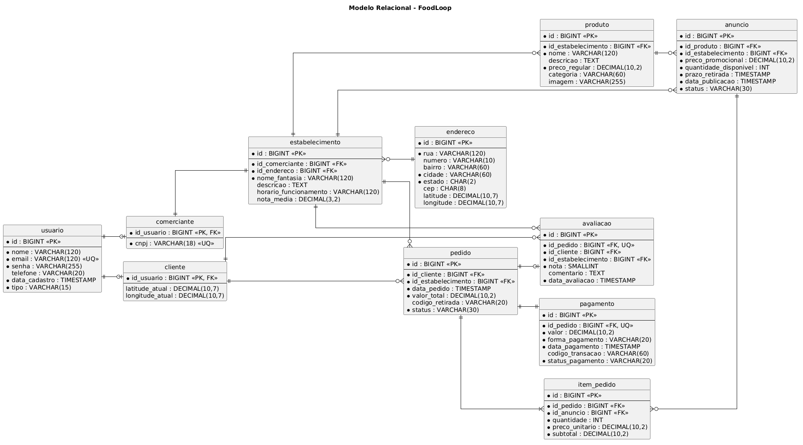

# Arquitetura da solução

##  Visão geral

A solução do FoodLoop adota uma arquitetura **cliente-servidor** baseada em três camadas principais: um **aplicativo mobile multiplataforma** no lado do cliente, uma **API REST** no lado do servidor e um **banco de dados relacional** responsável pela persistência das informações. A comunicação entre as camadas é realizada por meio do protocolo **HTTPS**, com troca de mensagens no formato **JSON**, e a autenticação dos usuários é mediada por **tokens JWT**.

Adicionalmente, a solução integra-se a um conjunto de **serviços externos especializados** — pagamento, geolocalização, armazenamento de mídia e notificações push — que ampliam as capacidades do sistema sem demandar desenvolvimento próprio dessas funcionalidades. Tal abordagem reduz a complexidade do back-end, encurta o ciclo de desenvolvimento e aumenta a confiabilidade dos componentes não centrais ao domínio do negócio.

##  Componentes da solução

###  Front-end (aplicativo mobile)

O aplicativo é desenvolvido em **React Native**, framework que permite a construção de uma única base de código compilada simultaneamente para os sistemas operacionais Android e iOS. Essa escolha reduz o esforço de desenvolvimento e manutenção e garante consistência visual entre as plataformas. O aplicativo atende aos dois perfis de usuário (cliente e comerciante), com telas e fluxos diferenciados de acordo com o tipo de conta autenticada.

###  Back-end (API REST)

O back-end é implementado em **Node.js com o framework Express**, expondo uma **API REST** que recebe requisições do aplicativo mobile e devolve respostas em JSON. A API é responsável pelas regras de negócio do FoodLoop, incluindo gestão de usuários, de estabelecimentos parceiros, de anúncios de excedente, de pedidos, de pagamentos e de avaliações. A autenticação dos usuários é tratada por um módulo dedicado, baseado no padrão **JWT (JSON Web Token)**, garantindo que cada requisição seja validada antes de acessar recursos protegidos.

###  Banco de dados

A persistência das informações é realizada em um banco **PostgreSQL**, sistema relacional robusto e de código aberto. O modelo relacional foi escolhido por refletir adequadamente a natureza estruturada do domínio (usuários, estabelecimentos, anúncios, pedidos e avaliações são entidades com relacionamentos bem definidos) e por oferecer recursos transacionais necessários ao registro de pedidos e pagamentos.

###  Serviços externos

A solução delega funcionalidades especializadas a serviços externos consolidados:

- **Firebase Storage** — armazenamento de imagens dos produtos anunciados e das fotos de perfil de usuários e comércios;
- **Mercado Pago** — gateway de pagamento responsável pelo processamento das transações financeiras (cartão de crédito e PIX);
- **Google Maps API** — fornecimento dos mapas, da geolocalização do cliente e das rotas até os estabelecimentos parceiros;
- **Firebase Cloud Messaging (FCM)** — envio de notificações push ao aplicativo, utilizadas para alertar clientes sobre novos anúncios próximos e o status de seus pedidos, bem como para informar comerciantes sobre novas reservas.

##  Ambiente de hospedagem

O back-end e o banco de dados são hospedados na plataforma **Render**, serviço de cloud que oferece **plano gratuito** suficiente para o ciclo de desenvolvimento e para a apresentação do projeto. A plataforma fornece deploy automatizado a partir do repositório Git, certificado SSL nativo e gerenciamento simplificado de variáveis de ambiente, reduzindo a complexidade operacional do projeto.

Os serviços externos (Firebase Storage, Firebase Cloud Messaging, Google Maps API e Mercado Pago) são consumidos diretamente de seus respectivos provedores, dispensando hospedagem própria. O aplicativo mobile, por sua vez, é executado nos dispositivos dos próprios usuários finais, distribuído por meio das lojas oficiais (Google Play Store e Apple App Store) ao final do ciclo de desenvolvimento.

##  Fluxo de comunicação entre os componentes

1. O usuário (cliente ou comerciante) interage com o **aplicativo mobile**;
2. O aplicativo envia requisições **HTTPS** à **API REST**, transportando dados em formato **JSON**;
3. A API valida o **token JWT** da requisição, processa a regra de negócio e consulta ou atualiza o **banco de dados PostgreSQL**;
4. Quando necessário, a API comunica-se com os **serviços externos** (Mercado Pago para pagamento, Firebase Storage para imagens, Firebase Cloud Messaging para envio de push);
5. O aplicativo também consome diretamente a **Google Maps API** para apresentar o mapa e a geolocalização;
6. A API devolve a resposta em **JSON**, e o aplicativo atualiza a interface apresentada ao usuário.

**Diagrama de arquitetura da solução FoodLoop**




##  Justificativas das escolhas arquiteturais

A arquitetura proposta atende aos seguintes critérios:

- **Multiplataforma com baixo custo de desenvolvimento:** o uso de React Native permite cobrir Android e iOS com uma única base de código;
- **Escalabilidade horizontal do back-end:** a separação entre front-end, back-end e banco viabiliza a evolução independente de cada camada;
- **Confiabilidade em funções não centrais:** a delegação de pagamento, mapas, armazenamento e notificações a provedores especializados elimina riscos técnicos significativos e reduz o esforço de desenvolvimento;
- **Custo zero na fase acadêmica:** todos os serviços propostos oferecem planos gratuitos compatíveis com o porte do projeto.
  


## Diagrama de Classes

##  Visão geral

O diagrama de classes apresenta a estrutura interna do sistema FoodLoop, mostrando quais são as classes do domínio, o que cada uma guarda, o que cada uma faz e como elas se conectam. Essas classes funcionam como o "molde" dos objetos que existem em memória quando o aplicativo está rodando, e correspondem diretamente às entidades que aparecem nos processos AS-IS e TO-BE.

A modelagem usa notação UML e contempla herança, agregação, composição e enumerações para representar os conjuntos de valores fixos manipulados pelo sistema.

##  Classes do domínio

###  Usuários

A classe Usuario é abstrata e reúne o que todo perfil de usuário tem em comum: identificador, nome, e-mail, senha, telefone e data de cadastro, além das operações de autenticação e atualização de perfil. Dela derivam dois tipos concretos de usuário.

A classe Cliente representa o consumidor que usa o aplicativo para encontrar comércios, comprar produtos com desconto e avaliar a experiência. Guarda também a localização atual, que serve para mostrar os estabelecimentos próximos no mapa.

A classe Comerciante representa o dono ou responsável pelo comércio parceiro. Guarda o CNPJ e é quem publica os anúncios e acompanha os pedidos recebidos.

###  Estabelecimento e endereço

A classe Estabelecimento descreve o comércio parceiro: nome fantasia, descrição, horário de funcionamento e a nota média calculada a partir das avaliações. Cada estabelecimento tem um Endereco vinculado, com os dados físicos e as coordenadas geográficas usadas pelo mapa do aplicativo.

###  Produto e anúncio

A classe Produto representa o item do cardápio do comércio, com nome, descrição, preço regular, categoria e imagem. Já a classe Anuncio representa uma oferta promocional sobre um produto específico que está sobrando, com preço promocional, quantidade disponível, prazo de retirada e status atual. Um mesmo produto pode aparecer em vários anúncios ao longo do tempo, mas cada anúncio fala de um produto só.

###  Pedido, item de pedido e pagamento

Quando o cliente compra um ou mais anúncios, o sistema cria um Pedido. Esse pedido pertence a um único cliente e agrupa os ItemPedido, que detalham quantidade, preço unitário e subtotal de cada item comprado. Para cada pedido existe também um Pagamento, que registra valor, forma de pagamento, código da transação e status — pendente, aprovado ou recusado.

### Avaliação

A classe Avaliacao guarda o feedback que o cliente deixa depois de retirar o pedido. Cada avaliação fica ligada ao pedido que a originou e ao estabelecimento avaliado, com nota, comentário opcional e data. Essa ligação é o que permite calcular a nota média do estabelecimento e dar rastreabilidade ao feedback.

##  Enumerações

O modelo usa quatro enumerações para padronizar os valores fixos:

- StatusAnuncio (ATIVO, ENCERRADO_COM_RESERVA, ENCERRADO_COM_SOBRA) representa o ciclo de vida do anúncio;
- StatusPedido (RECEBIDO, EM_PREPARO, PRONTO_PARA_RETIRADA, RETIRADO, CANCELADO) representa as etapas do pedido;
- FormaPagamento (CARTAO_CREDITO, PIX) descreve os meios de pagamento aceitos;
- StatusPagamento (PENDENTE, APROVADO, RECUSADO) representa o resultado do processamento financeiro.

##  Relacionamentos principais

A herança entre Usuario, Cliente e Comerciante evita repetir os campos comuns de cadastro. A relação um-para-um entre Comerciante e Estabelecimento traduz a regra de que cada comerciante administra apenas um comércio no FoodLoop. A composição entre Pedido e ItemPedido indica que os itens só fazem sentido dentro do pedido — se o pedido deixa de existir, os itens também deixam. As relações um-para-muitos cobrem as situações naturais: um estabelecimento publica vários anúncios, um cliente faz vários pedidos, um estabelecimento recebe várias avaliações.

Diagrama de classes do sistema FoodLoop


##  Modelo de dados

O desenvolvimento da solução proposta requer a existência de bases de dados que permitam realizar o cadastro de dados e os controles associados aos processos identificados, assim como suas recuperações.

### Modelo conceitual 

O Diagrama Entidade-Relacionamento (DER), em notação Peter Chen, representa de forma conceitual como as entidades (objetos ou conceitos do minimundo) se relacionam entre si. O DER deve incluir entidades, atributos, relacionamentos, cardinalidade, conforme as regras do minimundo. Deve ser elaborado um único DER que suporte todos os processos mapeados, de modo a garantir uma base de dados integrada. O modelo também deve representar, quando aplicável, o controle de acesso dos usuários (partes interessadas nos processos) de acordo com os papéis definidos nos modelos de processo de negócio.

Elabore o modelo utilizando uma ferramenta de modelagem apropriada.


---

> **Links úteis**:
> - [Notação de Peter Chen para modelagem conceitual de banco de dados](https://www.youtube.com/watch?v=_y31cFi_ByY)
> - [Como fazer um diagrama entidade-relacionamento](https://www.lucidchart.com/pages/pt/como-fazer-um-diagrama-entidade-relacionamento)

### Modelo relacional




### Modelo físico

Insira aqui o script de criação das tabelas do banco de dados.

Veja um exemplo:

```sql
CREATE TABLE employees (
    emp_no      INT             NOT NULL,
    birth_date  DATE            NOT NULL,
    first_name  VARCHAR(14)     NOT NULL,
    last_name   VARCHAR(16)     NOT NULL,
    gender      ENUM ('M','F')  NOT NULL,    
    hire_date   DATE            NOT NULL,
    PRIMARY KEY (emp_no)
);

CREATE TABLE departments (
    dept_no     CHAR(4)         NOT NULL,
    dept_name   VARCHAR(40)     NOT NULL,
    PRIMARY KEY (dept_no),
    UNIQUE  KEY (dept_name)
);

CREATE TABLE dept_manager (
   emp_no       INT             NOT NULL,
   dept_no      CHAR(4)         NOT NULL,
   from_date    DATE            NOT NULL,
   to_date      DATE            NOT NULL,
   FOREIGN KEY (emp_no)  REFERENCES employees (emp_no)    ON DELETE CASCADE,
   FOREIGN KEY (dept_no) REFERENCES departments (dept_no) ON DELETE CASCADE,
   PRIMARY KEY (emp_no,dept_no)
); 

CREATE TABLE dept_emp (
    emp_no      INT             NOT NULL,
    dept_no     CHAR(4)         NOT NULL,
    from_date   DATE            NOT NULL,
    to_date     DATE            NOT NULL,
    FOREIGN KEY (emp_no)  REFERENCES employees   (emp_no)  ON DELETE CASCADE,
    FOREIGN KEY (dept_no) REFERENCES departments (dept_no) ON DELETE CASCADE,
    PRIMARY KEY (emp_no,dept_no)
);

CREATE TABLE titles (
    emp_no      INT             NOT NULL,
    title       VARCHAR(50)     NOT NULL,
    from_date   DATE            NOT NULL,
    to_date     DATE,
    FOREIGN KEY (emp_no) REFERENCES employees (emp_no) ON DELETE CASCADE,
    PRIMARY KEY (emp_no,title, from_date)
); 

CREATE TABLE salaries (
    emp_no      INT             NOT NULL,
    salary      INT             NOT NULL,
    from_date   DATE            NOT NULL,
    to_date     DATE            NOT NULL,
    FOREIGN KEY (emp_no) REFERENCES employees (emp_no) ON DELETE CASCADE,
    PRIMARY KEY (emp_no, from_date)
); 

CREATE OR REPLACE VIEW dept_emp_latest_date AS
    SELECT emp_no, MAX(from_date) AS from_date, MAX(to_date) AS to_date
    FROM dept_emp
    GROUP BY emp_no;

-- Shows only the current department for each employee
CREATE OR REPLACE VIEW current_dept_emp AS
    SELECT l.emp_no, dept_no, l.from_date, l.to_date
    FROM dept_emp d
        INNER JOIN dept_emp_latest_date l
        ON d.emp_no=l.emp_no AND d.from_date=l.from_date AND l.to_date = d.to_date;
```
Esse script deverá ser incluído em um arquivo .sql na pasta [de scripts SQL](../src/db).


## Tecnologias

Descreva as tecnologias utilizadas para implementar a solução proposta. Liste todas as tecnologias envolvidas, incluindo linguagens de programação, frameworks, bibliotecas, serviços web, IDEs, ferramentas de apoio e quaisquer outros recursos relevantes para o desenvolvimento.  

Apresente também um diagrama ou figura que ilustre a visão operacional, mostrando como as tecnologias interagem entre si durante o uso do sistema, desde a ação do usuário até a obtenção da resposta.

| **Dimensão**   | **Tecnologia**  |
| ---            | ---             |
| Front-end      | HTML + CSS + JS + React |
| Back-end       | Node.js         |
| SGBD           | MySQL           |
| Deploy         | Vercel          |


## Hospedagem

Explique como a hospedagem e o lançamento da plataforma foram realizados.

> **Links úteis**:
> - [Website com GitHub Pages](https://pages.github.com/)
> - [Programação colaborativa com Repl.it](https://repl.it/)
> - [Getting started with Heroku](https://devcenter.heroku.com/start)
> - [Publicando seu site no Heroku](http://pythonclub.com.br/publicando-seu-hello-world-no-heroku.html)

## Qualidade de software


## Visão geral

Para orientar o desenvolvimento do FoodLoop, a equipe selecionou subcaracterísticas da norma ISO/IEC 25010 que dialogam diretamente com os requisitos funcionais e não funcionais do projeto. A norma define oito características (Adequação Funcional, Eficiência de Desempenho, Compatibilidade, Usabilidade, Confiabilidade, Segurança, Manutenibilidade e Portabilidade) e trinta subcaracterísticas no total.

Foram escolhidas seis características e sete subcaracterísticas, cobrindo o que se considera essencial para um aplicativo mobile que envolve transações financeiras, geolocalização em tempo real e disponibilidade nos horários comerciais críticos. Cada subcaracterística está vinculada a um ou mais requisitos do projeto, com uma métrica concreta que permitirá à equipe avaliar o atendimento da qualidade ao longo das sprints.

## Subcaracterísticas selecionadas

### Adequação Funcional — Completude Funcional

O FoodLoop precisa entregar fluxos críticos para dois perfis distintos (consumidor e estabelecimento), do cadastro à avaliação. A completude funcional garante que o produto cubra de fato o conjunto de requisitos acordados, evitando lacunas que comprometam a operação real do aplicativo.

Requisitos amarrados: RF-001 a RF-012.

Métrica: percentual de requisitos funcionais entregues e validados pela equipe ao final de cada sprint. Meta: 100% dos RFs com prioridade ALTA e MÉDIA entregues até a sprint final; RFs BAIXA podem ficar como melhoria pós-projeto.

### Eficiência de Desempenho — Comportamento em Relação ao Tempo

O fluxo principal do aplicativo passa por carregamento de mapa com ofertas geolocalizadas e processamento de transações em tempo real. Tempo de resposta ruim significa abandono antes da reserva, justamente o gargalo que o app pretende resolver.

Requisitos amarrados: RNF-004 (carregamento do mapa em até 3 segundos) e RF-003 (listagem com filtros de geolocalização).

Métrica: tempo médio de carregamento do mapa com até 50 ofertas ativas e tempo médio de resposta das requisições à API. Meta: até 3 segundos para o mapa e até 500 milissegundos para chamadas REST simples, medido em ambiente de homologação com conexão 4G.

### Usabilidade — Operabilidade e Apreensibilidade

O público-alvo inclui usuários com diferentes graus de familiaridade com tecnologia, em especial do lado dos comerciantes (lanchonetes, padarias, pequenos comércios). O aplicativo precisa ser fácil de aprender e operar sem treinamento prévio.

Requisitos amarrados: RF-001 (cadastro e login), RF-002 (CRUD de ofertas pelo comerciante), RF-003 (busca e filtros pelo consumidor) e RF-008 (avaliação após retirada).

Métrica: pontuação no questionário SUS (System Usability Scale) aplicado em testes com usuários representativos das duas personas, e tempo médio para completar três tarefas-chave (cadastrar oferta, realizar reserva, avaliar pedido). Meta: SUS maior ou igual a 70 e cada tarefa concluída em até 2 minutos por um usuário novo.

### Confiabilidade — Disponibilidade

O pico de uso do FoodLoop coincide com o fim do expediente comercial, momento em que os estabelecimentos publicam ofertas para escoar excedentes. Indisponibilidade nessa janela inviabiliza o uso principal do app.

Requisitos amarrados: RNF-005 (99% de disponibilidade no horário de pico, 18h às 22h).

Métrica: uptime mensal medido pelo painel de monitoramento da plataforma de hospedagem. Meta: pelo menos 99% no intervalo das 18h às 22h e 95% no restante do dia.

### Segurança — Confidencialidade e Integridade

O aplicativo processa pagamentos e armazena dados pessoais (e-mail, telefone, CPF de cadastro, histórico de pedidos e dados de comerciantes). A confidencialidade protege o que não deve ser visto por terceiros; a integridade garante que os dados não sejam adulterados em trânsito ou em repouso. As duas são fundamentais para a confiança do usuário e para a legitimidade das transações financeiras.

Requisitos amarrados: RNF-002 (Firebase Auth para autenticação), RNF-003 (criptografia ponta a ponta nos pagamentos), RF-004 (processamento de reserva e pagamento) e RF-011 (cálculo e retenção automática da comissão da plataforma).

Métrica: percentual de transações financeiras transmitidas via HTTPS com criptografia ativa; número de incidentes de acesso não autorizado por sprint; validação dos hashes de senha gerados pelo Firebase Auth. Meta: 100% das transações criptografadas, zero incidentes de acesso indevido e 100% dos cadastros usando autenticação válida.

### Compatibilidade — Coexistência

O RNF-001 determina que o aplicativo será construído em React Native, com publicação simultânea nas lojas Android e iOS. A subcaracterística de coexistência cobre a necessidade de o app operar bem ao lado de outros aplicativos no dispositivo, sem competir por recursos a ponto de degradar a experiência.

Requisitos amarrados: RNF-001 (compatibilidade Android e iOS via React Native).

Métrica: percentual de telas críticas (login, mapa, reserva, pagamento e avaliação) renderizadas corretamente nos dois sistemas operacionais, em pelo menos um dispositivo de cada gama (entrada e intermediário) por SO. Meta: 100% de equivalência funcional e visual nas telas críticas.

## Síntese das métricas

 Métricas de qualidade do FoodLoop

| Característica | Subcaracterística | Métrica | Meta |
|---|---|---|---|
| Adequação Funcional | Completude funcional | RFs entregues e validados | 100% dos RFs ALTA e MÉDIA |
| Eficiência de Desempenho | Comportamento em relação ao tempo | tempo de carregamento do mapa | até 3 segundos |
| Eficiência de Desempenho | Comportamento em relação ao tempo | tempo de resposta da API | até 500 ms |
| Usabilidade | Operabilidade e apreensibilidade | pontuação SUS | maior ou igual a 70 |
| Usabilidade | Operabilidade e apreensibilidade | tempo para concluir tarefa-chave | até 2 minutos |
| Confiabilidade | Disponibilidade | uptime das 18h às 22h | maior ou igual a 99% |
| Segurança | Confidencialidade e integridade | transações criptografadas via HTTPS | 100% |
| Segurança | Confidencialidade e integridade | incidentes de acesso não autorizado | zero por sprint |
| Compatibilidade | Coexistência | telas críticas equivalentes em Android e iOS | 100% |


