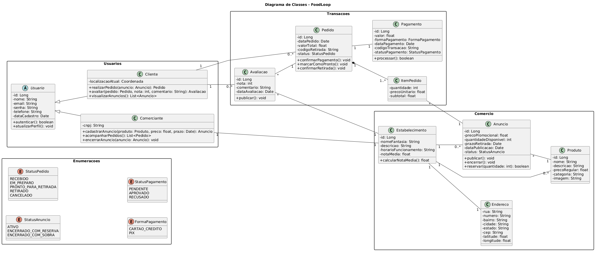

# Arquitetura da solução

##  Visão geral

A solução do FoodLoop adota uma arquitetura **cliente-servidor** baseada em três camadas principais: um **aplicativo mobile multiplataforma** no lado do cliente, uma **API REST** no lado do servidor e um **banco de dados relacional** responsável pela persistência das informações. A comunicação entre as camadas é realizada por meio do protocolo **HTTPS**, com troca de mensagens no formato **JSON**, e a autenticação dos usuários é mediada por **tokens JWT**.

Adicionalmente, a solução integra-se a um conjunto de **serviços externos especializados** — pagamento, geolocalização, armazenamento de mídia e notificações push — que ampliam as capacidades do sistema sem demandar desenvolvimento próprio dessas funcionalidades. Tal abordagem reduz a complexidade do back-end, encurta o ciclo de desenvolvimento e aumenta a confiabilidade dos componentes não centrais ao domínio do negócio.

##  Componentes da solução

###  Front-end (aplicativo mobile)

O aplicativo é desenvolvido em **React Native**, framework que permite a construção de uma única base de código compilada simultaneamente para os sistemas operacionais Android e iOS. Essa escolha reduz o esforço de desenvolvimento e manutenção e garante consistência visual entre as plataformas. O aplicativo atende aos dois perfis de usuário (cliente e comerciante), com telas e fluxos diferenciados de acordo com o tipo de conta autenticada.

###  Back-end (API REST)

O back-end é implementado em **Node.js com o framework Express**, expondo uma **API REST** que recebe requisições do aplicativo mobile e devolve respostas em JSON. A API é responsável pelas regras de negócio do FoodLoop, incluindo gestão de usuários, de estabelecimentos parceiros, de anúncios de excedente, de pedidos, de pagamentos e de avaliações. A autenticação dos usuários é tratada por um módulo dedicado, baseado no padrão **JWT (JSON Web Token)**, garantindo que cada requisição seja validada antes de acessar recursos protegidos.

###  Banco de dados

A persistência das informações é realizada em um banco **PostgreSQL**, sistema relacional robusto e de código aberto. O modelo relacional foi escolhido por refletir adequadamente a natureza estruturada do domínio (usuários, estabelecimentos, anúncios, pedidos e avaliações são entidades com relacionamentos bem definidos) e por oferecer recursos transacionais necessários ao registro de pedidos e pagamentos.

###  Serviços externos

A solução delega funcionalidades especializadas a serviços externos consolidados:

- **Firebase Storage** — armazenamento de imagens dos produtos anunciados e das fotos de perfil de usuários e comércios;
- **Mercado Pago** — gateway de pagamento responsável pelo processamento das transações financeiras (cartão de crédito e PIX);
- **Google Maps API** — fornecimento dos mapas, da geolocalização do cliente e das rotas até os estabelecimentos parceiros;
- **Firebase Cloud Messaging (FCM)** — envio de notificações push ao aplicativo, utilizadas para alertar clientes sobre novos anúncios próximos e o status de seus pedidos, bem como para informar comerciantes sobre novas reservas.

##  Ambiente de hospedagem

O back-end e o banco de dados são hospedados na plataforma **Render**, serviço de cloud que oferece **plano gratuito** suficiente para o ciclo de desenvolvimento e para a apresentação do projeto. A plataforma fornece deploy automatizado a partir do repositório Git, certificado SSL nativo e gerenciamento simplificado de variáveis de ambiente, reduzindo a complexidade operacional do projeto.

Os serviços externos (Firebase Storage, Firebase Cloud Messaging, Google Maps API e Mercado Pago) são consumidos diretamente de seus respectivos provedores, dispensando hospedagem própria. O aplicativo mobile, por sua vez, é executado nos dispositivos dos próprios usuários finais, distribuído por meio das lojas oficiais (Google Play Store e Apple App Store) ao final do ciclo de desenvolvimento.

##  Fluxo de comunicação entre os componentes

1. O usuário (cliente ou comerciante) interage com o **aplicativo mobile**;
2. O aplicativo envia requisições **HTTPS** à **API REST**, transportando dados em formato **JSON**;
3. A API valida o **token JWT** da requisição, processa a regra de negócio e consulta ou atualiza o **banco de dados PostgreSQL**;
4. Quando necessário, a API comunica-se com os **serviços externos** (Mercado Pago para pagamento, Firebase Storage para imagens, Firebase Cloud Messaging para envio de push);
5. O aplicativo também consome diretamente a **Google Maps API** para apresentar o mapa e a geolocalização;
6. A API devolve a resposta em **JSON**, e o aplicativo atualiza a interface apresentada ao usuário.

**Diagrama de arquitetura da solução FoodLoop**


##  Justificativas das escolhas arquiteturais

A arquitetura proposta atende aos seguintes critérios:

- **Multiplataforma com baixo custo de desenvolvimento:** o uso de React Native permite cobrir Android e iOS com uma única base de código;
- **Escalabilidade horizontal do back-end:** a separação entre front-end, back-end e banco viabiliza a evolução independente de cada camada;
- **Confiabilidade em funções não centrais:** a delegação de pagamento, mapas, armazenamento e notificações a provedores especializados elimina riscos técnicos significativos e reduz o esforço de desenvolvimento;
- **Custo zero na fase acadêmica:** todos os serviços propostos oferecem planos gratuitos compatíveis com o porte do projeto.
  


## Diagrama de Classes

##  Visão geral

O diagrama de classes apresenta a estrutura interna do sistema FoodLoop, mostrando quais são as classes do domínio, o que cada uma guarda, o que cada uma faz e como elas se conectam. Essas classes funcionam como o "molde" dos objetos que existem em memória quando o aplicativo está rodando, e correspondem diretamente às entidades que aparecem nos processos AS-IS e TO-BE.

A modelagem usa notação UML e contempla herança, agregação, composição e enumerações para representar os conjuntos de valores fixos manipulados pelo sistema.

##  Classes do domínio

###  Usuários

A classe Usuario é abstrata e reúne o que todo perfil de usuário tem em comum: identificador, nome, e-mail, senha, telefone e data de cadastro, além das operações de autenticação e atualização de perfil. Dela derivam dois tipos concretos de usuário.

A classe Cliente representa o consumidor que usa o aplicativo para encontrar comércios, comprar produtos com desconto e avaliar a experiência. Guarda também a localização atual, que serve para mostrar os estabelecimentos próximos no mapa.

A classe Comerciante representa o dono ou responsável pelo comércio parceiro. Guarda o CNPJ e é quem publica os anúncios e acompanha os pedidos recebidos.

###  Estabelecimento e endereço

A classe Estabelecimento descreve o comércio parceiro: nome fantasia, descrição, horário de funcionamento e a nota média calculada a partir das avaliações. Cada estabelecimento tem um Endereco vinculado, com os dados físicos e as coordenadas geográficas usadas pelo mapa do aplicativo.

###  Produto e anúncio

A classe Produto representa o item do cardápio do comércio, com nome, descrição, preço regular, categoria e imagem. Já a classe Anuncio representa uma oferta promocional sobre um produto específico que está sobrando, com preço promocional, quantidade disponível, prazo de retirada e status atual. Um mesmo produto pode aparecer em vários anúncios ao longo do tempo, mas cada anúncio fala de um produto só.

###  Pedido, item de pedido e pagamento

Quando o cliente compra um ou mais anúncios, o sistema cria um Pedido. Esse pedido pertence a um único cliente e agrupa os ItemPedido, que detalham quantidade, preço unitário e subtotal de cada item comprado. Para cada pedido existe também um Pagamento, que registra valor, forma de pagamento, código da transação e status — pendente, aprovado ou recusado.

### Avaliação

A classe Avaliacao guarda o feedback que o cliente deixa depois de retirar o pedido. Cada avaliação fica ligada ao pedido que a originou e ao estabelecimento avaliado, com nota, comentário opcional e data. Essa ligação é o que permite calcular a nota média do estabelecimento e dar rastreabilidade ao feedback.

##  Enumerações

O modelo usa quatro enumerações para padronizar os valores fixos:

- StatusAnuncio (ATIVO, ENCERRADO_COM_RESERVA, ENCERRADO_COM_SOBRA) representa o ciclo de vida do anúncio;
- StatusPedido (RECEBIDO, EM_PREPARO, PRONTO_PARA_RETIRADA, RETIRADO, CANCELADO) representa as etapas do pedido;
- FormaPagamento (CARTAO_CREDITO, PIX) descreve os meios de pagamento aceitos;
- StatusPagamento (PENDENTE, APROVADO, RECUSADO) representa o resultado do processamento financeiro.

##  Relacionamentos principais

A herança entre Usuario, Cliente e Comerciante evita repetir os campos comuns de cadastro. A relação um-para-um entre Comerciante e Estabelecimento traduz a regra de que cada comerciante administra apenas um comércio no FoodLoop. A composição entre Pedido e ItemPedido indica que os itens só fazem sentido dentro do pedido — se o pedido deixa de existir, os itens também deixam. As relações um-para-muitos cobrem as situações naturais: um estabelecimento publica vários anúncios, um cliente faz vários pedidos, um estabelecimento recebe várias avaliações.

Diagrama de classes do sistema FoodLoop




##  Modelo de dados

O desenvolvimento da solução proposta requer a existência de bases de dados que permitam realizar o cadastro de dados e os controles associados aos processos identificados, assim como suas recuperações.

### Modelo conceitual

O Diagrama Entidade-Relacionamento (DER) do FoodLoop foi elaborado em notação **Peter Chen** e cobre todos os processos modelados em [04-Modelagem dos processos de negócio](04-Modelagem-processos-negocio.md), garantindo uma base de dados integrada para os perfis de Consumidor e Estabelecimento Parceiro.

#### Entidades

| Entidade | Função no minimundo |
|---|---|
| **Usuario** (abstrata) | Atributos comuns a todo perfil de usuário (login, contato, foto). |
| **Cliente** | Subtipo de Usuario. Consumidor que descobre, compra e avalia. |
| **Comerciante** | Subtipo de Usuario. Responsável pelo estabelecimento parceiro. |
| **Estabelecimento** | Comércio parceiro cadastrado no sistema. |
| **Endereco** | Endereço físico e coordenadas geográficas do estabelecimento. |
| **Produto** | Item do cardápio do estabelecimento. |
| **Anuncio** | Oferta de excedente publicada pelo comerciante a partir de um produto. |
| **Pedido** | Compra realizada por um cliente em um estabelecimento. |
| **ItemPedido** | Cada linha de anúncio dentro de um pedido. |
| **Pagamento** | Transação financeira vinculada a um único pedido. |
| **Avaliacao** | Feedback do cliente após retirar o pedido. |
| **DeviceToken** | Tokens FCM dos dispositivos do usuário, usados para envio de push. |
| **Notificacao** | Histórico das notificações enviadas, com suporte a deep link. |
| **PreferenciaNotificacao** | Preferências de alerta por tipo, por usuário. |

#### Herança

A entidade `Usuario` é abstrata e o atributo `tipo` discrimina o subtipo:

```
Usuario (abstrata)
  ├── Cliente
  └── Comerciante
```

#### Atributos por entidade

**Usuario**: `id` (PK), `nome`, `email` (único), `senha_hash`, `telefone`, `tipo` (cliente|comerciante), `foto_url`, `data_cadastro`, `ativo`.

**Cliente**: `id_usuario` (PK, FK → Usuario), `latitude_atual`, `longitude_atual`.

**Comerciante**: `id_usuario` (PK, FK → Usuario), `cnpj` (único).

**Estabelecimento**: `id` (PK), `id_comerciante` (FK, único), `id_endereco` (FK, único), `nome_fantasia`, `descricao`, `horario_funcionamento`, `nota_media`, `logo_url`, `ativo`.

**Endereco**: `id` (PK), `rua`, `numero`, `bairro`, `cidade`, `estado`, `cep`, `latitude`, `longitude`.

**Produto**: `id` (PK), `id_estabelecimento` (FK), `nome`, `descricao`, `preco_regular`, `categoria`, `imagem`, `ativo`.

**Anuncio**: `id` (PK), `id_produto` (FK), `id_estabelecimento` (FK), `preco_promocional`, `quantidade_inicial`, `quantidade_disponivel`, `quantidade_sobra`, `prazo_retirada`, `data_publicacao`, `status`.

**Pedido**: `id` (PK), `id_cliente` (FK), `id_estabelecimento` (FK), `data_pedido`, `valor_total`, `taxa_comissao`, `valor_comissao`, `codigo_retirada` (único), `status`, `cancelado_por`, `motivo_cancelamento`, `data_cancelamento`.

**ItemPedido**: `id` (PK), `id_pedido` (FK), `id_anuncio` (FK), `quantidade`, `preco_unitario`, `subtotal` (calculado).

**Pagamento**: `id` (PK), `id_pedido` (FK, único), `valor`, `forma_pagamento`, `data_pagamento`, `codigo_transacao`, `status_pagamento`.

**Avaliacao**: `id` (PK), `id_pedido` (FK, único), `id_estabelecimento` (FK), `nota` (1 a 5), `comentario` (até 500 caracteres), `data_avaliacao`.

**DeviceToken**: `id` (PK), `id_usuario` (FK), `token` (único), `plataforma`, `data_registro`.

**Notificacao**: `id` (PK), `id_usuario` (FK), `titulo`, `corpo`, `deep_link`, `lida`, `data_envio`.

**PreferenciaNotificacao**: `id` (PK), `id_usuario` (FK, único), `novos_anuncios_proximos`, `status_pedido`, `promocoes`.

#### Relacionamentos e cardinalidades

| Entidades | Cardinalidade | Observação |
|---|:---:|---|
| Usuario – Cliente | 1:1 | Herança |
| Usuario – Comerciante | 1:1 | Herança |
| Comerciante – Estabelecimento | 1:1 | Um comerciante administra um único estabelecimento |
| Estabelecimento – Endereco | 1:1 | Composição |
| Estabelecimento – Produto | 1:N | — |
| Produto – Anuncio | 1:N | Um produto pode aparecer em vários anúncios ao longo do tempo |
| Estabelecimento – Anuncio | 1:N | — |
| Cliente – Pedido | 1:N | — |
| Estabelecimento – Pedido | 1:N | — |
| Pedido – ItemPedido | 1:N | Composição |
| Anuncio – ItemPedido | 1:N | — |
| Pedido – Pagamento | 1:1 | Composição |
| Pedido – Avaliacao | 1:0..1 | Uma avaliação opcional por pedido |
| Estabelecimento – Avaliacao | 1:N | — |
| Usuario – DeviceToken | 1:N | Um usuário pode ter vários dispositivos |
| Usuario – Notificacao | 1:N | — |
| Usuario – PreferenciaNotificacao | 1:1 | — |

#### Enumerações

- **tipo_usuario**: `cliente`, `comerciante`
- **status_anuncio**: `ATIVO`, `ENCERRADO_COM_RESERVA`, `ENCERRADO_COM_SOBRA`
- **status_pedido**: `RECEBIDO`, `EM_PREPARO`, `PRONTO_PARA_RETIRADA`, `RETIRADO`, `CANCELADO`
- **forma_pagamento**: `CARTAO_CREDITO`, `PIX`
- **status_pagamento**: `PENDENTE`, `APROVADO`, `RECUSADO`
- **origem_cancelamento**: `CLIENTE`, `COMERCIANTE`, `SISTEMA`

> **Diagrama:** o DER do FoodLoop em notação Peter Chen está disponível em `docs/images/modelo_conceitual.png` (a ser publicado pela equipe a partir do desenho elaborado em ferramenta de modelagem).

### Modelo relacional

O modelo lógico em notação Pé de Galinha (Crow's Foot) traduz o DER conceitual para o esquema relacional implementado no PostgreSQL. O mapeamento aplicou as seguintes decisões:

- **Herança Usuario → Cliente / Comerciante** foi implementada por **tabelas separadas com chave primária compartilhada** (`cliente.id_usuario` e `comerciante.id_usuario` referenciam `usuario.id`), preservando integridade e permitindo evolução independente dos atributos de cada subtipo;
- **Composições** (`Pedido → ItemPedido`, `Pedido → Pagamento`, `Estabelecimento → Endereco`) usam `ON DELETE CASCADE` ou `RESTRICT` conforme a regra de negócio;
- **Restrições de unicidade** garantem regras como "um e-mail por usuário" (`uq_usuario_email`), "um CNPJ por comerciante" (`uq_comerciante_cnpj`), "um estabelecimento por comerciante" (`uq_estab_comerciante`), "um pagamento por pedido" (`uq_pagamento_pedido`) e "uma avaliação por pedido" (`uq_avaliacao_pedido`);
- **Restrições CHECK** validam domínios de valor (`nota_media` entre 0 e 5, `nota` da avaliação entre 1 e 5, preços e quantidades positivos, `prazo_retirada > data_publicacao`, coerência do cancelamento) diretamente no banco;
- **Enumerações** do DER conceitual viraram tipos `ENUM` nativos do PostgreSQL, padronizando os valores aceitos sem depender da camada de aplicação.

| Tabela | PK | Chaves estrangeiras | Restrições principais |
|---|---|---|---|
| `usuario` | `id` | — | `email` único; `tipo` ∈ {cliente, comerciante} |
| `cliente` | `id_usuario` | → `usuario` | Herança 1:1 |
| `comerciante` | `id_usuario` | → `usuario` | Herança 1:1; `cnpj` único |
| `endereco` | `id` | — | Coordenadas obrigatórias |
| `estabelecimento` | `id` | → `comerciante`, → `endereco` | `id_comerciante` e `id_endereco` únicos; `nota_media` ∈ [0, 5] |
| `produto` | `id` | → `estabelecimento` | `preco_regular > 0` |
| `anuncio` | `id` | → `produto`, → `estabelecimento` | Quantidades não-negativas; `prazo_retirada > data_publicacao` |
| `pedido` | `id` | → `cliente`, → `estabelecimento` | `codigo_retirada` único; coerência do cancelamento |
| `item_pedido` | `id` | → `pedido`, → `anuncio` | `subtotal` gerado (`quantidade × preco_unitario`) |
| `pagamento` | `id` | → `pedido` | `id_pedido` único (1:1) |
| `avaliacao` | `id` | → `pedido`, → `estabelecimento` | `id_pedido` único; `nota` entre 1 e 5 |
| `device_token` | `id` | → `usuario` | `token` único; `plataforma` ∈ {android, ios} |
| `notificacao` | `id` | → `usuario` | — |
| `preferencia_notificacao` | `id` | → `usuario` | `id_usuario` único (1:1) |


### Modelo físico

O modelo físico foi implementado em **PostgreSQL 16** e está versionado em [`src/db/`](../src/db). O script principal cria os tipos enumerados, as 13 tabelas com suas restrições (PK, FK, UNIQUE, CHECK), os índices de apoio às consultas mais frequentes e dois triggers de manutenção:

- **`trg_nota_media`** — recalcula `estabelecimento.nota_media` a cada `INSERT/UPDATE/DELETE` em `avaliacao`;
- **`trg_controle_estoque`** — devolve `quantidade_disponivel` ao anúncio sempre que um pedido transita para `CANCELADO`.

| Arquivo | Conteúdo |
|---|---|
| [`src/db/schema.sql`](../src/db/schema.sql) | DDL completo (tipos, tabelas, índices, restrições e triggers). |
| [`src/db/seed.sql`](../src/db/seed.sql) | Dados de teste cobrindo um pedido concluído com avaliação e um pedido cancelado pelo sistema. |

Trecho ilustrativo da DDL — entidade `pedido`, com a coerência do cancelamento garantida no banco:

```sql
CREATE TABLE pedido (
    id                    BIGSERIAL              PRIMARY KEY,
    id_cliente            BIGINT                 NOT NULL,
    id_estabelecimento    BIGINT                 NOT NULL,
    data_pedido           TIMESTAMP              NOT NULL DEFAULT NOW(),
    valor_total           NUMERIC(10,2)          NOT NULL,
    taxa_comissao         NUMERIC(5,2)           NOT NULL DEFAULT 0.00,
    valor_comissao        NUMERIC(10,2)          NOT NULL DEFAULT 0.00,
    codigo_retirada       VARCHAR(20)            NOT NULL,
    status                status_pedido          NOT NULL DEFAULT 'RECEBIDO',
    cancelado_por         origem_cancelamento,
    motivo_cancelamento   TEXT,
    data_cancelamento     TIMESTAMP,
    CONSTRAINT uq_pedido_codigo_retirada UNIQUE (codigo_retirada),
    CONSTRAINT fk_pedido_cliente
        FOREIGN KEY (id_cliente) REFERENCES cliente (id_usuario) ON DELETE RESTRICT,
    CONSTRAINT fk_pedido_estabelecimento
        FOREIGN KEY (id_estabelecimento) REFERENCES estabelecimento (id) ON DELETE RESTRICT,
    CONSTRAINT ck_pedido_valor CHECK (valor_total > 0),
    CONSTRAINT ck_pedido_taxa_comissao CHECK (taxa_comissao >= 0 AND taxa_comissao <= 100),
    CONSTRAINT ck_pedido_valor_comissao CHECK (valor_comissao >= 0),
    CONSTRAINT ck_pedido_cancelamento CHECK (
        (status = 'CANCELADO' AND cancelado_por IS NOT NULL AND data_cancelamento IS NOT NULL)
        OR status != 'CANCELADO'
    )
);
```

Para executar o esquema localmente:

```bash
psql -U <usuario> -d foodloop -f src/db/schema.sql
psql -U <usuario> -d foodloop -f src/db/seed.sql
```


## Tecnologias

A escolha do conjunto de tecnologias do FoodLoop priorizou três critérios: **alinhamento com a arquitetura proposta** na Visão geral, **custo operacional compatível com o volume da operação inicial** (free tiers que comportam o tráfego do MVP sem comprometer a evolução paga conforme o produto cresce) e **velocidade de iteração da equipe**, evitando ferramentas que demandariam tempo significativo de configuração de ambiente nativo em troca de pouco ganho funcional.

### Visão consolidada por camada

| **Camada / Dimensão** | **Tecnologia** | **Função no projeto** |
| --- | --- | --- |
| Front-end (mobile) | React Native via Expo (managed workflow) | Aplicativo multiplataforma Android e iOS a partir de uma única base de código |
| Front-end (build/distribuição) | EAS Build (Expo Application Services) | Geração de APK/IPA na nuvem, sem necessidade de Mac para iOS |
| Front-end (navegação) | React Navigation | Pilha de telas, abas e navegação por perfil de usuário |
| Front-end (HTTP) | Axios | Cliente HTTP para consumo da API REST |
| Front-end (mapa) | react-native-maps + Google Maps SDK | Mapa nativo e marcadores de estabelecimentos próximos |
| Front-end (push) | Expo Notifications + Firebase Cloud Messaging | Recebimento de notificações de status de pedido e novos anúncios |
| Front-end (armazenamento local) | AsyncStorage | Persistência do token JWT e preferências locais |
| Back-end | Node.js LTS (v20) + Express | Servidor HTTP que expõe a API REST do FoodLoop |
| Back-end (autenticação) | jsonwebtoken + bcrypt | Emissão e verificação de tokens JWT e hash seguro de senhas |
| Back-end (banco) | Driver `pg` ou Prisma ORM | Acesso ao PostgreSQL a partir do Node.js |
| Back-end (integrações) | firebase-admin, mercadopago, @googlemaps/google-maps-services-js | SDKs oficiais para FCM, gateway de pagamento e API do Google Maps |
| Back-end (qualidade) | helmet, cors, express-rate-limit | Cabeçalhos de segurança, controle de origem e limitação de requisições |
| Banco de dados | PostgreSQL 16 | SGBD relacional para usuários, ofertas, pedidos, pagamentos e avaliações |
| Serviços externos | Firebase Storage | Armazenamento de imagens de produtos e fotos de perfil |
| Serviços externos | Firebase Cloud Messaging | Entrega de notificações push aos dispositivos |
| Serviços externos | Mercado Pago (Checkout Pro) | Processamento de pagamentos via cartão de crédito e PIX |
| Serviços externos | Google Maps Platform | Mapa, geocodificação reversa e cálculo de proximidade |
| Hospedagem (back + banco) | Render (free tier) | Web service Node.js e banco PostgreSQL gerenciado |
| Hospedagem (storage e push) | Firebase (plano Spark, gratuito) | Storage e FCM consumidos diretamente do Google |
| IDE | Visual Studio Code | Desenvolvimento mobile e back-end |
| Versionamento | Git + GitHub | Controle de versão e CI/CD via integração com Render |
| Teste de API | Postman ou Insomnia | Validação manual de endpoints durante o desenvolvimento |
| Emulador | Android Studio (AVD) e Expo Go em dispositivo físico | Execução do app durante o desenvolvimento |
| Distribuição | Google Play Store e Apple App Store | Publicação pública do aplicativo após validação do MVP em campo |
| Padronização de código | ESLint + Prettier | Linting e formatação consistente em todo o repositório |
| Documentação | Markdown no repositório GitHub | Documentos do projeto e diagramas Mermaid renderizados nativamente |

## Hospedagem

A hospedagem do FoodLoop foi estruturada para atender três requisitos práticos do estágio inicial do produto: **custo operacional próximo de zero enquanto o volume de transações ainda é baixo**, **deploy automatizado a partir do repositório** para eliminar fricção de release, e **separação clara entre serviços geridos pela equipe e serviços externos delegados**, permitindo escalar cada componente de forma independente. Cada peça do sistema é hospedada no provedor mais adequado à sua natureza, com caminho de upgrade pago já mapeado para o momento em que a operação justificar.

### Back-end e banco de dados — Render

O servidor Node.js e a instância PostgreSQL ficam hospedados no [Render](https://render.com), no plano gratuito. A escolha do Render se justifica pelos seguintes pontos:

- Free tier sem cartão de crédito, suficiente para sustentar o tráfego do MVP enquanto a base de usuários é construída;
- Deploy contínuo: cada `git push` na branch `main` do repositório GitHub dispara automaticamente o build e o deploy do serviço;
- Certificado SSL (HTTPS) emitido e renovado automaticamente, atendendo ao RNF-003;
- Gerenciamento centralizado de variáveis de ambiente (chaves de API, segredos JWT, credenciais do banco) pelo painel do Render;
- PostgreSQL gerenciado, com backups automáticos diários e string de conexão fornecida como variável de ambiente.

A configuração do serviço é descrita por um arquivo `render.yaml` versionado no repositório, garantindo que qualquer membro da equipe possa reproduzir o ambiente sem dependência de configuração manual no painel.

**Limitação conhecida do free tier:** o web service hiberna após 15 minutos sem requisições, o que adiciona um tempo de cold start na primeira chamada após o período de inatividade. A mitigação imediata é um cron de keep-alive (interno ou externo, via UptimeRobot) batendo em um endpoint leve a cada 10 minutos durante a janela de pico do produto (18h às 22h, conforme RNF-005). A mitigação definitiva é a migração para o plano pago de 7 dólares por mês no Render, prevista a partir do momento em que a operação justificar disponibilidade contínua 24/7.

### Serviços externos — sem hospedagem própria

Os serviços abaixo são consumidos diretamente de seus provedores, sem qualquer infraestrutura mantida pela equipe:

- **Firebase Storage e Firebase Cloud Messaging:** projeto criado no [Firebase Console](https://console.firebase.google.com) no plano Spark (gratuito), com migração para o plano pago Blaze prevista quando o volume de mídia ou de mensagens push ultrapassar a cota gratuita. As credenciais de administrador são geradas no console e injetadas como variáveis de ambiente na API hospedada no Render. O `google-services.json` (Android) e o `GoogleService-Info.plist` (iOS) ficam no projeto Expo do front-end.
- **Google Maps Platform:** chave de API gerada no [Google Cloud Console](https://console.cloud.google.com) com a cota gratuita mensal de 200 dólares em uso. As APIs habilitadas são Maps SDK for Android, Maps SDK for iOS e Geocoding API. A chave é restringida por aplicativo (SHA-1 do APK e bundle id do iOS) para evitar uso indevido.
- **Mercado Pago:** conta de desenvolvedor criada no [Mercado Pago Developers](https://www.mercadopago.com.br/developers). Durante o desenvolvimento usa-se o par de credenciais de teste, e no lançamento substitui-se pelas credenciais de produção. O webhook de notificação de pagamento é apontado para a URL pública do back-end no Render. A comissão por transação (RF-011) é descontada no momento da liquidação, sem custo fixo mensal.

### Aplicativo mobile — distribuição

Durante o desenvolvimento, o aplicativo roda em dispositivos físicos via app **Expo Go** ou via **development build** gerado pelo EAS Build. Para a fase de validação com usuários reais (clientes da Couto Lanches e do primeiro grupo de estabelecimentos parceiros), o EAS Build gera APKs Android distribuídos por link direto e builds iOS via TestFlight, permitindo rodadas rápidas de feedback antes da publicação pública.

A publicação na Google Play Store e na Apple App Store ocorre quando o produto atingir os critérios de prontidão definidos pela equipe (estabilidade, completude dos RFs de alta prioridade e cobertura mínima das duas plataformas). As contas de desenvolvedor já estão dimensionadas no orçamento do produto: 25 dólares de taxa única na Google Play Console e 99 dólares anuais na Apple Developer Program.

### Resumo da topologia de hospedagem

| Componente | Provedor | Plano | Custo |
| --- | --- | --- | --- |
| API REST (Node.js + Express) | Render | Free Web Service | Zero |
| Banco de dados (PostgreSQL) | Render | Free Postgres | Zero |
| Armazenamento de imagens | Firebase Storage | Spark | Zero |
| Notificações push | Firebase Cloud Messaging | Spark | Zero |
| Mapas e geocodificação | Google Maps Platform | Free monthly credit | Zero dentro da cota |
| Gateway de pagamento | Mercado Pago | Conta padrão | Comissão por transação |
| Build do aplicativo | EAS Build (Expo) | Free | 30 builds/mês gratuitos |
| Distribuição de teste | Link interno do EAS | — | Zero |

## Qualidade de software


## Visão geral

Para orientar o desenvolvimento do FoodLoop, a equipe selecionou subcaracterísticas da norma ISO/IEC 25010 que dialogam diretamente com os requisitos funcionais e não funcionais do projeto. A norma define oito características (Adequação Funcional, Eficiência de Desempenho, Compatibilidade, Usabilidade, Confiabilidade, Segurança, Manutenibilidade e Portabilidade) e trinta subcaracterísticas no total.

Foram escolhidas seis características e sete subcaracterísticas, cobrindo o que se considera essencial para um aplicativo mobile que envolve transações financeiras, geolocalização em tempo real e disponibilidade nos horários comerciais críticos. Cada subcaracterística está vinculada a um ou mais requisitos do projeto, com uma métrica concreta que permitirá à equipe avaliar o atendimento da qualidade ao longo das sprints.

## Subcaracterísticas selecionadas

### Adequação Funcional — Completude Funcional

O FoodLoop precisa entregar fluxos críticos para dois perfis distintos (consumidor e estabelecimento), do cadastro à avaliação. A completude funcional garante que o produto cubra de fato o conjunto de requisitos acordados, evitando lacunas que comprometam a operação real do aplicativo.

Requisitos amarrados: RF-001 a RF-012.

Métrica: percentual de requisitos funcionais entregues e validados pela equipe ao final de cada sprint. Meta: 100% dos RFs com prioridade ALTA e MÉDIA entregues até a sprint final; RFs BAIXA podem ficar como melhoria pós-projeto.

### Eficiência de Desempenho — Comportamento em Relação ao Tempo

O fluxo principal do aplicativo passa por carregamento de mapa com ofertas geolocalizadas e processamento de transações em tempo real. Tempo de resposta ruim significa abandono antes da reserva, justamente o gargalo que o app pretende resolver.

Requisitos amarrados: RNF-004 (carregamento do mapa em até 3 segundos) e RF-003 (listagem com filtros de geolocalização).

Métrica: tempo médio de carregamento do mapa com até 50 ofertas ativas e tempo médio de resposta das requisições à API. Meta: até 3 segundos para o mapa e até 500 milissegundos para chamadas REST simples, medido em ambiente de homologação com conexão 4G.

### Usabilidade — Operabilidade e Apreensibilidade

O público-alvo inclui usuários com diferentes graus de familiaridade com tecnologia, em especial do lado dos comerciantes (lanchonetes, padarias, pequenos comércios). O aplicativo precisa ser fácil de aprender e operar sem treinamento prévio.

Requisitos amarrados: RF-001 (cadastro e login), RF-002 (CRUD de ofertas pelo comerciante), RF-003 (busca e filtros pelo consumidor) e RF-008 (avaliação após retirada).

Métrica: pontuação no questionário SUS (System Usability Scale) aplicado em testes com usuários representativos das duas personas, e tempo médio para completar três tarefas-chave (cadastrar oferta, realizar reserva, avaliar pedido). Meta: SUS maior ou igual a 70 e cada tarefa concluída em até 2 minutos por um usuário novo.

### Confiabilidade — Disponibilidade

O pico de uso do FoodLoop coincide com o fim do expediente comercial, momento em que os estabelecimentos publicam ofertas para escoar excedentes. Indisponibilidade nessa janela inviabiliza o uso principal do app.

Requisitos amarrados: RNF-005 (99% de disponibilidade no horário de pico, 18h às 22h).

Métrica: uptime mensal medido pelo painel de monitoramento da plataforma de hospedagem. Meta: pelo menos 99% no intervalo das 18h às 22h e 95% no restante do dia.

### Segurança — Confidencialidade e Integridade

O aplicativo processa pagamentos e armazena dados pessoais (e-mail, telefone, CPF de cadastro, histórico de pedidos e dados de comerciantes). A confidencialidade protege o que não deve ser visto por terceiros; a integridade garante que os dados não sejam adulterados em trânsito ou em repouso. As duas são fundamentais para a confiança do usuário e para a legitimidade das transações financeiras.

Requisitos amarrados: RNF-002 (autenticação por token JWT emitido pela API e persistência em PostgreSQL), RNF-003 (criptografia ponta a ponta nos pagamentos), RF-004 (processamento de reserva e pagamento) e RF-011 (cálculo e retenção automática da comissão da plataforma).

Métrica: percentual de transações financeiras transmitidas via HTTPS com criptografia ativa; número de incidentes de acesso não autorizado por sprint; validação dos hashes de senha gerados por bcrypt no back-end. Meta: 100% das transações criptografadas, zero incidentes de acesso indevido e 100% dos cadastros usando autenticação válida.

### Compatibilidade — Coexistência

O RNF-001 determina que o aplicativo será construído em React Native, com publicação simultânea nas lojas Android e iOS. A subcaracterística de coexistência cobre a necessidade de o app operar bem ao lado de outros aplicativos no dispositivo, sem competir por recursos a ponto de degradar a experiência.

Requisitos amarrados: RNF-001 (compatibilidade Android e iOS via React Native).

Métrica: percentual de telas críticas (login, mapa, reserva, pagamento e avaliação) renderizadas corretamente nos dois sistemas operacionais, em pelo menos um dispositivo de cada gama (entrada e intermediário) por SO. Meta: 100% de equivalência funcional e visual nas telas críticas.

## Síntese das métricas

 Métricas de qualidade do FoodLoop

| Característica | Subcaracterística | Métrica | Meta |
|---|---|---|---|
| Adequação Funcional | Completude funcional | RFs entregues e validados | 100% dos RFs ALTA e MÉDIA |
| Eficiência de Desempenho | Comportamento em relação ao tempo | tempo de carregamento do mapa | até 3 segundos |
| Eficiência de Desempenho | Comportamento em relação ao tempo | tempo de resposta da API | até 500 ms |
| Usabilidade | Operabilidade e apreensibilidade | pontuação SUS | maior ou igual a 70 |
| Usabilidade | Operabilidade e apreensibilidade | tempo para concluir tarefa-chave | até 2 minutos |
| Confiabilidade | Disponibilidade | uptime das 18h às 22h | maior ou igual a 99% |
| Segurança | Confidencialidade e integridade | transações criptografadas via HTTPS | 100% |
| Segurança | Confidencialidade e integridade | incidentes de acesso não autorizado | zero por sprint |
| Compatibilidade | Coexistência | telas críticas equivalentes em Android e iOS | 100% |


