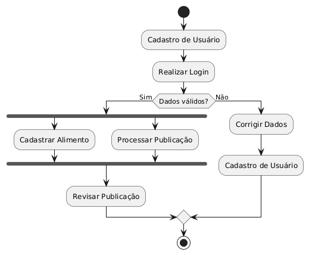

### Processo 1 AS IS – Cadastro e Publicação de Alimentos

O processo atual consiste no cadastro de um usuário (doador ou estabelecimento) na plataforma FoodLoop e, em seguida, na publicação de alimentos disponíveis para doação ou venda. Atualmente, esse processo é realizado de forma simples, com preenchimento manual das informações, sem automações avançadas ou validações complexas.

O usuário acessa o sistema, realiza seu cadastro informando dados básicos e, após autenticação, pode cadastrar um alimento com informações como descrição, quantidade, validade e imagem.

Fluxo do processo
1. Usuário acessa a plataforma
2. Usuário realiza cadastro
3. Sistema valida os dados
4. Usuário realiza login
5. Usuário cadastra alimento
6. Sistema salva publicação
7. Processo finalizado
 

#### Detalhamento das atividades

**Cadastro de Usuário**

Nesta atividade, o usuário informa seus dados para criar uma conta na plataforma. Os campos incluem nome, e-mail, senha, telefone e tipo de usuário. O sistema exige que o e-mail esteja em formato válido e que a senha possua no mínimo 8 caracteres. O usuário pode optar por concluir o cadastro ou cancelar a operação.

| Campo            | Tipo            | Restrições              | Valor default |
|------------------|-----------------|------------------------|--------------|
| nome             | Caixa de texto  | obrigatório            |              |
| email            | Caixa de texto  | formato de e-mail      |              |
| senha            | Caixa de texto  | mínimo de 8 caracteres |              |
| telefone         | Caixa de texto  | apenas números         |              |
| tipo de usuário  | Seleção única   | doador/empresa         | doador       |

| Comandos   | Destino              | Tipo     |
|------------|---------------------|----------|
| cadastrar  | Login               | default  |
| cancelar   | Fim do Processo 1   | cancel   |

**Login**

Nesta atividade, o usuário realiza a autenticação no sistema informando e-mail e senha. Os dados devem seguir as mesmas restrições definidas no cadastro. Após o preenchimento, o usuário pode acessar o sistema ou retornar à tela de cadastro.

| Campo  | Tipo           | Restrições              | Valor default |
|--------|----------------|--------------------------|--------------|
| email  | Caixa de texto | formato de e-mail        |              |
| senha  | Caixa de texto | mínimo de 8 caracteres   |              |

| Comandos | Destino                  | Tipo    |
|----------|--------------------------|---------|
| entrar   | Cadastro de Alimento     | default |
| voltar   | Cadastro de Usuário      | cancel  |

**Cadastro de Alimento**

Nesta atividade, o usuário cadastra um alimento disponível para doação ou venda. São informados dados como nome do alimento, descrição, quantidade, data de validade, imagem e tipo. A quantidade deve ser maior que zero e a data de validade deve ser futura. O usuário pode publicar o alimento ou cancelar a operação.

| Campo            | Tipo            | Restrições        | Valor default |
|------------------|-----------------|------------------|--------------|
| nome do alimento | Caixa de texto  | obrigatório      |              |
| descrição        | Área de texto   |                  |              |
| quantidade       | Número          | maior que 0      |              |
| data validade    | Data            | data futura      |              |
| imagem           | Imagem          | opcional         |              |
| tipo             | Seleção única   | doação/venda     | doação       |

| Comandos  | Destino               | Tipo    |
|-----------|----------------------|---------|
| publicar  | Salvar Publicação    | default |
| cancelar  | Fim do Processo 1    | cancel  |

**Salvar Publicação**

Nesta atividade, o sistema registra as informações do alimento no banco de dados e exibe uma mensagem de confirmação ao usuário indicando que a publicação foi realizada com sucesso. O processo é finalizado após essa etapa.

| Campo       | Tipo           | Restrições | Valor default          |
|-------------|----------------|-----------|-----------------------|
| confirmação | Área de texto  | automático| Publicado com sucesso |

| Comandos   | Destino            | Tipo    |
|------------|--------------------|---------|
| finalizar  | Fim do Processo 1  | default |
