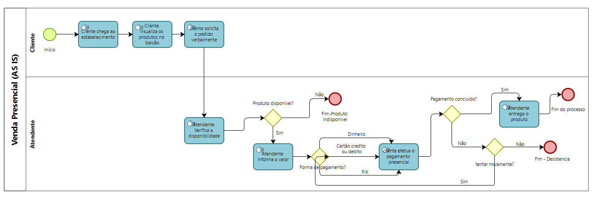

### Processo 1 AS IS – Venda Presencial 

O processo atual consiste na venda de salgados e sucos aos clientes da lanchonete, realizada de forma integralmente manual e presencial. Atualmente, esse processo ocorre sem qualquer suporte tecnológico, com preços fixos pré-determinados, sem cardápio digital e sem registro informatizado das transações.

O cliente se desloca fisicamente até o estabelecimento, observa os produtos expostos na vitrine, solicita o pedido verbalmente ao atendente, realiza o pagamento no balcão e recebe o produto para consumo no local ou retirada.

### Fluxo do processo

1. Cliente chega ao estabelecimento
2. Cliente visualiza os produtos no balcão
3. Cliente solicita o pedido verbalmente
4. Atendente verifica a disponibilidade
5. Atendente informa o valor
6. Cliente efetua o pagamento presencial
7. Atendente entrega o produto
8. Processo finalizado
 

#### Detalhamento das atividades

**Solicitação de Pedido**

Nesta atividade, o cliente, já presente no estabelecimento, comunica ao atendente qual produto deseja consumir. A escolha é feita visualmente, a partir dos itens expostos na vitrine, e a comunicação é exclusivamente verbal. Não há cardápio digital nem reserva prévia: o cliente só tem acesso ao catálogo no momento em que chega ao balcão.

| Campo            | Tipo            | Restrições              | Valor default |
|------------------|-----------------|-------------------------|---------------|
| Produto          | Verbal          | Precisa estar na vitrine|        -       |
| Quantidade       | Verbal          | Limitado ao estoque do dia |      1        |

| Comandos   | Destino              | Tipo     |
|------------|---------------------|----------|
| disponível  | Informação do Valor               | default  |
| indisponível   | Fim do Processo 1   | cancel   |

**Informação do Valor e Pagamento**

Nesta atividade, o atendente comunica verbalmente o preço do produto, fixo e pré-determinado pelo proprietário (sem variação ao longo do dia e sem promoções). O cliente então realiza o pagamento no balcão, podendo utilizar dinheiro, cartão físico ou PIX. Não há emissão de comprovante digital associado ao cliente.

| Campo  | Tipo           | Restrições              | Valor default |
|--------|----------------|--------------------------|--------------|
| preço	  | tabela fixa |	valor pré-determinado pelo proprietário        |        -      |
| forma de pagamento  | seleção única	| dinheiro / cartão / PIX  |     -         |

| Comandos | Destino                  | Tipo    |
|----------|--------------------------|---------|
| pagar   | Entrega do Produto     | default |
| desistir   | Fim do Processo 1      | cancel  |

**Entrega do Produto**

Nesta atividade, o atendente entrega o produto ao cliente, que pode consumi-lo no próprio estabelecimento ou levá-lo para viagem. A entrega é imediata e presencial, e não existe qualquer registro da transação em sistema: nem o comerciante tem histórico digital da venda nem o cliente mantém vínculo posterior com o pedido.

| Campo            | Tipo            | Restrições        | Valor default |
|------------------|-----------------|------------------|--------------|
| entrega	 | física	  | produto retirado no balcão      |       -       |

| Comandos  | Destino               | Tipo    |
|-----------|----------------------|---------|
| finalizar  | Fim do Processo 1    | default |
