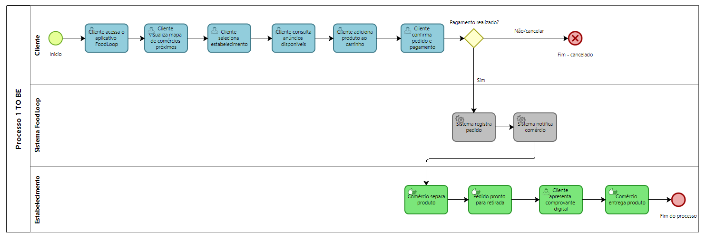

# PROCESSO 1 TO-BE – COMPRA VIA APP FOODLOOP

## 1 Descrição do processo

O processo proposto substitui a venda exclusivamente presencial por uma experiência digital geolocalizada, na qual o cliente utiliza o aplicativo FoodLoop para localizar estabelecimentos próximos, consultar produtos disponíveis, realizar pedido e pagamento, e, em seguida, efetuar a retirada no comércio.

A digitalização do canal de compra amplia o alcance do estabelecimento, permite a captura de clientes que não estariam fisicamente no local no momento do consumo e gera registro digital da transação para ambas as partes, superando o gargalo AS-IS de dependência exclusiva do fluxo físico presencial.

## 2 Fluxo do processo

1. Cliente acessa o aplicativo FoodLoop;
2. Cliente visualiza o mapa de comércios próximos;
3. Cliente seleciona o estabelecimento de interesse;
4. Cliente consulta os anúncios disponíveis;
5. Cliente adiciona o produto ao carrinho;
6. Cliente confirma o pedido e realiza o pagamento via aplicativo;
7. Sistema registra o pedido e notifica o comércio;
8. Comércio separa o produto para retirada;
9. Cliente se dirige ao estabelecimento e apresenta o comprovante digital;
10. Comércio entrega o produto ao cliente;
11. Processo finalizado.

**Figura 1 – Diagrama de atividades do processo de compra via aplicativo (TO-BE)**

Fonte: Elaborado pelos autores (2026).

## 3 Detalhamento das atividades

### 3.1 Descoberta e seleção do anúncio

O cliente acessa o aplicativo e visualiza, em um mapa geolocalizado, os estabelecimentos parceiros próximos a sua posição atual. Ao selecionar um comércio, o cliente consulta os anúncios publicados e escolhe o produto de interesse, adicionando-o ao carrinho.

**Quadro 1 – Campos da atividade "Descoberta e seleção do anúncio"**

| Campo | Tipo | Restrições | Valor default |
|---|---|---|---|
| localização do cliente | geolocalização | permissão de GPS concedida | posição atual |
| raio de busca | número | em quilômetros | 5 |
| estabelecimento selecionado | seleção única | parceiro cadastrado no FoodLoop | — |
| produto escolhido | seleção única | anúncio ativo dentro do prazo | — |

Fonte: Elaborado pelos autores (2026).

**Quadro 2 – Comandos da atividade "Descoberta e seleção do anúncio"**

| Comando | Destino | Tipo |
|---|---|---|
| adicionar ao carrinho | Confirmação do pedido | default |
| voltar | Mapa de comércios | cancel |

Fonte: Elaborado pelos autores (2026).

### 3.2 Confirmação do pedido e pagamento

O cliente revisa os produtos adicionados ao carrinho, confirma a quantidade e realiza o pagamento diretamente no aplicativo. O sistema registra a transação, emite comprovante digital e notifica automaticamente o estabelecimento a respeito do novo pedido.

**Quadro 3 – Campos da atividade "Confirmação do pedido e pagamento"**

| Campo | Tipo | Restrições | Valor default |
|---|---|---|---|
| itens do carrinho | lista | ao menos um item | — |
| quantidade | número | maior que 0 | 1 |
| forma de pagamento | seleção única | cartão de crédito / PIX | cartão |
| comprovante digital | gerado pelo sistema | automático após pagamento | — |

Fonte: Elaborado pelos autores (2026).

**Quadro 4 – Comandos da atividade "Confirmação do pedido e pagamento"**

| Comando | Destino | Tipo |
|---|---|---|
| pagar | Processamento pelo comércio | default |
| cancelar | Mapa de comércios | cancel |

Fonte: Elaborado pelos autores (2026).

### 3.3 Processamento pelo comércio

O estabelecimento recebe, em seu painel operacional do FoodLoop, a notificação do novo pedido contendo os itens solicitados e o prazo estimado de retirada. O atendente separa fisicamente o produto e atualiza o status do pedido como "pronto para retirada".

**Quadro 5 – Campos da atividade "Processamento pelo comércio"**

| Campo | Tipo | Restrições | Valor default |
|---|---|---|---|
| notificação de pedido | mensagem do sistema | gerada automaticamente | — |
| status do pedido | seleção única | recebido / em preparo / pronto | recebido |

Fonte: Elaborado pelos autores (2026).

**Quadro 6 – Comandos da atividade "Processamento pelo comércio"**

| Comando | Destino | Tipo |
|---|---|---|
| marcar como pronto | Retirada do produto | default |

Fonte: Elaborado pelos autores (2026).

### 3.4 Retirada e entrega do produto

O cliente se dirige ao estabelecimento dentro da janela de retirada e apresenta o comprovante digital gerado no aplicativo. O atendente valida o comprovante e entrega o produto, encerrando a transação.

**Quadro 7 – Campos da atividade "Retirada e entrega do produto"**

| Campo | Tipo | Restrições | Valor default |
|---|---|---|---|
| comprovante digital | código ou QR code | gerado no pedido | — |
| validação | automática | comparação com pedido ativo | — |

Fonte: Elaborado pelos autores (2026).

**Quadro 8 – Comandos da atividade "Retirada e entrega do produto"**

| Comando | Destino | Tipo |
|---|---|---|
| confirmar entrega | Fim do Processo 1 | default |

Fonte: Elaborado pelos autores (2026).
