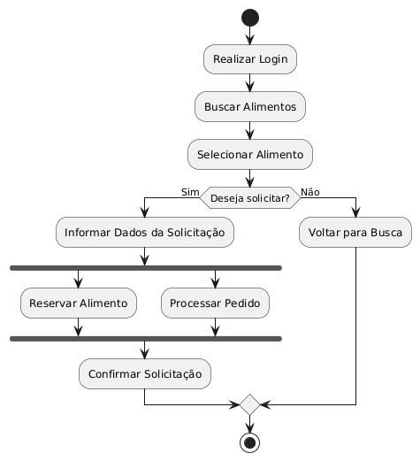

### Processo 2 TO BE – Solicitação de Alimento

O processo consiste na busca e solicitação de alimentos disponíveis na plataforma. O usuário acessa o sistema, visualiza os alimentos cadastrados e realiza uma solicitação de reserva ou compra. O sistema registra o pedido e aguarda confirmação.

Fluxo do processo
1. Usuário acessa a plataforma
2. Usuário realiza login
3. Usuário busca alimentos
4. Usuário seleciona um alimento
5. Usuário solicita reserva/compra
6. Sistema registra solicitação
7. Processo finalizado

#### Detalhamento das atividades

**Buscar Alimentos**

Nesta atividade, o usuário pode pesquisar alimentos disponíveis na plataforma utilizando filtros como nome, categoria e localização. O usuário pode iniciar a busca ou cancelar o processo.

| Campo            | Tipo            | Restrições        | Valor default |
|------------------|-----------------|------------------|--------------|
| nome do alimento | Caixa de texto  | opcional         |              |
| categoria        | Seleção única   | alimento/bebida  |              |
| localização      | Caixa de texto  | opcional         |              |

| Comandos | Destino                | Tipo    |
|----------|------------------------|---------|
| buscar   | Selecionar Alimento    | default |
| voltar   | Fim do Processo 2      | cancel  |

**Selecionar Alimentos**

Nesta etapa, o usuário visualiza uma lista de alimentos disponíveis e pode selecionar um item específico para visualizar mais detalhes ou retornar à busca.

| Campo              | Tipo          | Restrições | Valor default |
|--------------------|--------------|-----------|--------------|
| lista de alimentos | Tabela       | obrigatório |              |
| detalhes           | Área de texto| automático |              |

| Comandos  | Destino               | Tipo    |
|-----------|----------------------|---------|
| selecionar| Solicitar Alimento   | default |
| voltar    | Buscar Alimentos     | cancel  |

**Solicitar Alimentos**

Nesta atividade, o usuário informa a quantidade desejada e o tipo de solicitação (reserva ou compra). Também pode adicionar observações. Após isso, pode confirmar ou cancelar a solicitação.

| Campo        | Tipo            | Restrições        | Valor default |
|--------------|-----------------|------------------|--------------|
| quantidade   | Número          | maior que 0      |              |
| tipo         | Seleção única   | reserva/compra   | reserva      |
| observação   | Área de texto   | opcional         |              |

| Comandos   | Destino                 | Tipo    |
|------------|------------------------|---------|
| confirmar  | Registrar Solicitação  | default |
| cancelar   | Fim do Processo 2      | cancel  |

**Registrar Solicitação**

Nesta etapa, o sistema registra a solicitação e exibe uma mensagem de confirmação ao usuário, finalizando o processo.

| Campo        | Tipo            | Restrições | Valor default          |
|--------------|-----------------|-----------|-----------------------|
| confirmação  | Área de texto   | automático| Solicitação realizada |

| Comandos   | Destino            | Tipo    |
|------------|--------------------|---------|
| finalizar  | Fim do Processo 2  | default |
