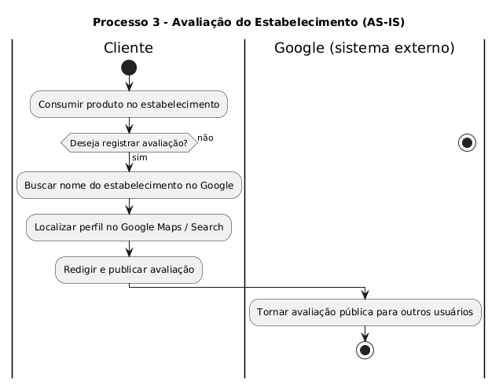

# PROCESSO 3 AS-IS – AVALIAÇÃO DO ESTABELECIMENTO PELO CLIENTE

## 1 Descrição do processo

O processo em análise refere-se ao registro público de opiniões acerca do estabelecimento por parte dos clientes que o frequentaram. Tal procedimento depende integralmente de uma plataforma externa — o Google — e não apresenta qualquer vínculo com a experiência de compra no comércio, uma vez que a iniciativa de avaliar parte exclusivamente do cliente, de forma espontânea e sem qualquer incentivo ou lembrete por parte do estabelecimento.

O cliente que decide registrar sua opinião busca o nome do comércio no Google, localiza o perfil correspondente no Google Maps ou na busca da referida plataforma e, em seguida, publica sua avaliação, que passa a ser visível aos demais usuários.

## 2 Fluxo do processo

1. Consumo do produto no estabelecimento;
2. Decisão de registrar ou não a avaliação;
3. Busca do estabelecimento no Google;
4. Localização do perfil no Google Maps ou na busca;
5. Redação e publicação da avaliação;
6. Publicação da avaliação pelo Google;
7. Processo finalizado.

**Figura 1 – Diagrama de atividades do processo de avaliação do estabelecimento (AS-IS)**

## 3 Detalhamento das atividades

### 3.1 Decisão de avaliar

Após o consumo do produto, o cliente avalia se deseja ou não registrar publicamente sua opinião sobre o comércio. A decisão é de caráter voluntário, uma vez que o estabelecimento não solicita, não incentiva e não emite qualquer lembrete para a realização do registro.

**Quadro 1 – Campos da atividade "Decisão de avaliar"**

| Campo | Tipo | Restrições | Valor default |
|---|---|---|---|
| intenção de avaliar | decisão pessoal | sem incentivo do comércio | — |

Fonte: Elaborado pelos autores (2026).

**Quadro 2 – Comandos da atividade "Decisão de avaliar"**

| Comando | Destino | Tipo |
|---|---|---|
| avaliar | Busca no Google | default |
| não avaliar | Fim do Processo 3 | cancel |

Fonte: Elaborado pelos autores (2026).

### 3.2 Busca no Google

O cliente utiliza o motor de busca do Google ou o aplicativo Google Maps para localizar o estabelecimento. A consulta exige que o cliente recorde corretamente o nome do comércio ou sua localização aproximada, fator que pode representar uma barreira para clientes ocasionais.

**Quadro 3 – Campos da atividade "Busca no Google"**

| Campo | Tipo | Restrições | Valor default |
|---|---|---|---|
| termo de busca | caixa de texto | nome ou endereço do estabelecimento | — |

Fonte: Elaborado pelos autores (2026).

**Quadro 4 – Comandos da atividade "Busca no Google"**

| Comando | Destino | Tipo |
|---|---|---|
| pesquisar | Localização do perfil | default |
| cancelar | Fim do Processo 3 | cancel |

Fonte: Elaborado pelos autores (2026).

### 3.3 Localização do perfil

Dentre os resultados da busca, o cliente seleciona o perfil correspondente ao estabelecimento. Essa etapa pressupõe que o comércio já possua perfil previamente registrado no Google; em caso contrário, o cliente não consegue efetuar o registro da avaliação.

**Quadro 5 – Campos da atividade "Localização do perfil"**

| Campo | Tipo | Restrições | Valor default |
|---|---|---|---|
| perfil do estabelecimento | seleção | perfil previamente registrado no Google Maps ou Search | — |

Fonte: Elaborado pelos autores (2026).

**Quadro 6 – Comandos da atividade "Localização do perfil"**

| Comando | Destino | Tipo |
|---|---|---|
| abrir perfil | Redação da avaliação | default |
| cancelar | Fim do Processo 3 | cancel |

Fonte: Elaborado pelos autores (2026).

### 3.4 Redação e publicação da avaliação

O cliente atribui uma nota — geralmente de 1 (uma) a 5 (cinco) estrelas — e, opcionalmente, redige um comentário a respeito de sua experiência. Após a confirmação, a avaliação é publicada na plataforma do Google e torna-se visível publicamente aos demais usuários. Destaca-se que o comércio não dispõe de controle sobre o referido conteúdo nem de ferramentas internas para sua moderação.

**Quadro 7 – Campos da atividade "Redação e publicação da avaliação"**

| Campo | Tipo | Restrições | Valor default |
|---|---|---|---|
| nota | seleção única | 1 a 5 estrelas | — |
| comentário | área de texto | opcional | — |

Fonte: Elaborado pelos autores (2026).

**Quadro 8 – Comandos da atividade "Redação e publicação da avaliação"**

| Comando | Destino | Tipo |
|---|---|---|
| publicar | Fim do Processo 3 | default |
| cancelar | Fim do Processo 3 | cancel |

Fonte: Elaborado pelos autores (2026).
