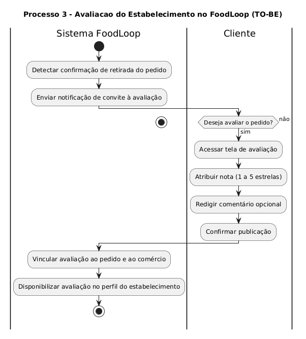

# PROCESSO 3 TO-BE – AVALIAÇÃO DO ESTABELECIMENTO NO FOODLOOP

## 1 Descrição do processo

O processo proposto internaliza, dentro do próprio FoodLoop, o registro de avaliações a respeito do estabelecimento, eliminando a dependência da plataforma externa Google observada no AS-IS. A avaliação passa a estar diretamente vinculada ao pedido realizado, o que aumenta a taxa de retorno de feedback e oferece ao comerciante visibilidade sobre o desempenho individual de cada transação.

O sistema convida ativamente o cliente a avaliar sua experiência imediatamente após a confirmação da retirada do produto, estabelecendo um ciclo de reputação acoplado à experiência de compra.

## 2 Fluxo do processo

1. Sistema detecta a confirmação da retirada do pedido;
2. Sistema envia notificação convidando o cliente a avaliar;
3. Cliente decide se deseja ou não avaliar;
4. Cliente acessa a tela de avaliação do pedido;
5. Cliente atribui nota de 1 a 5 estrelas;
6. Cliente redige comentário opcional;
7. Cliente confirma a publicação da avaliação;
8. Sistema vincula a avaliação ao pedido e ao comércio;
9. Sistema disponibiliza a avaliação no perfil do estabelecimento;
10. Processo finalizado.

**Figura 1 – Diagrama de atividades do processo de avaliação do estabelecimento (TO-BE)**

Fonte: Elaborado pelos autores (2026).

## 3 Detalhamento das atividades

### 3.1 Convite à avaliação

Após a confirmação da retirada do pedido no estabelecimento, o sistema FoodLoop envia automaticamente, ao cliente, uma notificação convidando-o a registrar sua avaliação sobre a experiência de compra. O convite é vinculado ao pedido específico, o que permite ao cliente avaliar aquela transação individualmente.

**Quadro 1 – Campos da atividade "Convite à avaliação"**

| Campo | Tipo | Restrições | Valor default |
|---|---|---|---|
| pedido finalizado | referência interna | pedido com status "retirado" | — |
| notificação enviada | automática | gerada pelo sistema | — |

Fonte: Elaborado pelos autores (2026).

**Quadro 2 – Comandos da atividade "Convite à avaliação"**

| Comando | Destino | Tipo |
|---|---|---|
| abrir notificação | Registro da avaliação | default |
| ignorar notificação | Fim do Processo 3 | cancel |

Fonte: Elaborado pelos autores (2026).

### 3.2 Registro da avaliação pelo cliente

O cliente acessa a tela de avaliação, atribui uma nota de 1 (uma) a 5 (cinco) estrelas e, opcionalmente, redige um comentário descritivo acerca de sua experiência. A avaliação é exclusivamente referente ao pedido em questão, o que assegura maior especificidade do feedback em comparação ao AS-IS.

**Quadro 3 – Campos da atividade "Registro da avaliação pelo cliente"**

| Campo | Tipo | Restrições | Valor default |
|---|---|---|---|
| nota | seleção única | 1 a 5 estrelas | — |
| comentário | área de texto | opcional; limite de 500 caracteres | — |

Fonte: Elaborado pelos autores (2026).

**Quadro 4 – Comandos da atividade "Registro da avaliação pelo cliente"**

| Comando | Destino | Tipo |
|---|---|---|
| publicar | Publicação e vinculação da avaliação | default |
| cancelar | Fim do Processo 3 | cancel |

Fonte: Elaborado pelos autores (2026).

### 3.3 Publicação e vinculação da avaliação

O sistema FoodLoop recebe a avaliação, vincula-a ao pedido correspondente e ao estabelecimento avaliado, e a disponibiliza no perfil público do comércio dentro do aplicativo. A partir de então, a avaliação passa a compor a nota média do estabelecimento e a ficar visível aos demais usuários da plataforma.

**Quadro 5 – Campos da atividade "Publicação e vinculação da avaliação"**

| Campo | Tipo | Restrições | Valor default |
|---|---|---|---|
| avaliação | objeto | nota e comentário validados | — |
| pedido vinculado | referência interna | pedido identificado pelo sistema | — |
| perfil do estabelecimento | atualizado automaticamente | recalcula nota média | — |

Fonte: Elaborado pelos autores (2026).

**Quadro 6 – Comandos da atividade "Publicação e vinculação da avaliação"**

| Comando | Destino | Tipo |
|---|---|---|
| publicar no perfil | Fim do Processo 3 | default |

Fonte: Elaborado pelos autores (2026).
