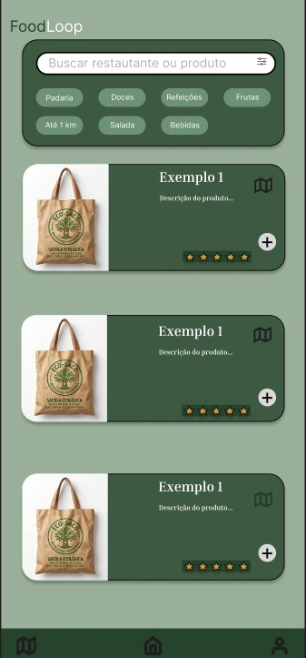
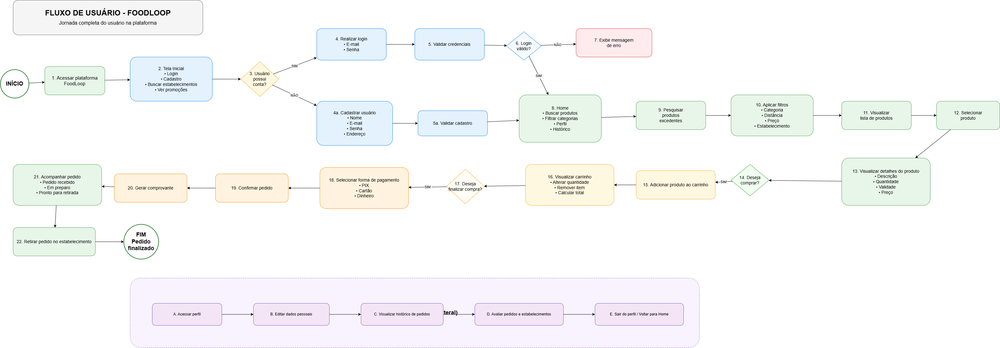
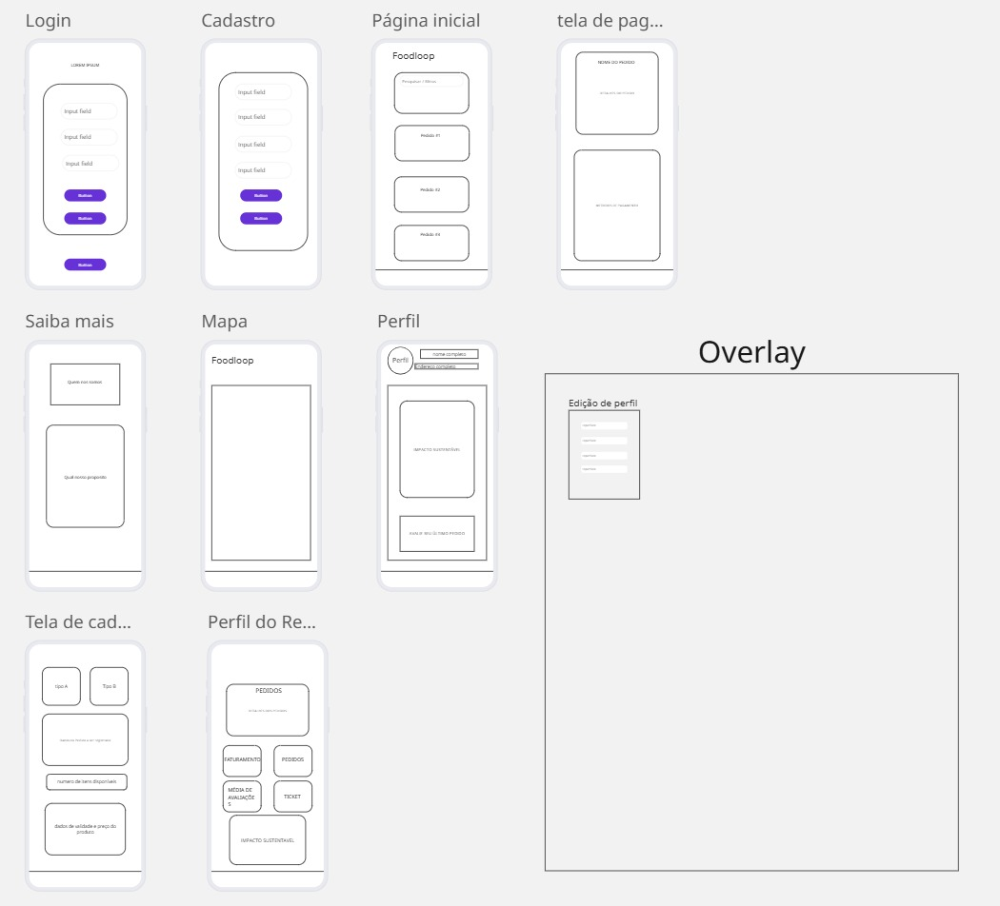
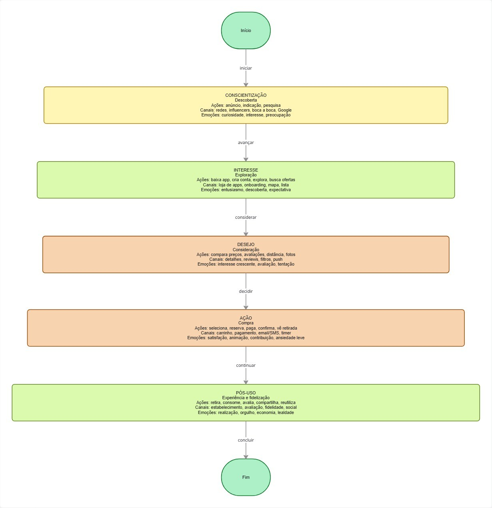
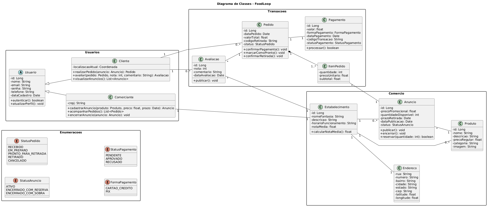
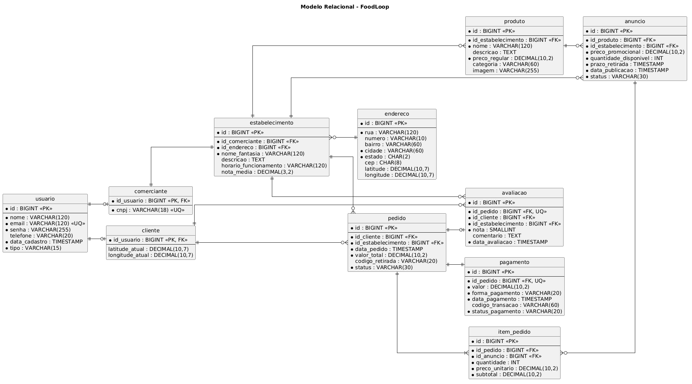
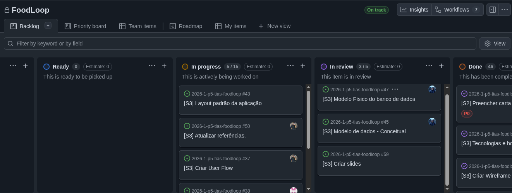

<!-- _class: cover -->

# FoodLoop

## Tecnologia contra o desperdício de alimentos

Sprint 3 · Projeto da Solução

---

<!-- _class: dark -->

<p class="label">O problema</p>

# <span class="accent">41 kg</span> de comida<br>jogados fora<br>por brasileiro / ano

<p style="font-size: 0.85em; opacity: 0.7;">Fonte: ONU Brasil · Índice de Desperdício de Alimentos 2024</p>

---

<p class="label">A solução</p>

# Conectamos<br><span class="accent">comércios com excedente</span><br>a quem busca preço justo

Aplicativo mobile que transforma desperdício em economia circular.

---

<p class="label">Como funciona</p>

# Em 3 passos.

|       |       |       |
|-------|-------|-------|
| <span class="huge">1</span> | <span class="huge">2</span> | <span class="huge">3</span> |
| **Anuncia** | **Reserva** | **Retira** |
| Comércio publica excedente com desconto | Cliente encontra no mapa, paga via Pix ou cartão | Apresenta o QR no balcão e avalia depois |

---



<p class="label">Produto</p>

# 12 telas,<br>7 fluxos.

Login, mapa, busca, carrinho, pagamento, painel do parceiro, dashboard de impacto.

---



<p class="label">User flow</p>

# Caminho<br>completo.

Da descoberta ao pós-venda — com decisões, validações e fluxos de exceção.

---



<p class="label">Wireframes & Protótipo</p>

# Da estrutura<br>ao **Figma**.

Wireframes em baixa fidelidade validaram a navegação antes do design final.

---



<p class="label">Jornada do usuário</p>

# Modelo<br>**AIDA**.

Conscientização → Interesse → Desejo → Ação → Pós-uso.

Mapeia ações, canais e emoções em cada etapa.

---



---

<p class="label">Banco de dados</p>

# Do conceitual ao **PostgreSQL**.

|  |  |  |
|---|---|---|
| <span class="huge">14</span> | <span class="huge">13</span> | <span class="huge">2</span> |
| **Entidades** no DER (Peter Chen) | **Tabelas** no relacional (Pé de Galinha) | **Triggers** no DDL PostgreSQL 16 |

---



---

<!-- _class: dark -->

<p class="label">Modelo físico</p>

# DDL versionado em <span class="accent">`src/db/`</span>

```sql
CREATE TABLE pedido (
    id              BIGSERIAL          PRIMARY KEY,
    id_cliente      BIGINT             NOT NULL,
    valor_total     NUMERIC(10,2)      NOT NULL,
    valor_comissao  NUMERIC(10,2)      NOT NULL DEFAULT 0.00,
    codigo_retirada VARCHAR(20)        NOT NULL UNIQUE,
    status          status_pedido      NOT NULL DEFAULT 'RECEBIDO',
    cancelado_por   origem_cancelamento,
    CONSTRAINT ck_pedido_cancelamento CHECK (
        (status = 'CANCELADO' AND cancelado_por IS NOT NULL)
        OR status != 'CANCELADO'
    )
);
```

Restrições no banco. Não confiamos só na aplicação.

---

<p class="label">Qualidade — ISO/IEC 25010</p>

# Metas mensuráveis.

| Característica | Métrica | Meta |
|---|---|---|
| Eficiência | Carregamento do mapa | **≤ 3 s** |
| Eficiência | Tempo de resposta REST | **≤ 500 ms** |
| Usabilidade | Pontuação SUS | **≥ 70** |
| Confiabilidade | Uptime 18h–22h | **≥ 99%** |
| Segurança | Transações criptografadas | **100%** |
| Compatibilidade | Telas Android e iOS | **100%** |

---

<!-- _class: team -->



<p class="label">Time</p>

# Scrum + GitHub Projects.

| | |
|---|---|
| **Cristiano** | BPMN |
| **Diogo** | Arquitetura, classes |
| **Gabriel A.** | User flow, infra |
| **Gabriel X.** | Jornada AIDA |
| **Guilherme** | Banco de dados |
| **Rafael** | Wireframes, slides |

---

<!-- _class: cover -->

# Obrigado.

## Perguntas?

github.com/ICEI-PUC-Minas-PBE-SI-TI/2026-1-p5-tias-foodloop
