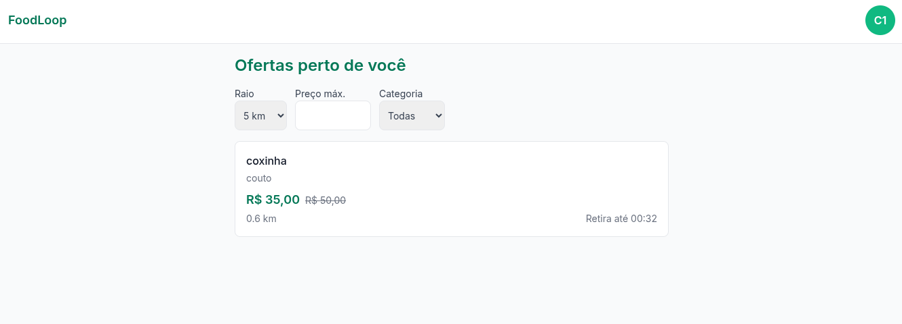
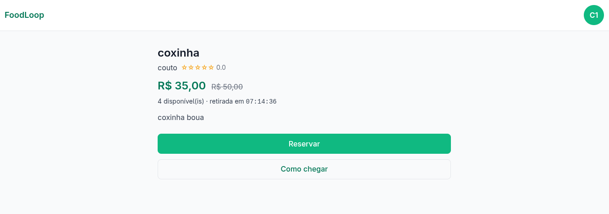
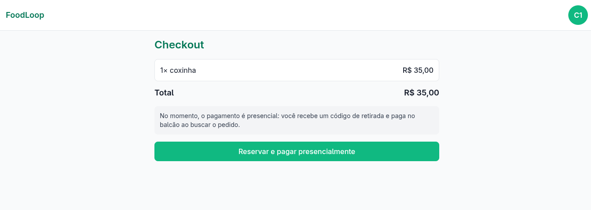
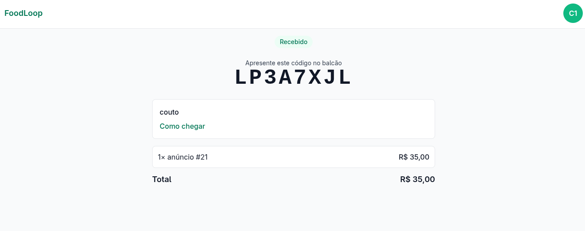

<!-- _class: cover -->
<!-- _paginate: false -->

FOODLOOP · PITCH SPRINT 4 · 1º/2026

# FoodLoop.

### Comer melhor por menos. Desperdiçar nada.

foodloop-front.onrender.com

---

<!-- _header: O PROBLEMA -->

# Um terço da comida do mundo vai pro lixo.

Boa parte dela ainda estava **pronta pra ser vendida.**

---

<!-- _class: metric -->

1,3 bi

de toneladas de alimento desperdiçadas por ano no mundo

FAO · State of Food and Agriculture, 2024

---

<!-- _class: metric -->

R$ 41 bi

é o tamanho do desperdício do varejo alimentício no Brasil — 30% disso é comida ainda <em>própria para consumo</em>

EMBRAPA · ABRAS, 2025

---

<!-- _header: QUEM SENTE -->

## Três lados perdendo ao mesmo tempo

| Quem                                   | Dor                                                   |
| -------------------------------------- | ----------------------------------------------------- |
| **Padaria · lanchonete · restaurante** | Fim do expediente vira lixo. Margem evapora.          |
| **Cliente do bairro**                  | Quer comida boa por preço justo. Não encontra oferta. |
| **Cidade**                             | Orgânico no aterro vira metano — 28× pior que CO₂.    |

> O excedente existe. A demanda existe. **Falta o canal.**

---

<!-- _header: NOSSA HIPÓTESE -->

# Marketplace hiperlocal de excedente do dia.

Comerciante publica o que vai sobrar **hoje**. Cliente vê, reserva, e retira com um código de 8 caracteres. Sem entrega, sem cadeia complexa.

**Piloto:** Couto Lanches · Centro de Betim/MG.

---

<!-- _header: O PRODUTO -->

# A jornada em 4 telas

Próximas slides: app real, deployado em produção, dados reais de Betim.

---

<!-- _class: product -->
<!-- _header: 1 · BUSCAR -->

## Lista ordenada por distância

- Geolocalização do browser
- Raio ajustável: **1 / 3 / 5 / 10 km**
- Filtro por preço e categoria
- Preço **promocional** ao lado do regular
- p95 de **21 ms** com 1.000 anúncios

---

<!-- _class: product -->
<!-- _header: 2 · DECIDIR -->

## Detalhe com contagem regressiva

- Preço cheio riscado vs. promocional
- Contagem **ao vivo** até o prazo
- Endereço completo do estabelecimento
- Botão único: **Reservar agora**

---

<!-- _class: product -->
<!-- _header: 3 · RESERVAR -->

## Checkout em um toque

- Reserva em **transação atômica**
- Estoque decrementa, pagamento PIX criado como PENDENTE
- Pedido nasce `RECEBIDO`
- Cliente recebe **código de retirada** de 8 caracteres
- Alfabeto sem ambiguidade (sem I, O, 1, 0)

---

<!-- _class: product -->
<!-- _header: 4 · RETIRAR -->

## Validação física do código

- Código aparece em letras grandes no celular
- Comerciante confere visualmente
- Status: **RECEBIDO → PRONTO → RETIRADO**
- Sobra do dia: **zero**

---

<!-- _header: ARQUITETURA -->

## Web-first, produção real desde o dia 1

- **Front** — React + Tailwind, CDN global, sem cold start
- **API** — Express + Prisma 7 na Render
- **Banco** — PostgreSQL no Neon, sa-east-1, com Haversine inline em SQL
- **CI/CD** verde · deploy automático em `main` · branch protection com 1 approval

---

<!-- _header: MERCADO -->

## O tamanho da oportunidade

| Camada                                     | Tamanho/ano    |
| ------------------------------------------ | -------------- |
| **TAM** — varejo alimentício no Brasil     | R$ 1,1 trilhão |
| **SAM** — pequeno e médio varejo perecível | R$ 180 bilhões |
| **SOM** — Betim + região metropolitana BH  | R$ 600 milhões |

**Modelo:** comissão por transação · MVP = 0% · onboarding manual no piloto

---

<!-- _header: TIMING -->

## Por que agora

- **Hábito instalado** — apps de entrega educaram o consumidor
- **Inflação alimentar** sustenta busca por preço promocional
- **Marco regulatório** — Lei 14.016/2020 incentiva venda e doação de excedente
- **Geolocalização no browser** é commodity — sem app store, sem instalar

---

<!-- _class: close -->
<!-- _paginate: false -->

# Reduzir desperdício é vender o que ia pro lixo.

<strong>foodloop-front.onrender.com</strong>

Comer melhor por menos. Desperdiçar nada.

